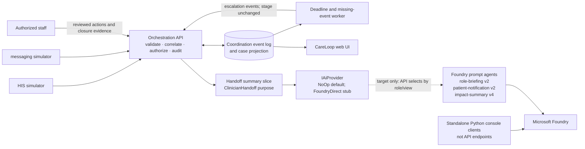

# CareLoop architecture

> **AI implementation status:** `CareLoop.Api` contains a clinician-handoff summary seam, but the fact collector, drafter, endpoint handlers, and external provider are stubs. `NoOpAiProvider` is the default. The Python scripts in `src/ai_agents/` are standalone console clients for three Foundry prompt agents; they are not an HTTP service and the API does not invoke them.

## Purpose and constraints

CareLoop is a coordination and accountability layer around existing provider systems. Development simulators and tests use synthetic data; the API is designed to work with real provider systems. Clinical interpretation, urgency, pathways, and closure requirements are supplied or approved by qualified humans. Deadlines remain configuration placeholders until approved.

The orchestration API is the authority for case state. It accepts events, validates and correlates them, applies idempotency and guarded transitions, records audit history, and exposes read models. The UI is read-only for coordination. Simulators produce events; they do not edit cases or clinical data directly.

## Component view



The event log is the source for audit and timeline reconstruction; the case projection supports worklist queries. FHIR-shaped exchange may be used at the provider boundary, but the internal coordination model is not a clinical FHIR repository. The API reads/writes through its own boundaries; the AI clients have no API access in the current code.

The API defines `SummaryPurpose.ClinicianHandoff` as the only built summary purpose; `PatientStageExplanation` is reserved and not implemented. Its request contract carries a purpose and a fact set, while provider selection is through `IAiProvider`. The current `NoOpAiProvider` returns no draft, and `FoundryDirectProvider` is a stub. A separate target is for the backend to select a Foundry prompt agent based on the authorized role, requested view/purpose, and allowed facts, then return a reviewable draft. The source does not yet define this routing or an API-to-agent wire contract.

The three checked-in Python clients identify `role-briefing` version 2, `patient-notification` version 2, and `impact-summary` version 4. Each script sends a hard-coded `"Hello"` input to its Foundry agent and streams output to the console. Foundry owns each agent's prompt, tools, and model configuration; these are not represented in repository code. They are not yet integrated with the API. See the [AI specification](ai-spec.md) and [integration contract](integration.md) for what is present and what remains a target.

## Ten-stage case lifecycle

> **Display vocabulary.** The Domain as built (`CareLoop.Domain.Cases.CaseStage`) has five stages with four tracks. The ten below are the labels the dashboard shows, derived from stage plus track statuses (decision 1 in [ui-design-gap-analysis.md](../ui-design-gap-analysis.md)). The code is the reference for transitions.

Stages advance only on validated, authorized events. Supporting events and exception flags do not create extra stages.

| # | Stage | Entry / progression evidence |
|---|---|---|
| 1 | `RESULT_RECEIVED` | Screening result arrives through the configured provider boundary. |
| 2 | `CASE_CREATED` | Result is validated and deduplicated; one coordination case is opened. |
| 3 | `OWNER_ASSIGNED` | A coordinator is assigned or the case enters an accountable facility lead queue. |
| 4 | `PATIENT_NOTIFIED` | Messaging simulator reports delivery; delivery is not acknowledgement. |
| 5 | `PATIENT_ACKNOWLEDGED` | Patient acknowledgement and any separately recorded understanding are captured. |
| 6 | `CONSULTATION_PENDING` | A consultation or handoff request is recorded with its proposed owner. |
| 7 | `FOLLOW_UP_IN_PROGRESS` | Referral and appointment events are correlated; acceptance is not completed care. |
| 8 | `CARE_OUTCOME_DOCUMENTED` | An authorized source supplies an outcome event and clinical record reference. |
| 9 | `CLOSURE_REVIEW` | Evidence or an authorized exception is awaiting a human closure decision. |
| 10 | `CLOSED` | An authorized closure event with typed reason and evidence is accepted and audited. |

Notification, consultation, referral, and appointment have their own sub-statuses. A failed or unacknowledged message, rejected referral, missed appointment, or overdue action creates an owned task/exception without erasing the case or advancing it to closure. Owner transfer is an offer followed by explicit acceptance; until acceptance, the sender remains accountable.

## Event exchange

This sequence shows the backend-owned workflow. AI-related interactions below are illustrative of the target only; the summary endpoint and provider pipeline currently return `501`/throw `NotImplementedException`.

```mermaid
sequenceDiagram
    actor Staff as Authorized clinician/coordinator
    participant HIS as HIS simulator
    participant API as Orchestration API
    participant Store as Coordination store
    participant AI as Selected Foundry prompt agent (target; not wired)
    participant Channel as messaging simulator
    participant Worker as Deadline worker
    participant UI as Demo UI

    HIS->>API: Result event (source, patient, result, reviewed urgency)
    API->>API: Validate, correlate, deduplicate
    API->>Store: Append event, create case, assign owner or queue
    Staff->>UI: Request a role/view-specific draft (target)
    UI->>API: Draft request
    API->>API: Select authorized purpose, view, agent and eligible facts (target)
    API->>AI: Purpose- and view-scoped request (target)
    AI-->>API: Draft response (target)
    API-->>UI: Draft for review (target)
    Staff->>API: Review, edit, approve, or reject draft (target)
    API->>Store: Audit review decision (target)
    API-->>Channel: Approved text message or email (JSON)
    Channel->>API: Delivery / failure / reply (1 = got the message, anything else = call request)
    API->>Store: Append attributed event; update coordination projection
    HIS->>API: Consultation, referral, appointment, outcome events
    API->>Store: Validate evidence and append correlated events
    Worker->>Store: Check approved clocks and missing events
    Worker->>API: Owned escalation event (does not advance stage)
    UI->>API: Read case, timeline, exceptions and metrics
    Note over API,AI: Aggregate insight generation is a proposal, not implemented
    Staff->>API: Authorized decision with evidence or documented exception
    API->>Store: Guard transition, append audit; close only if valid
```

## Cross-cutting invariants

- Preserve source system, source event, patient reference, result reference, occurrence time, and actor provenance.
- Replayed source identifiers are idempotent. Conflicting corrections or identity mismatches require visible human review.
- Every open next action has an owner or a named accountable queue; assignment and acceptance are explicit.
- A referral sent or accepted, an appointment booked, a message delivered, or an escalation acknowledged does not prove care was received.
- Patient receipt, understanding, help request, and consent are distinct. A caregiver's action is attributed to the caregiver and limited to approved permissions.
- Clinical records stay in source systems. The coordination store keeps references, evidence references, workflow status, deadlines, and audit events.
- Only an authorized human can record a clinical disposition or close a case; the API enforces the gate and records the decision.
- Any connected agent must receive only an API-selected purpose/view and minimum necessary, eligible facts, and return a draft for human review. No such API-to-agent invocation is implemented yet.
- AI cannot diagnose, set urgency, infer consent, send patient messages, accept referrals, change case state, calculate metrics, or close cases.
- Deadline checks are deterministic and configured from approved rules. Missing configuration must surface review work rather than inventing a deadline or urgency.
- Simulator fixtures and scenarios use synthetic data. The API and dashboard do not branch on or add simulated-data flags. Report cohort denominators and assumptions; do not claim real clinical improvement.

## Decisions to resolve as a team

Before the role/view agent route can be implemented, define its API-to-agent contract, provider and prompt-agent mapping, role/view authorization, output validation, and review/audit behavior. Also record the chosen relational database, orchestration/hosting approach, event envelope/versioning, identity model, pathway clock/evidence configuration, and patient-language reviewers. Until approved, these remain open; no production credentials belong in this repository.
