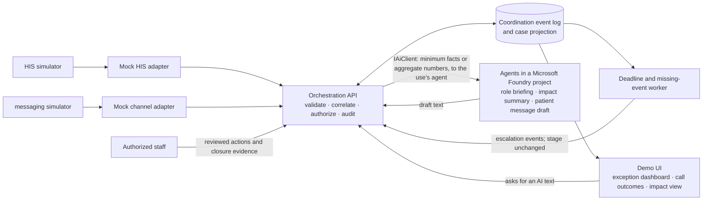

# CareLoop architecture

> **AI implementation status (19 November 2026):** The API asks the agents in a Microsoft Foundry project itself, through `IAiClient`, for three texts shown to staff: the role briefing, the impact summary and the patient message draft. Each use has its own agent, called by name (`role-briefing`, `impact-summary`, `patient-notification`); the API never creates or changes one. On Foundry the patient message draft is one of the agent's own templates, named by the API and filled in. The Python AI workflow service and the AI handoff summary in the earlier design are not built and have been removed; nothing AI writes is published to the HIS. AI is off by default (`Ai:Provider` = `NoOp`). [`integration.md`](integration.md) is the contract.

## Purpose and constraints

CareLoop is a coordination and accountability layer around existing provider systems. The prototype uses simulators and synthetic identifiers; it does not connect to live endpoints or hold clinical records. Clinical interpretation, urgency, pathways, and closure requirements are supplied or approved by qualified humans. Deadlines remain configuration placeholders until approved.

The orchestration API is the authority for case state. It accepts events, validates and correlates them, applies idempotency and guarded transitions, records audit history, and exposes read models. The UI is read-only for coordination. Simulators produce events; they do not edit cases or clinical data directly.

## Component view



The event log is the source for audit and timeline reconstruction; the case projection supports worklist queries. FHIR-shaped exchange may be used at the adapter boundary, but the prototype's internal coordination model is not a clinical FHIR repository. The choice of relational database and local hosting method is still a team decision.

The backend coordinates the ten-stage journey. When a member of staff opens the home page, the impact page or a case, the web app may ask the API for an AI text. The API reads what that person may see, builds the data from the fields each use allows, puts it into that use's prompt file and hands the request to the provider behind `IAiClient` (`NoOpAiClient` by default, `FoundryAiClient` for Microsoft Foundry). On Foundry each use goes to its own agent, and `FoundryAgentFormat` is the one file that translates the request into that agent's input and its answer into text; any other provider is sent the prompt. The API does not check the text against the data. It puts its own opening sentence in front of the role briefing and swaps the case tokens (`C-1`, `C-2`, …) for case numbers, so case numbers are never sent; an agent's refusal, or an answer in an unexpected shape, is a failure (503) and is never shown as text. The three texts are the role briefing, the impact summary over backend-computed numbers, and a draft of a patient message for staff to read. AI does not create tasks, assign owners, monitor deadlines, advance stages, calculate metrics, send messages, or write case state. Its output is a draft labelled as written by AI; it is not stored and nothing acts on it. The .NET API remains the case-state, authorization, audit, and closure gate. See the [integration contract](integration.md); the [AI specification](ai-spec.md) is the earlier proposal, including the handoff summary and translation, which are not built.

## Ten-stage case lifecycle

> **Display vocabulary.** The Domain as built (`CareLoop.Domain.Cases.CaseStage`) has five stages with four tracks. The ten below are the labels the dashboard shows, derived from stage plus track statuses (decision 1 in [ui-design-gap-analysis.md](../ui-design-gap-analysis.md)). The code is the reference for transitions.

Stages advance only on validated, authorized events. Supporting events and exception flags do not create extra stages.

| # | Stage | Entry / progression evidence |
|---|---|---|
| 1 | `RESULT_RECEIVED` | Synthetic screening result arrives through the HIS adapter. |
| 2 | `CASE_CREATED` | Result is validated and deduplicated; one coordination case is opened. |
| 3 | `OWNER_ASSIGNED` | A coordinator is assigned or the case enters an accountable facility lead queue. |
| 4 | `PATIENT_NOTIFIED` | Messaging simulator reports delivery; delivery is not acknowledgement. |
| 5 | `PATIENT_ACKNOWLEDGED` | Patient acknowledgement and any separately recorded understanding are captured. |
| 6 | `CONSULTATION_PENDING` | A consultation or handoff request is recorded with its proposed owner. |
| 7 | `FOLLOW_UP_IN_PROGRESS` | Referral and appointment events are correlated; acceptance is not completed care. |
| 8 | `CARE_OUTCOME_DOCUMENTED` | An authorized source supplies an outcome event and clinical record reference. |
| 9 | `CLOSURE_REVIEW` | Evidence or an authorized exception is awaiting a human closure decision. |
| 10 | `CLOSED` | An authorized closure event with typed reason and evidence is accepted and audited. |

Notification, consultation, referral, and appointment have their own sub-statuses. A failed or unacknowledged message, rejected referral, missed appointment, or overdue action creates an owned task/exception without erasing the case or advancing it to closure. Owner transfer is an offer followed by explicit acceptance; until acceptance, the sender remains accountable.

## Event exchange

This sequence is an implementation guide, not a finalized schema. Agree the shared envelope and event-specific payloads in `contracts/` before producers and consumers implement them.

```mermaid
sequenceDiagram
    actor Staff as Authorized clinician/coordinator
    participant HIS as HIS simulator
    participant API as Orchestration API
    participant Store as Coordination store
    participant AI as Foundry agent
    participant Channel as messaging simulator
    participant Worker as Deadline worker
    participant UI as Demo UI

    HIS->>API: Result event (source, patient, result, reviewed urgency)
    API->>API: Validate, correlate, deduplicate
    API->>Store: Append event, create case, assign owner or queue
    API-->>Channel: Approved text message or email (JSON)
    Channel->>API: Delivery / failure / reply (1 = got the message, anything else = call request)
    API->>Store: Append attributed event; update coordination projection
    HIS->>API: Consultation, referral, appointment, outcome events
    API->>Store: Validate evidence and append correlated events
    Worker->>Store: Check approved clocks and missing events
    Worker->>API: Owned escalation event (does not advance stage)
    UI->>API: Read case, timeline, exceptions, synthetic metrics
    UI->>API: Ask for a role briefing, impact summary or patient message draft
    API->>Store: Record the read in the read audit
    API->>AI: Minimum facts or small-number-suppressed aggregate numbers
    AI-->>API: Draft text
    API-->>UI: The text, labelled as written by AI (not stored, not sent)
    Staff->>API: Authorized decision with evidence or documented exception
    API->>Store: Guard transition, append audit; close only if valid
```

## Cross-cutting invariants

- Preserve source system, source event, patient reference, result reference, occurrence time, and actor provenance.
- Replayed source identifiers are idempotent. Conflicting corrections or identity mismatches require visible human review.
- Every open next action has an owner or a named accountable queue; assignment and acceptance are explicit.
- A referral sent or accepted, an appointment booked, a message delivered, or an escalation acknowledged does not prove care was received.
- Patient receipt, understanding, help request, and consent are distinct. A caregiver's action is attributed to the caregiver and limited to approved permissions.
- Clinical records stay in source systems. The coordination store keeps references, evidence references, workflow status, deadlines, and audit events.
- Only an authorized human can record a clinical disposition or close a case; the API enforces the gate and records the decision.
- AI returns draft text for staff only: the role briefing, the impact summary and the patient message draft. It cannot diagnose, set urgency, infer consent, send patient messages, accept referrals, change case state, calculate metrics, or close cases, and it never discloses a result. Patients receive approved templates.
- Deadline checks are deterministic and configured from approved rules. Missing configuration must surface review work rather than inventing a deadline or urgency.
- Mark all simulator data, AI drafts, and impact metrics as synthetic. Report cohort denominators and assumptions; do not claim real clinical improvement.

## Decisions to resolve as a team

Before implementation depends on them, record the chosen relational database, local orchestration/hosting approach, event envelope and versioning, identity/role model for the demo, pathway clock/evidence configuration, and who reviews patient-facing language. Which component calls the model is settled: the API asks the agents in a Foundry project directly (see [`integration.md`](integration.md), which also lists the open AI points). Until approved, these remain open; no production integration or credentials belong in this repository.
