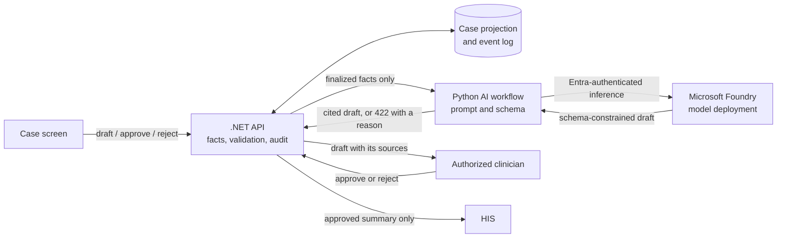
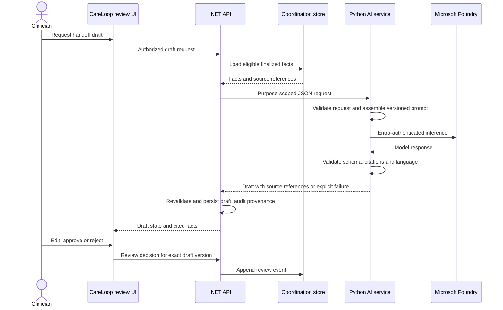
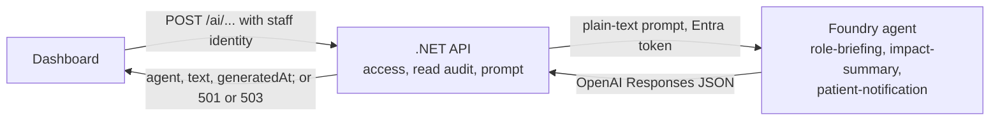

# API and AI workflow integration: the handoff summary

How the .NET API and the Python AI workflow service work together to draft a clinician handoff summary, what the API can and cannot do with AI, and what is built today.

This is FR-11, and this document is the contract. It implements decisions 8 to 11 (see [ui-design-gap-analysis.md](../ui-design-gap-analysis.md) section 5). [`ai-spec.md`](ai-spec.md) is the design proposal behind it and is superseded here where the two differ.

## The boundary

AI makes already-recorded information easier to read and hand over. It does not operate the workflow.

| Capability | Owner | What AI may do |
|---|---|---|
| Case state, ownership, deadlines, exceptions, referrals, appointments, closure | .NET API and the deadline worker | Nothing. No AI decisions, no AI writes |
| Counts, rates, denominators, timing, overdue status | API read models | Nothing in the numbers. The impact summary agent puts precomputed aggregates into words beside them (see [Foundry agents](#foundry-agents-role-briefing-impact-summary-patient-message-draft)) |
| Clinician handoff summary | Python AI workflow service, calling a Microsoft Foundry deployment | Organize supplied facts into cited sections. A draft only |
| Patient-facing wording | Approved templates under `Infrastructure/Templates/{language}/` | Nothing that is sent. A staff-only preview of a message may be drafted; it is never sent |
| Arabic | Deferred | Nothing. English only, everything language-keyed |

The four rules that do not bend, from `AGENTS.md`:

- AI output is a draft. A person approves it, and the approval is an event.
- AI cannot set urgency, alter source data, close a case or send a message. It is given no way to.
- Nothing is published until a person approves it. The FHIR publisher sends a `DocumentReference` only for an approved summary.
- Failure is visible. There is no success-shaped fallback: "no draft" and "a draft that may be wrong" must never look the same to the person about to sign it.

## Who calls the model

The Python service does (decision 8). The prompt, the response schema and the Foundry credentials live in one place, and the API holds no model credential.

A second route exists: the API can call a Foundry deployment directly. It is there so the summary still works when the Python service is not running, and so the two can be compared on the same fact set. Both sit behind `IAiProvider`, so nothing outside `AddSummaries` knows which is in use.



`Ai:Provider` selects the route:

| Value | Meaning |
|---|---|
| `NoOp` | Default. AI is off. Drafting answers 409 and every other feature runs untouched |
| `AiWorkflow` | The API calls the Python service, which calls Foundry |
| `FoundryDirect` | The API calls a Foundry deployment itself |

## Draft-request integration



The design document also proposes patient-message drafting, Arabic translation and aggregate insight narratives. These remain governed extensions; they do not alter the implemented FR-11 boundary or allow the AI service to dispatch messages or mutate case state.

## What flows between them

### The API builds the facts

`HandoffFactCollector` is the whole data boundary. Everything the model may write about passes through it, so one test can hold it to account.

Sent:

- Coordination facts from the case and its timeline: stage, owner, next action, due time, unresolved exceptions, correlated events.
- Clinical facts a clinician finalized, read from the source for the length of one draft (decision 9). They are **not** written to the coordination store; the clinical record stays in the source system.

Never sent:

- Patient names and contact details.
- Images. No imaging, pathology or radiology interpretation is ever asked for.
- Unfinalized or conflicting interpretations. These are named in `known_gaps` so the draft flags them, rather than a person discovering the silence later.

Every fact carries `fact_id`, `fact_type`, `value`, `recorded_at`, `source_reference` and `review_status`. The identifier is what a draft must cite.

### The request

`POST {Ai:AiWorkflow:BaseUrl}/summaries/handoff`

| Field | Notes |
|---|---|
| `request_id` | Correlates the call, the stored draft and the audit entry |
| `case_reference` | A coordination reference, never a direct patient identifier |
| `purpose` | `clinician_handoff`; the only purpose built |
| `trigger` | `requested` or `handoff_proposed` |
| `stage` | Backend-owned workflow stage |
| `facts[]` | At least one, all `finalized` |
| `recorded_next_step` | Absent means none is recorded, and the draft must say so rather than invent one |
| `known_gaps[]` | What the collector found unfinalized, conflicting or missing |
| `language` | `en`. An unsupported tag fails rather than falling back |
| `policy_version`, `prompt_version` | Stamped onto the draft |

The model gets this and nothing else. It cannot query the event store, call a source system or choose a tool. Text inside a fact that reads like an instruction is therefore summarised, never obeyed: there is no field through which a fact could set urgency, a stage or an action, and the output is validated against the facts before anything is stored.

### The response

```json
{
  "request_id": "request-demo-001",
  "purpose": "clinician_handoff",
  "language": "en",
  "status": "draft",
  "sections": [
    { "heading": "Recorded progress", "text": "...", "source_fact_ids": ["fact-001"] }
  ],
  "missing_or_conflicting_facts": [],
  "human_review_required": true,
  "model_deployment": "configured-deployment-name",
  "prompt_version": "fr11-v1"
}
```

`status` is always `draft` and `human_review_required` always `true`. `source_fact_ids` may be empty only for a section stating that something is missing, because an absence has no fact to cite.

### Validation, on both sides

A draft is refused, and nothing stored, when it cites a `fact_id` that was not supplied, answers another `request_id`, used another `prompt_version`, or is not in the requested language. A citation of an unsupplied fact means the model wrote something it was not given, which is the failure this design exists to catch.

The Python service checks this before returning. `HandoffSummaryDrafter` checks it again on receipt, because the provider is a service across the network and trust in it is not a safety argument.

### Failure

The service answers `422` with a reason when AI is off or unconfigured, the request exceeds `CARELOOP_AI_MAX_INPUT_BYTES`, the model times out or is refused by a content filter, or the output does not validate. The API raises `AiDraftUnavailableException` and the endpoint answers `503`, and the case screen shows "draft unavailable, human review needed". No substitute text is ever produced.

## The three things a person can do

| Action | Endpoint | Effect |
|---|---|---|
| Draft | `POST /cases/{caseId}/handoff-summary` | Stores a record in status `Draft`. 409 when AI is off or a summary is already approved; 503 when no valid draft could be produced |
| Approve | `POST /cases/{caseId}/handoff-summary/{summaryId}/approval` | Stores exactly the text submitted, which may differ from the draft, and writes a `HandoffSummaryApproved` source event naming the approver. This is what lets the FHIR publisher send the `DocumentReference` |
| Reject | `POST /cases/{caseId}/handoff-summary/{summaryId}/rejection` | Records the reviewer and reason. No case event: rejection changes no stage, owner or deadline |

Three statuses, not two. A draft a reviewer turned down must be distinguishable from one nobody has read, both on the case screen and for the evaluation question of how often reviewers reject what AI writes.

Approval happens in the CareLoop web app (decision 4). The HIS simulator receives the approved `DocumentReference` and nothing else.

### When a draft is produced

On request, and automatically when a handoff is proposed (decision 11). `AutoDraftOnHandoff` subscribes to `HandoffProposed` so the receiving clinician finds a draft waiting instead of having to ask.

It is off by default behind `Ai:AutoDraftOnHandoff`, because an automatic draft spends a model call and sends facts out of CareLoop with nobody having asked. It drafts once per case, which also makes a retried outbox delivery safe, and a failure never fails the handoff: the proposal has already happened, and the clinician can ask for a draft on the case screen.

## What is recorded

`HandoffSummaries` keeps the request identifier, the sections and their citations, the flattened text, what the draft reported as missing, the fact identifiers and source references, the provider, model deployment, prompt version, policy version, trigger and language, and the approval or rejection with its reviewer and time.

The flattened text is held rather than derived, so the text a person approved cannot be changed later by a change to how sections are flattened. Raw prompts and model reasoning are not stored, and the clinical facts a draft was built from stay in the source system: only identifiers and source references are kept here.

## Configuration

API, in the `Ai` section. No API key exists: the direct route authenticates with Entra ID.

| Setting | Purpose |
|---|---|
| `Ai:Provider` | `NoOp`, `AiWorkflow` or `FoundryDirect` |
| `Ai:AutoDraftOnHandoff` | Draft when a handoff is proposed |
| `Ai:TimeoutSeconds` | Bounded wait before reporting a draft unavailable |
| `Ai:MaxRequestBytes` | Request-size guardrail, checked before any call |
| `Ai:PromptVersion` | Recorded with every draft |
| `Ai:AiWorkflow:BaseUrl` | The Python service |
| `Ai:FoundryDirect:ProjectEndpoint`, `:DeploymentName` | The direct route. The deployment name is the model identifier on the OpenAI-compatible path, and is often not the catalogue name |

Python service, from the environment: `AZURE_AI_PROJECT_ENDPOINT`, `AZURE_AI_MODEL_DEPLOYMENT_NAME`, `CARELOOP_AI_ENABLED`, `CARELOOP_AI_TIMEOUT_SECONDS`, `CARELOOP_AI_MAX_INPUT_BYTES`.

Endpoint and deployment are configuration, never constants in source. Nothing live is committed, even though an endpoint URL is not itself confidential: it names a real deployment and belongs in the environment's configuration service.

Authentication is Entra ID throughout: `DefaultAzureCredential` locally with the developer's approved identity, managed identity when hosted, the narrowest inference permission the deployment supports.

## What is built

| Piece | State |
|---|---|
| `IAiProvider`, `NoOpAiProvider` | Working. The default, so everything runs with AI off |
| Fact, request, draft and response contracts | Written |
| `HandoffSummaryRecord` and its EF configuration | Written. In the `InitialCreate` migration |
| `HandoffFactCollector`, `HandoffSummaryDrafter`, `AutoDraftOnHandoff` | Stubs, `TODO(WS-9)` |
| `DraftHandoffSummary`, `ApproveSummary`, `RejectSummary` | Stubs, answering 501 |
| `AiWorkflowProvider`, `FoundryDirectProvider` | Stubs |
| `POST /summaries/handoff` in `src/ai_workflow/` | Not built. Specified here and in the WS9 proposal |
| Tests | 18, skipped, in `tests/api/CareLoop.Tests/Api/HandoffSummaryTests.cs` |

Implementing either provider needs a dependency that is not yet agreed: `Azure.Identity` for the API, `azure-identity` plus a Foundry SDK for the Python service. `AGENTS.md` says to ask first. The Foundry agents below add `Azure.Identity` to the API, pending that agreement.

## Foundry agents: role briefing, impact summary, patient message draft

Separate from the handoff summary above, and from `IAiProvider` and `Ai:Provider`: three agents in the team's Foundry project write a few words for the dashboard. CareLoop works out every number, deadline and order; the agents only put them into words. All three are drafts in the sense of the four rules: shown labelled as written by AI, never stored, never acted on, and absent rather than invented when the agent fails.

### The route

The dashboard calls the CareLoop API, never Foundry. The API builds the prompt from the fields allowed below and calls the agent directly:



`POST {ProjectEndpoint}/agents/{agent}/endpoint/protocols/openai/responses?api-version=v1`, body `{"input":[{"role":"user","content":"<prompt>"}]}`, header `Authorization: Bearer <token for https://ai.azure.com/.default>`. The text is `output_text`, or every `output[].content[].text` in order. The agents have no tools and receive nothing but the prompt.

| Endpoint | Agent | Who may call it | Answer |
|---|---|---|---|
| `POST /ai/role-briefing` | `role-briefing` | Every staff role, scoped like the worklist | `AiTextResponse { agent, text, generatedAt }` |
| `POST /ai/impact-summary` | `impact-summary` | Every staff role, scoped like `GET /metrics` | The same |
| `POST /cases/{caseId}/patient-message-draft` | `patient-notification` | Nurse navigator and clinician, for a case they may open | The same; a preview that is never sent |

501 with the not-implemented body while `Ai:Agents:Enabled` is `false`; 503, titled "AI could not write this", when the agent fails in any way (no token, 401, 403, 429, 5xx, a timeout, an answer marked incomplete, a refusal or no text); 401, 403 and 404 exactly as for the reads they mirror, including the documented reason for another facility. Every call is recorded in `CaseReads` like a read.

### What each agent is given

| Agent | Given | Never given |
|---|---|---|
| Role briefing | The reader's role in words and the facility's name; counts of open cases in scope (open, overdue, escalated, urgent, due today, needs an owner); up to five cases, overdue or escalated first, then urgent, then due today, each as its eight-character case number, programme, display step, next action in words, due status ("late by 18 hours", "due today at 12:00") and exception flags, and whether the reader or which role acts next. The coordinator's scope is the cases escalated to the coordinator | Patient names, MRNs, patient references, the hospital's result identifier, staff references, escalation reasons or any other free text |
| Impact summary | The aggregate measures `GET /metrics` returns for the same reader: counts, rates with what each is out of, median times to each step, closures by reason, confidence participation. It is asked not to repeat the numbers, which the screen shows beside its words | Any case, case number or identifier |
| Patient message draft | The case's next action in words, the facility's name, the upcoming appointment's day, time and place in local time when one is booked, the channel (text message or email) and the two reply codes: 1 "I got this message", 2 "call me". It writes `{first name}` where the name goes and is told never to mention or hint at a result | The patient's name, contact details, MRN, reference, the hospital's result identifier and any result or clinical content |

"Urgent" means a clinician-reviewed urgency code listed in `Ai:Agents:UrgentCodes`, which must match the dashboard's table; CareLoop never sets urgency. Each prompt begins with its prompt version (`role-briefing-v1`, `impact-summary-v1`, `patient-message-v1`) so a change of wording can be traced. Agent instructions in Foundry should expect these inputs and must not ask for anything else.

### Privacy rules

- Patient names, contact details and identifiers are never sent. One test seeds a case with a name, an MRN, a patient reference and a hospital result identifier and checks that no prompt from any of the three endpoints contains them.
- The patient message preview is not a message. Patient messages go out from the approved templates; the preview is shown to staff, labelled as a draft that was not sent, and is not stored.
- No AI output changes a case, an owner, a deadline, urgency or a metric. The endpoints read through no-tracking queries and write only the read audit.
- Prompts and texts are not logged. The client logs the agent, the status, the duration and, on failure, the agent's own error code.

### Configuration

`Ai:Agents`, off by default:

| Setting | Purpose |
|---|---|
| `Enabled` | `false` by default. When `true`, the others are validated at start-up and a bad value stops the host |
| `ProjectEndpoint` | `https://{resource}.services.ai.azure.com/api/projects/{project}`, from the environment (`Ai__Agents__ProjectEndpoint`); `https` only |
| `RoleBriefing`, `ImpactSummary`, `PatientNotification` | Agent names; `role-briefing`, `impact-summary`, `patient-notification` |
| `TimeoutSeconds` | `30`; from 1 to 300, token included |
| `AccessToken` | A ready token, honoured only in the `Development` environment, for a developer's local test; never committed |
| `UrgentCodes` | Urgency codes the briefing counts as urgent; a placeholder like the pathway's codes |

Docker Compose passes `AI_AGENTS_ENABLED`, `AI_AGENTS_PROJECT_ENDPOINT` and the agent names through; see `.env.example`.

### RBAC

There is no key. The API authenticates with `DefaultAzureCredential`: the managed identity when hosted in Azure (`AZURE_CLIENT_ID` selects a user-assigned identity), and the developer's own sign-in locally. Whichever identity calls needs the **Azure AI User** role on the Foundry project; without it every call answers 403 and the dashboard shows "AI could not write this". Grant it to the API's managed identity for a deployment, and to each developer who tests locally.

## Before real data

Synthetic only today. Before any non-synthetic data reaches a Foundry endpoint, the organization must confirm the region and data residency (all patient data and AI processing stay in the UAE), retention and logging settings, ADHICS controls, access roles, the network path, and the applicable DoH and legal approvals.

Two DoH boundaries shape this design rather than being model instructions that can be relaxed: the reporting physician informs the patient of results (§3.8.1), which is why AI never discloses a result, and assessment outcomes are considered by a multidisciplinary team (§3.9.8), which is why a summary organizes what a team recorded rather than concluding anything.

## Open

- Which roles may approve a summary. Proposed as `summaryApproverRoles` in the pathway definition, so it is configuration like every other role rule.
- Who owns `src/ai_workflow/`. It has no workstream today.
- Whether the periodic stage-insight narrative is built for the hackathon. Screen 3 promises it; nothing implements it.
