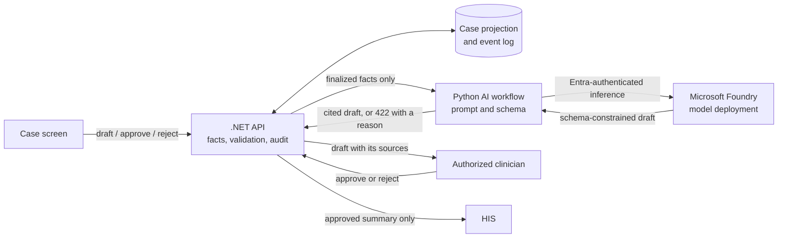
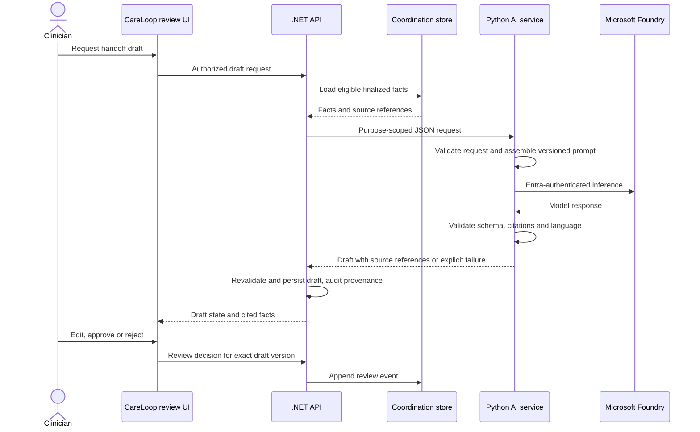
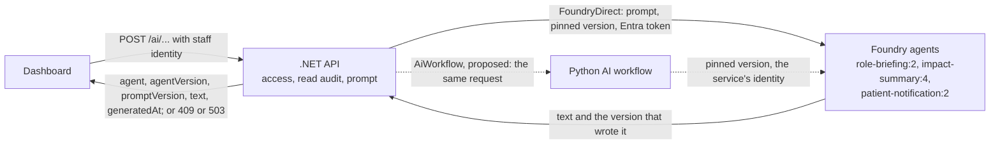

# API and AI workflow integration: the handoff summary

How the .NET API and the Python AI workflow service work together to draft a clinician handoff summary, what the API can and cannot do with AI, and what is built today.

This is FR-11, and this document is the contract. It implements decisions 8 to 11 (see [ui-design-gap-analysis.md](../ui-design-gap-analysis.md) section 5). [`ai-spec.md`](ai-spec.md) is the design proposal behind it and is superseded here where the two differ.

## The boundary

AI makes already-recorded information easier to read and hand over. It does not operate the workflow.

| Capability | Owner | What AI may do |
|---|---|---|
| Case state, ownership, deadlines, exceptions, referrals, appointments, closure | .NET API and the deadline worker | Nothing. No AI decisions, no AI writes |
| Counts, rates, denominators, timing, overdue status | API read models | Nothing in the numbers. The impact summary agent puts precomputed aggregates into words beside them (see [Foundry agents](#foundry-agents-role-briefing-impact-summary-patient-message-draft)) |
| Clinician handoff summary | Python AI workflow service, calling a Microsoft Foundry deployment | Organize supplied facts into cited sections. A draft only |
| Patient-facing wording | Approved templates under `Infrastructure/Templates/{language}/` | Nothing that is sent. A staff-only preview of a message may be drafted; it is never sent |
| Arabic | Deferred | Nothing. English only, everything language-keyed |

The four rules that do not bend, from `AGENTS.md`:

- AI output is a draft. A person approves it, and the approval is an event.
- AI cannot set urgency, alter source data, close a case or send a message. It is given no way to.
- Nothing is published until a person approves it. The FHIR publisher sends a `DocumentReference` only for an approved summary.
- Failure is visible. There is no success-shaped fallback: "no draft" and "a draft that may be wrong" must never look the same to the person about to sign it.

## Who calls the model

The Python service does (decision 8). The prompt, the response schema and the Foundry credentials live in one place, and the API holds no model credential.

A second route exists: the API can call a Foundry deployment directly. It is there so the summary still works when the Python service is not running, and so the two can be compared on the same fact set. Both sit behind `IAiProvider`, so nothing outside `AddSummaries` knows which is in use.



`Ai:Provider` selects the route:

| Value | Meaning |
|---|---|
| `NoOp` | Default. AI is off. Drafting answers 409 and every other feature runs untouched |
| `AiWorkflow` | The API calls the Python service, which calls Foundry |
| `FoundryDirect` | The API calls a Foundry deployment itself |

## Draft-request integration



The design document also proposes patient-message drafting, Arabic translation and aggregate insight narratives. These remain governed extensions; they do not alter the implemented FR-11 boundary or allow the AI service to dispatch messages or mutate case state.

## What flows between them

### The API builds the facts

`HandoffFactCollector` is the whole data boundary. Everything the model may write about passes through it, so one test can hold it to account.

Sent:

- Coordination facts from the case and its timeline: stage, owner, next action, due time, unresolved exceptions, correlated events.
- Clinical facts a clinician finalized, read from the source for the length of one draft (decision 9). They are **not** written to the coordination store; the clinical record stays in the source system.

Never sent:

- Patient names and contact details.
- Images. No imaging, pathology or radiology interpretation is ever asked for.
- Unfinalized or conflicting interpretations. These are named in `known_gaps` so the draft flags them, rather than a person discovering the silence later.

Every fact carries `fact_id`, `fact_type`, `value`, `recorded_at`, `source_reference` and `review_status`. The identifier is what a draft must cite.

### The request

`POST {Ai:AiWorkflow:BaseUrl}/summaries/handoff`

| Field | Notes |
|---|---|
| `request_id` | Correlates the call, the stored draft and the audit entry |
| `case_reference` | A coordination reference, never a direct patient identifier |
| `purpose` | `clinician_handoff`; the only purpose built |
| `trigger` | `requested` or `handoff_proposed` |
| `stage` | Backend-owned workflow stage |
| `facts[]` | At least one, all `finalized` |
| `recorded_next_step` | Absent means none is recorded, and the draft must say so rather than invent one |
| `known_gaps[]` | What the collector found unfinalized, conflicting or missing |
| `language` | `en`. An unsupported tag fails rather than falling back |
| `policy_version`, `prompt_version` | Stamped onto the draft |

The model gets this and nothing else. It cannot query the event store, call a source system or choose a tool. Text inside a fact that reads like an instruction is therefore summarised, never obeyed: there is no field through which a fact could set urgency, a stage or an action, and the output is validated against the facts before anything is stored.

### The response

```json
{
  "request_id": "request-demo-001",
  "purpose": "clinician_handoff",
  "language": "en",
  "status": "draft",
  "sections": [
    { "heading": "Recorded progress", "text": "...", "source_fact_ids": ["fact-001"] }
  ],
  "missing_or_conflicting_facts": [],
  "human_review_required": true,
  "model_deployment": "configured-deployment-name",
  "prompt_version": "fr11-v1"
}
```

`status` is always `draft` and `human_review_required` always `true`. `source_fact_ids` may be empty only for a section stating that something is missing, because an absence has no fact to cite.

### Validation, on both sides

A draft is refused, and nothing stored, when it cites a `fact_id` that was not supplied, answers another `request_id`, used another `prompt_version`, or is not in the requested language. A citation of an unsupplied fact means the model wrote something it was not given, which is the failure this design exists to catch.

The Python service checks this before returning. `HandoffSummaryDrafter` checks it again on receipt, because the provider is a service across the network and trust in it is not a safety argument.

### Failure

The service answers `422` with a reason when AI is off or unconfigured, the request exceeds `CARELOOP_AI_MAX_INPUT_BYTES`, the model times out or is refused by a content filter, or the output does not validate. The API raises `AiDraftUnavailableException` and the endpoint answers `503`, and the case screen shows "draft unavailable, human review needed". No substitute text is ever produced.

## The three things a person can do

| Action | Endpoint | Effect |
|---|---|---|
| Draft | `POST /cases/{caseId}/handoff-summary` | Stores a record in status `Draft`. 409 when AI is off or a summary is already approved; 503 when no valid draft could be produced |
| Approve | `POST /cases/{caseId}/handoff-summary/{summaryId}/approval` | Stores exactly the text submitted, which may differ from the draft, and writes a `HandoffSummaryApproved` source event naming the approver. This is what lets the FHIR publisher send the `DocumentReference` |
| Reject | `POST /cases/{caseId}/handoff-summary/{summaryId}/rejection` | Records the reviewer and reason. No case event: rejection changes no stage, owner or deadline |

Three statuses, not two. A draft a reviewer turned down must be distinguishable from one nobody has read, both on the case screen and for the evaluation question of how often reviewers reject what AI writes.

Approval happens in the CareLoop web app (decision 4). The HIS simulator receives the approved `DocumentReference` and nothing else.

### When a draft is produced

On request, and automatically when a handoff is proposed (decision 11). `AutoDraftOnHandoff` subscribes to `HandoffProposed` so the receiving clinician finds a draft waiting instead of having to ask.

It is off by default behind `Ai:AutoDraftOnHandoff`, because an automatic draft spends a model call and sends facts out of CareLoop with nobody having asked. It drafts once per case, which also makes a retried outbox delivery safe, and a failure never fails the handoff: the proposal has already happened, and the clinician can ask for a draft on the case screen.

## What is recorded

`HandoffSummaries` keeps the request identifier, the sections and their citations, the flattened text, what the draft reported as missing, the fact identifiers and source references, the provider, model deployment, prompt version, policy version, trigger and language, and the approval or rejection with its reviewer and time.

The flattened text is held rather than derived, so the text a person approved cannot be changed later by a change to how sections are flattened. Raw prompts and model reasoning are not stored, and the clinical facts a draft was built from stay in the source system: only identifiers and source references are kept here.

## Configuration

API, in the `Ai` section. No API key exists: the direct route authenticates with Entra ID. The same settings serve the handoff summary and the dashboard's agents ([below](#foundry-agents-role-briefing-impact-summary-patient-message-draft)); `Ai:Agents` adds only the agents' switch and which agent versions to call.

| Setting | Purpose |
|---|---|
| `Ai:Provider` | `NoOp`, `AiWorkflow` or `FoundryDirect`. Chooses the route for the handoff summary and for the dashboard's agents |
| `Ai:AutoDraftOnHandoff` | Draft when a handoff is proposed |
| `Ai:TimeoutSeconds` | Bounded wait before reporting a draft, or an agent's text, unavailable |
| `Ai:MaxRequestBytes` | Request-size guardrail, checked before any call |
| `Ai:PromptVersion` | Recorded with every draft |
| `Ai:AiWorkflow:BaseUrl` | The Python service |
| `Ai:FoundryDirect:ProjectEndpoint`, `:DeploymentName` | The direct route. The deployment name is the model identifier on the OpenAI-compatible path, and is often not the catalogue name. The agents use the project endpoint only: each agent version names its own model |

Python service, from the environment: `AZURE_AI_PROJECT_ENDPOINT`, `AZURE_AI_MODEL_DEPLOYMENT_NAME`, `CARELOOP_AI_ENABLED`, `CARELOOP_AI_TIMEOUT_SECONDS`, `CARELOOP_AI_MAX_INPUT_BYTES`.

Endpoint and deployment are configuration, never constants in source. Nothing live is committed, even though an endpoint URL is not itself confidential: it names a real deployment and belongs in the environment's configuration service.

Authentication is Entra ID throughout: `DefaultAzureCredential` locally with the developer's approved identity, managed identity when hosted, the narrowest inference permission the deployment supports.

One exception to keeping tokens out of configuration: `Ai:Agents:AccessToken`, a ready Entra token a developer may set to test the agents locally with their own sign-in. It is honoured in the `Development` environment only, set from the shell for one session and never committed; in any other environment it is ignored and a warning is logged, so a token copied into a deployed configuration authenticates nothing.

## What is built

| Piece | State |
|---|---|
| `IAiProvider`, `NoOpAiProvider` | Working. The default, so everything runs with AI off |
| Fact, request, draft and response contracts | Written |
| `HandoffSummaryRecord` and its EF configuration | Written. In the `InitialCreate` migration |
| `HandoffFactCollector`, `HandoffSummaryDrafter`, `AutoDraftOnHandoff` | Stubs, `TODO(WS-9)` |
| `DraftHandoffSummary`, `ApproveSummary`, `RejectSummary` | Stubs, answering 501 |
| `AiWorkflowProvider`, `FoundryDirectProvider` | Stubs |
| `POST /summaries/handoff` in `src/ai_workflow/` | Not built. Specified here and in the WS9 proposal |
| Tests | 18, skipped, in `tests/api/CareLoop.Tests/Api/HandoffSummaryTests.cs` |
| The dashboard's agents: `IAgentClient`, the three endpoints, `FoundryAgentClient` | Working behind `Ai:Agents:Enabled` and `Ai:Provider`, off by default. See below |
| `AiWorkflowAgentClient` | Written against the proposed contract below |
| `POST /agents/drafts` in `src/ai_workflow/` | Not built. Proposed below, pending the team's decision on the route |

Implementing either provider needs a dependency that is not yet agreed: `Azure.Identity` for the API, `azure-identity` plus a Foundry SDK for the Python service. `AGENTS.md` says to ask first. The Foundry agents below add `Azure.Identity` to the API, pending that agreement.

## Foundry agents: role briefing, impact summary, patient message draft

Separate from the handoff summary above and from `IAiProvider`, but on the same `Ai` settings: three agents in the team's Foundry project write a few words for the dashboard. CareLoop works out every number, deadline and order; the agents only put them into words. All three are drafts in the sense of the four rules: shown labelled as written by AI, never stored, never acted on, and absent rather than invented when the agent fails. Whether text that is only shown to staff, and never stored or sent, needs a person's approval is an open team decision (see [Open](#open)).

### The route

The dashboard calls the CareLoop API, never Foundry. Where the agents are called from is **pending the team's decision**: from the API (this pull request) or through the Python AI workflow service (decision 8 for the handoff summary). The endpoints do not depend on it. They call `IAgentClient`, and the shared `Ai:Provider` chooses the client:

| `Ai:Provider` | Client | What happens |
|---|---|---|
| `NoOp` (default) | `NoOpAgentClient` | AI is off. The endpoints answer 409 and nothing is sent |
| `FoundryDirect` | `FoundryAgentClient` | The API calls the Foundry project's Responses endpoint itself, with its own Entra identity. Built and tested |
| `AiWorkflow` | `AiWorkflowAgentClient` | The API sends the same purpose-scoped request to the Python service, which calls the agent. A thin client for the [proposed contract](#proposed-the-python-service-route) below; the Python side is not built |

On every route the API decides who may ask, builds the allowed facts and the prompt, writes the read audit and answers 409 or 503. The route only changes which identity holds the Foundry permission. `Ai:Agents:Enabled` must also be `true`, so the handoff summary can be switched on without the agents.



#### Calling a pinned agent version

`POST {Ai:FoundryDirect:ProjectEndpoint}/openai/v1/responses`, with `Authorization: Bearer <token for https://ai.azure.com/.default>` and `x-ms-client-request-id: <correlation ID>`:

```json
{
  "agent_reference": { "type": "agent_reference", "name": "role-briefing", "version": "2" },
  "input": [ { "role": "user", "content": "<prompt>" } ]
}
```

`agent_reference` with a `version` is how the Foundry Responses API addresses one agent version, and it is the request the Agent Framework's `FoundryAgent(agent_name, agent_version)` sends in `src/ai_agents/*/run_agent.py`. The agent's own endpoint (`…/agents/{agent}/endpoint/protocols/openai/responses`), which this pull request called at first, serves whichever version the project's version selector picks, the latest by default, so an edit in the portal could change the text while CareLoop's prompt version stayed the same. The answer's `agent_reference` names the version that wrote it, and an answer from any other version is refused like any other failure. The text is `output_text`, or every `output[].content[].text` in order; for these agents it is JSON, read as described [below](#what-each-agent-expects-and-returns). The request may not set the answer's format: Foundry answers `400` ("Not allowed when agent is specified", parameter `text`) when a request names an agent and a JSON schema, so the schema has to be set on the agent version itself.

This request was sent to the live project on 18 November 2026 with each pinned version; see [Tested live](#tested-live-on-18-november-2026).

#### Proposed: the Python service route

Proposed, pending the team's decision. For Peninah, if the team chooses the Python route:

`POST {Ai:AiWorkflow:BaseUrl}/agents/drafts`

```json
{
  "request_id": "2f4d9c1e-0b7a-4f7e-9a51-3c2d6e8f1a20",
  "purpose": "role_briefing",
  "agent": { "name": "role-briefing", "version": "2" },
  "prompt_version": "role-briefing-v3",
  "language": "en",
  "prompt": "<the prompt the API built: a first line, then <input_json>…</input_json>>"
}
```

```json
{
  "request_id": "2f4d9c1e-0b7a-4f7e-9a51-3c2d6e8f1a20",
  "purpose": "role_briefing",
  "agent": { "name": "role-briefing", "version": "2" },
  "prompt_version": "role-briefing-v3",
  "status": "draft",
  "text": "<the agent's answer, as it wrote it>"
}
```

- `purpose` is `role_briefing`, `impact_summary` or `patient_message_preview`; `request_id` is the call's correlation identifier, already in CareLoop's read audit.
- The service calls exactly the agent version named, with its own managed identity, and sends the prompt as it is: it adds nothing from case data. The API stays the data boundary.
- It answers `200` with the same `request_id`, `purpose`, `agent` and `prompt_version`, `status` `draft` and the agent's answer unchanged, or `422` with `{ "request_id", "reason" }` when AI is off, the request is over `CARELOOP_AI_MAX_INPUT_BYTES`, the agent times out, refuses or writes nothing.
- The API checks every field again and reads the agent's JSON answer itself, exactly as on the direct route. Anything but a matching `200` draft is the same calm 503.

#### The endpoints

| Endpoint | Agent (`Ai:Agents:…`) | Who may call it | Answer |
|---|---|---|---|
| `POST /ai/role-briefing` | `RoleBriefing`, `role-briefing:2` | Every staff role, for the cases the dashboard names in the body (`{ "caseIds": [...] }`, 1 to 1000): its "Start here today" card's, the reader's "My cases". Of those it briefs only the open cases the reader may read, scoped like the worklist, and ignores the rest | `AiTextResponse { agent, agentVersion, promptVersion, text, generatedAt }` |
| `POST /ai/impact-summary` | `ImpactSummary`, `impact-summary:4` | Every staff role, scoped like `GET /metrics` | The same |
| `POST /cases/{caseId}/patient-message-draft` | `PatientNotification`, `patient-notification:2` | Nurse navigator and clinician (pending the team's decision), for a case they may open | The same; a preview that is never sent |

409, titled "AI is switched off", while `Ai:Agents:Enabled` is `false` or `Ai:Provider` is `NoOp`, as the handoff summary answers while AI is off; 503, titled "AI could not write this", when the agent fails in any way (no token, 401, 403, 429, 5xx, a timeout, a request over `Ai:MaxRequestBytes`, an answer marked incomplete, a refusal, no text, or another agent version) or when it answers but gives no usable draft: it declines (`cannot_comply`), or its answer breaks the checks [below](#how-the-answer-is-read). An answer that came back empty, in the wrong format or failing a check is asked for again, at most twice, with all attempts together inside `Ai:TimeoutSeconds`; a refusal, which is the agent's judgement of the input, is never asked again, and neither is a failure to reach the agent. The screen shows the same calm note either way; the reason code goes to the log with the call's correlation identifier, which the read audit holds, and never to the screen. 401, 403 and 404 are exactly as for the reads they mirror, including the documented reason for another facility.

### What each agent expects and returns

Each agent's instructions live in its version in the Foundry project, not in this repository; they were read from the live project on 18 November 2026 (`GET {project}/agents/{name}/versions/{version}?api-version=v1`). Each one reads its facts as a single JSON object inside `<input_json>` and answers JSON. The prompt is a first line naming the prompt version, then that block, and nothing else: the agents treat an instruction inside the data as a reason to refuse (`INSTRUCTION_IN_DATA_REQUIRED_ACTION`), so CareLoop sends facts, not wording rules.

No version has a response schema set, so the shape of an answer can drift from call to call (see [Tested live](#tested-live-on-18-november-2026)). CareLoop accepts the shapes it has seen, checks what they say the same way, and declines anything else.

#### Role briefing (`role-briefing:2`, AG1, prompt `role-briefing-v3`)

| `<input_json>` field | What the agent expects | What CareLoop sends |
|---|---|---|
| `role` | `nurse`, `clinician`, `programme_coordinator`, `facility_lead` or `lab_technician` | The reader's role: nurse navigator is `nurse`, receiving clinician is `clinician`, lab is `lab_technician` |
| `as_of` | The time | Now, in local time with its offset |
| `calendar_version`, `clock_config {version, status}` | Which working-day calendar and clocks apply; a coordinator's briefing must say when deadlines are `provisional` | `mon-fri-no-holidays-v1` (Monday to Friday, a placeholder); the pathways in scope with their versions, `provisional` unless every deadline is clinically approved |
| `counts` | Items per band: `P1`, `P2`, `P3`, `info` | Counted from the items sent |
| `items[]` | `item_id`, `token` (pseudonymous), `band`, `kind`, `label`, `stage`, `clock_id`, `due_at`, `working_days_remaining`, `urgency_tier`, `owner_is_user`, already scoped, banded and ordered | One item per case the dashboard names (the reader's "My cases", as the card counts them) that is open and in the worklist's scope for the reader, so the briefing's numbers are the card's: `P1` overdue or escalated, `P2` due today or on a non-working day before the next working day, `info` urgent tier or needing an owner, `P3` due on one of the next five working days, a deadline on a non-working day counting on the working day before it; ordered by band, then deadline. `item_id` `W-1`… and `token` `P-1`… are made up for this one prompt. `kind` is the next action in the dashboard's words ("Make sure the patient has the message"), not its internal key, because the agent groups items by `kind` and names them in its words (no separate `label` is sent). `owner_is_user` is `true`, and `acts_next` is "the reader", when the reader owns the case or the pathway gives its next action to the reader's role (a call-back is the nurse navigator's, choosing an owner the facility lead's: the deadline's `ownerRole`, the lookup the deadlines use); otherwise `acts_next` names that role, or the owner's. The scope reads "the cases on the reader's worklist". Sent the owner's role alone, a nurse navigator's call-backs read "a clinician acts next", which the agent refused as `ROLE_SCOPE_CONFLICT` eight times in ten. Also `patient_contact` (delivered, replied, asked for a call, not reached), `needs_owner`, the open `escalation` (level, role, acknowledged) and, for every facility, the facility's name |
| `lookahead[]` | Up to five working days, each `{date, item_ids}` | The next five working days and the `P3` items due on each (a Saturday deadline under the Friday before it) |
| `max_items_per_section` | How many items each section lists | 5 |

It answers `{"headline", "sections": {"today", "coming_up", "role": {"intro", "item_ids", "overflow_count"}, "lookahead": [{"date", "summary", "item_ids"}]}}`: a headline with the `P1` and `P2` counts, then an intro of up to 25 words for each band, naming patients only by token. Reason codes when it cannot comply: `MISSING_FIELD`, `COUNT_MISMATCH`, `UNKNOWN_BAND`, `ROLE_SCOPE_CONFLICT`, `INSTRUCTION_IN_DATA_REQUIRED_ACTION`, `OTHER`.

Staff read the headline; then what to act on now and what is due today; then, when there is one, the intro for their role. Each token becomes the case number the dashboard shows (`case 1A2B3C4D`). The look-ahead is not shown: the worklist below already lists those deadlines.

#### Impact summary (`impact-summary:4`, AG3, prompt `impact-summary-v3`)

| `<input_json>` field | What the agent expects | What CareLoop sends |
|---|---|---|
| `snapshot_id`, `period`, `filters`, `cohort_size`, `synthetic` | What the figures cover | `metrics-v1@<time>`; the day the first case in the cohort was opened up to now; every programme and the facility (or every facility); the number of cases; `true`, always, until the checks under [Before real data](#before-real-data) are done |
| `measures[]` | `metric_id`, `label`, `numerator`, `denominator`, `value`, `unit`, `missing_count`, `suppressed`, `comparison {status}` | The open cases past their deadline, escalated and with no named owner (each out of the open cases), and each rate `GET /metrics` computes, with `denominator_label` saying what it is out of. `missing_count` is `null`: CareLoop does not count missing values per measure yet. `comparison.status` is `not_tracked`: there is no escalation-off replay |
| `step_times[]` | `metric_id`, `label`, `median_working_days`, `comparison_median` | The median clock time from the screening result to each step, in words (`19 hours`), with how many cases it rests on. CareLoop measures clock time, not working days |
| `funnel[]` | `stage`, `count` | Nothing yet: the stages' counts would let a suppressed count be worked out by subtraction, so the funnel waits for a [secondary suppression](#small-numbers) rule |
| `delay_reasons[]`, `delay_reasons_total` | `metric_id`, `code`, `label`, `count`; the total | Why open cases wait (past the deadline, patient not reached, referral declined, message not acknowledged, no named owner); the total of the counts sent |
| `supplementary[]` | More measures in the same shape | Closures by reason, out of the closed cases; the patients told who gave a confidence rating; the average rating |
| `targets[]` | Department of Health targets mapped to a `metric_id` | Empty: no measure is mapped to a target yet |
| `max_words` | Default 120 | 120 |

It answers `{"sentences": [{"text", "metric_ids"}], "limits_note"}`: two to four sentences, each naming the metric IDs it rests on, and a separate note on what the figures cannot show ("Simulated on synthetic data; not evidence of real-world improvement." while `synthetic` is `true`). Reason codes: `MISSING_FIELD`, `ALL_MEASURES_SUPPRESSED`, `INCONSISTENT_SNAPSHOT`, `INSTRUCTION_IN_DATA_REQUIRED_ACTION`, `OTHER`. Staff read the sentences as one paragraph and the note as a second.

#### Patient message draft (`patient-notification:2`, AG2, prompt `patient-message-v3`)

| `<input_json>` field | What the agent expects | What CareLoop sends |
|---|---|---|
| `stage`, `language`, `channel` | The stage, the message's language, `sms`, `app` or `email` | `patient_contact`; `en`, the only language with templates; `sms` or `email` |
| `template` | `id`, `version`, `class` (`A` logistics, `B` result-bearing), `language` and `spans[]`, each `locked` (copied word for word), `adaptable` (tone and reading level only) or `slot` (one fact) | A category A template built in the API: an adaptable greeting ("Hello"), the first name, "this is your care team at {facility}." as locked text (the agent's category A rules allow a clinic's name in a text message only in locked text: sent as a slot, it was refused `CLASS_CONFLICT` nine times in ten on 19 November), the [patient-safe step](#the-patient-safe-step) as locked text too (sent as a slot, it was left out of about one answer in four), for an upcoming booking "Your appointment is on" its day and time and ". Place: {place}." (or "to be confirmed"), the two reply codes, and an adaptable "Thank you."; email adds a locked subject line |
| `facts[]` | `fact_id`, `fact_type`, `value`, `recorded_at`, `review_status` | `first_name`, the placeholder `{first name}` and never a name, and `appointment_time` for an upcoming booking; every one `final` |
| `adaptation` | `reading_level`, `tone`, `greeting_style` | `plain`, `warm-neutral`, `first name` |
| `max_chars` | The channel's limit | 459 for a text message (three segments of 153, a placeholder) and 1000 for an email |

It answers the spans, each with its `span_id` and `text` (and the `fact_id` a slot used). Reason codes: `SLOT_UNFILLED`, `FACT_NOT_FINAL`, `LANGUAGE_MISMATCH`, `TOO_LONG`, `TEMPLATE_INVALID`, `CLASS_CONFLICT`, `INSTRUCTION_IN_DATA_REQUIRED_ACTION`, `OTHER`. The spans are put together in the template's order into the preview staff read; for email, the subject comes first, on its own line.

"Urgent" means a clinician-reviewed urgency code listed in `Ai:Agents:UrgentCodes`, which must match the dashboard's table; CareLoop never sets urgency.

#### How the answer is read

`AgentReply` reads the answer as one JSON object, also from inside a Markdown code fence. These are declines, each with a short reason code for the log:

- a refusal in any shape the agents use: `{"status": "cannot_comply", "reason_code": …}`, `{"cannot_comply": {"reason_code": …}}`, or plain text such as `cannot_comply: TEMPLATE_INVALID` or "I'm unable to fulfill your request due to the following reason: SLOT_UNFILLED." The agent's own code is logged; a code that is not a short upper-case word is logged as `OTHER`, and the agent's explanation is never logged;
- an answer that is not JSON (`NOT_JSON`), or that lacks a field the contract names (`MISSING_OUTPUT_FIELD`, `MALFORMED_OUTPUT`). A briefing's sections are read as an object keyed by section, or as an array whose items name their section in `key`, `name`, `section` or `id`;
- a briefing that lists an item or token that was not sent (`UNKNOWN_ITEM_ID`, `UNKNOWN_TOKEN`), lists an item under another band's section (`ITEM_IN_WRONG_SECTION`), or leaves a `P1` item neither listed nor counted (`P1_NOT_ACCOUNTED_FOR`);
- an impact summary with no sentence or more than four (`SENTENCE_COUNT`), or a sentence citing a metric ID that was not sent (`UNKNOWN_METRIC_ID`);
- a patient message whose spans differ from the template's (`SPANS_CHANGED`), with a locked span not word for word (`LOCKED_SPAN_CHANGED`), a slot not exactly its fact (`SLOT_VALUE_CHANGED`), a number in an adaptable span that had none (`ADAPTED_SPAN_ADDED_NUMBER`), or over the channel's limit (`TOO_LONG`). An adaptable span left empty, which the agent may do to fit the limit, is left out. Its spans are accepted as an array under `spans` or another name, as one object keyed by span ID, or as the filled-in message in plain text: on its own, between `---` lines with a note to the reader around it, or as one string under `message`. All of these came back from the same agent version, whose instructions name no output format. Plain text is accepted only when it is exactly the template's spans in order, every locked span word for word and every slot its fact, with nothing before, after or between them but white space and the adaptable spans (letters and light punctuation, no digits, no line breaks); Markdown bold (`**`), which changes no word, is dropped first. Anything else is `NOT_JSON`. The preview is always put together from the template's spans, so its layout does not depend on the answer's.

Each attempt is recorded in the read audit before it is sent, with its own correlation identifier. An unusable answer logs `Agent {name:version} gave no usable draft for request {correlation ID} (attempt {n} of 3): {reason code}`; when the last attempt fails, or the agent refused, the answer is the calm 503 above.

#### The patient-safe step

Several next actions reveal clinical state ("review the result", "start the treatment", "send a new referral"), and the reporting physician gives results (DoH §3.8.1). An instruction not to hint at a result cannot help once the input is the hint, so the API maps each next action to one step with no result in it, in the spirit of the category A administrative templates, and the next action itself never reaches the prompt:

| Next action | The step the agent is given |
|---|---|
| `acknowledge-notification` | Your care team sent you a message and would like to know that you got it. |
| `call-patient` | Your care team will call you back, as you asked. |
| `contact-patient-another-way` | Please contact your care team. |
| `rebook-appointment` | Your care team would like to find a new time for your appointment. |
| Every other next action (`assign-owner`, `review-result`, `answer-consultation`, `respond-to-referral`, `arrange-follow-up`, `reassign-consultation`, `arrange-alternative-referral`, `start-treatment`, `decide-closure`) and any key not listed | Your care team would like to talk with you. |

The role briefing does name next actions: it is written for staff, never for a patient.

#### Small numbers

Before the impact summary's prompt is sent, a count from 1 to 4 is sent as `"suppressed": true` with no number, and so is a rate, median or average resting on fewer than 5 cases, or with fewer than 5 on either side (3 of 40 closed, or 18 of 20 attended). The agent's instructions forbid it to use a suppressed measure. So that a suppressed count cannot be worked out by subtraction, the cohort size and the open cases are both left out when the open or the closed cases number 1 to 4 (total = open + closed); when exactly one closure reason is small, the next smallest is suppressed with it, because the reasons split the closed cases between them; and the funnel is not sent. The screen still shows staff every exact number; only what is sent to the agent is reduced. The threshold of 5 is a placeholder: ai-spec §4.3 leaves the small-cell threshold to a governance decision, and the prompt sends it as `small_cell_threshold`.

### Versions and audit

- Each agent is pinned in `Ai:Agents` as `name:version`. The defaults match `src/ai_agents/*/run_agent.py`: `role-briefing:2`, `impact-summary:4`, `patient-notification:2`. A new version in the portal changes nothing until the setting changes; change the setting and the script together.
- Each call has a correlation identifier. Before the call, the read audit (`CaseReads`) records the view, the reader and any reason, as for a read, and also the agent's name and version, the prompt version and the correlation identifier (migration `AiCallAudit`). The identifier is sent with the call (`x-ms-client-request-id` on the direct route, `request_id` on the Python route) and logged with its outcome.
- `AiTextResponse` returns `agentVersion` and `promptVersion`, and the dashboard shows them in small muted words under the caption.

### Privacy rules

- Patient names, contact details, identifiers and free text from the hospital system are never sent. One test seeds a case with a name, an MRN, a patient reference, a hospital result identifier, a phone number, an email address, an appointment's place and an escalation reason, and checks that no prompt from any of the three endpoints contains them, nor the case's identifier or case number.
- The briefing names each case only by a token made up for that one prompt (`P-1`, `P-2`…); the API puts the case number back after the answer. The case identifiers the dashboard sends to say which cases to brief on stay in the API, and the log records only how many were ignored, never which. It no longer sends the patient's preferred language, which the agent does not use.
- The patient message prompt never carries a next action. A test builds it for every next action the pathway defines and fails if any next action, or its wording on the dashboard, appears, or if the step is not one of the patient-safe steps. The first name is sent as the placeholder `{first name}`, never a name.
- The patient message preview is not a message. Patient messages go out from the approved templates; the preview is shown to staff, labelled as a draft that was not sent, and is not stored.
- No AI output changes a case, an owner, a deadline, urgency or a metric. The endpoints read through no-tracking queries and write only the read audit.
- Prompts and answers are not logged. The clients log the agent version, the status, the duration, the correlation identifier and, on failure, the agent's own error code; a declined answer logs only its reason code.

### Configuration

`Ai:Agents`, off by default; everything else is the shared `Ai` settings [above](#configuration):

| Setting | Purpose |
|---|---|
| `Enabled` | `false` by default. While `false`, or while `Ai:Provider` is `NoOp`, the endpoints answer 409. When `true`, the agent versions, `Ai:TimeoutSeconds` (1 to 300), `Ai:MaxRequestBytes` and the route's address (`Ai:FoundryDirect:ProjectEndpoint`, `https` only, or `Ai:AiWorkflow:BaseUrl`) are checked at start-up, and a bad value stops the host |
| `RoleBriefing`, `ImpactSummary`, `PatientNotification` | The agent versions, `name:version`: `role-briefing:2`, `impact-summary:4`, `patient-notification:2` |
| `AccessToken` | A ready token for a developer's local test, honoured in `Development` only; the exception described under [Configuration](#configuration) |
| `UrgentCodes` | Urgency codes the briefing counts as urgent; not a connection setting, and a placeholder like the pathway's codes |

Docker Compose passes `AI_PROVIDER`, `AI_TIMEOUT_SECONDS`, `AI_FOUNDRY_PROJECT_ENDPOINT`, `AI_AGENTS_ENABLED` and the agent versions through, and points `Ai:AiWorkflow:BaseUrl` at the `ai-workflow` service; see `.env.example`. The Azure deployment in `infra/azure` sets `Ai__Provider` to `NoOp` or `AiWorkflow` today; switching the agents on there needs `Ai__Agents__Enabled` and, for the direct route, `FoundryDirect` and the project endpoint, once the team has chosen the route.

### RBAC

There is no key. Whichever identity calls the agents needs the **Foundry User** role (formerly Azure AI User, role ID `53ca6127-db72-4b80-b1b0-d745d6d5456d`) on the Foundry account (`care-loop-resource`) or its project; without it every call answers 403 and the dashboard shows "AI could not write this". Microsoft's RBAC page gives Foundry User the project's data actions as well as agent endpoints; **Foundry Agent Consumer** (`eed3b665-ab3a-47b6-8f48-c9382fb1dad6`) covers only an agent's own endpoints. CareLoop calls the project's Responses endpoint, a project data action, so Foundry User is the role it needs. This has not been tested with one role alone: the account used on 18 November had both.

- `FoundryDirect`: the API's identity, through `DefaultAzureCredential`. In Azure that is the API's user-assigned managed identity (`apps` in `infra/azure`, chosen with `AZURE_CLIENT_ID`); locally, the developer's own sign-in, or the `Development`-only token.
- `AiWorkflow`: the Python service's identity (`ai` in `infra/azure`), which the deployment gives Foundry User when `AZURE_AI_FOUNDRY_ACCOUNT_ID` is set. The API's identity then needs no Foundry role at all.

### Tested live on 18 November 2026

Against the team's project (`care-loop-resource`, project `care-loop`) with each pinned version, using a signed-in guest account with Foundry User and Foundry Agent Consumer, and synthetic cases only. The raw answers are kept outside the repository.

| | Before (prompt v2, plain text) | After (prompt v3, `<input_json>`) |
|---|---|---|
| Role briefing (`gpt-6.1-sol`) | Refused, `MISSING_FIELD`, for the nurse navigator, the facility lead and the programme coordinator; the old code would have shown the refusal's JSON as the briefing | Complied for all three roles in 5 to 19 s, e.g. "1 item needs action now and 2 are due today." The coordinator's says "Deadlines are provisional." |
| Impact summary (`model-router`, answered by `gpt-5.6-luna`) | Markdown bullets and a `**limits_note:**` line, which the old code would have shown as written | Complied in 5 to 12 s: three sentences with their metric IDs and the synthetic-data note |
| Patient message (`model-router`, answered by `gpt-4o-mini`) | Refused, `cannot_comply: TEMPLATE_INVALID` | Complied about half the time for a text message, in 2 to 9 s; the other answers were plain text (one left out the next step), so CareLoop declined them as `NOT_JSON`. Email previews came back as plain text every time |

The same run, through the API on a local stack with AI on, gave all three cards real AI words. Several calls in a burst answered `429` (the `model-router` deployment's token rate limit), which is the calm 503.

### Measured on 19 November 2026

In a video recording on 18 November (a local build of `main` with this branch at `168b693`), the patient message preview failed four times in five and the nurse navigator's briefing about half the time. The next night each row below was asked ten times through the endpoints' own code, against the live pinned agents, with the same synthetic cases; the raw prompts and answers are kept outside the repository. A row counts the answers staff would see. `429`, the `model-router` deployment's rate limit, is counted apart: it depends on how quickly calls come, not on what is sent.

| | Before (`168b693`) | After |
|---|---|---|
| Role briefing, nurse navigator | 2 of 10: refused `ROLE_SCOPE_CONFLICT` eight times ("W-1 and W-2 specify that a clinician acts next … conflicting with the nurse's own-cases scope") | 10 of 10, 6 s (median) |
| Role briefing, facility lead | 9 of 10: once the sections came as an array named by `key` | 10 of 10, 6 s |
| Role briefing, programme coordinator | 10 of 10 | 10 of 10, 9 s |
| Impact summary | 7 of 7 when spaced out, and three `429`; ten `429` straight after the patient message calls | 10 of 10, 6 s |
| Patient message, text | 0 of 9: refused `CLASS_CONFLICT` nine times ("The care_team slot contains a clinic name"); one `429` | 10 of 10, 3 s |
| Patient message, email | 1 of 5: four plain-text answers declined as `NOT_JSON`; five `429` | 10 of 10, 3 s |

What changed:

- The briefing tells the agent who acts on each item from the pathway, and its scope reads "the cases on the reader's worklist" (the `items[]` row above).
- The facility's name and the patient-safe step are locked text in the message template. Sent as a slot, the step was left out of 10 answers in 42; locked, of none in 63.
- The patient message is read from plain text, notes around it, Markdown bold or one JSON string when it is exactly the template filled in ([How the answer is read](#how-the-answer-is-read)). In the last run, 9 of its 20 answers were plain text and 5 had notes around them.
- An answer that cannot be used is asked for again, at most twice. In the three runs while the last changes were made (100 calls), 8 needed a second attempt and one of them a third: 7 then gave a draft and one met a `429`. In the last run (60 calls), none needed one. Once the agent refused `SLOT_UNFILLED` in words although every slot had its fact; that is now read as a refusal and not asked again.

Rate limit: the deployment's headers give 10,000 tokens and 10 requests a minute (`x-ratelimit-limit-tokens`, `x-ratelimit-limit-requests`), shared by the patient message and the impact summary. Before, each row's ten calls ran back to back, 5 s apart, and 16 of the 60 calls answered `429`. After, the rows ran in turn, 8 s apart, closer to one person using the dashboard, and none did. A burst, such as several people opening previews at once, still can; CareLoop does not ask again after a `429`, and the screen shows the calm note.
## Before real data

Synthetic only today. Before any non-synthetic data reaches a Foundry endpoint, the organization must confirm the region and data residency (all patient data and AI processing stay in the UAE), retention and logging settings, ADHICS controls, access roles, the network path, and the applicable DoH and legal approvals.

Two DoH boundaries shape this design rather than being model instructions that can be relaxed: the reporting physician informs the patient of results (§3.8.1), which is why AI never discloses a result, and assessment outcomes are considered by a multidisciplinary team (§3.9.8), which is why a summary organizes what a team recorded rather than concluding anything.

## Open

- Which roles may approve a summary. Proposed as `summaryApproverRoles` in the pathway definition, so it is configuration like every other role rule.
- Who owns `src/ai_workflow/`. It has no workstream today.
- The stage-insight narrative, in part. The impact-summary agent now writes a short narrative beside the Impact numbers, from aggregates with small numbers hidden; it is shown to staff, not stored and not published. The periodic narrative of ai-spec §2.6 and §6, with a stored snapshot, a review and a publication step, is not built.
- Where the dashboard's agents are called from: the API (`FoundryDirect`) or the Python service (`AiWorkflow`, with the [proposed contract](#proposed-the-python-service-route)). A team decision for 19 November; the proposal is in [`docs/workstreams.md`](../workstreams.md#contract-points-to-settle-between-workstreams).
- Whether AI text that is shown only to staff, and never stored, published or sent, may be shown with a label and no approval (the role briefing and the impact summary). If the team agrees, the proposed exception to the rules [above](#the-boundary) is in `docs/workstreams.md`; if not, a review step is needed before the text is shown.
- The patient message preview against AG3: an exception for the prototype, or a preview that starts from the approved template with the agent filling only the adaptable parts; and who may request one (nurse navigator and clinician today, coordinator or physician in ai-spec §5.1). Proposed wording for both is in `docs/workstreams.md`. The preview now sends AG2 a category A template built in the API, with the agent adapting only the greeting and the closing; the template's wording is a placeholder like the approved templates.
- The small-cell threshold, report audience and review owner for aggregate narratives (ai-spec §9). The impact summary uses 5 as a placeholder.
- For the agents' owner: a response schema on each agent version, so every answer has the shape above (the request cannot set one), and a pinned model for `patient-notification` and `impact-summary` instead of `model-router`, which answered the patient message with `gpt-4o-mini` and plain text about half the time; more quota for the `model-router` deployment, which allows 10,000 tokens and 10 requests a minute and answered `429` to a burst of calls ([Measured on 19 November](#measured-on-19-november-2026)); and what the MCP toolbox attached to each version (`require_approval: never`) holds. CareLoop gives the agents nothing to call and does not need it.
- The working-day calendar (`mon-fri-no-holidays-v1`, Monday to Friday with no public holidays) and the text message limit (459 characters, three segments) are placeholders for the team to set.
- The agents' instructions live in the Foundry project, not here. The contracts above are the versions read on 18 November 2026; a new version that changes its inputs or outputs needs a new prompt version in CareLoop before its pin moves.
