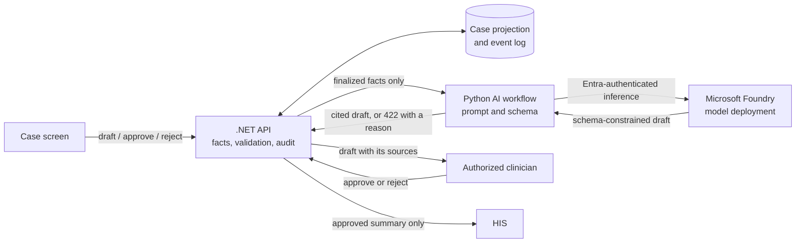
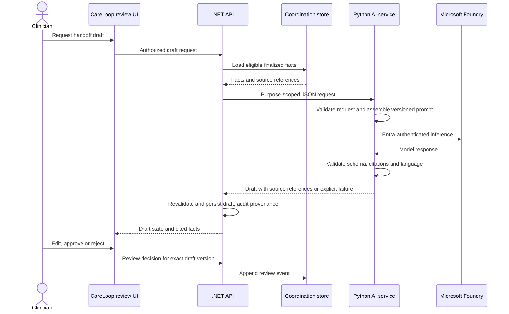
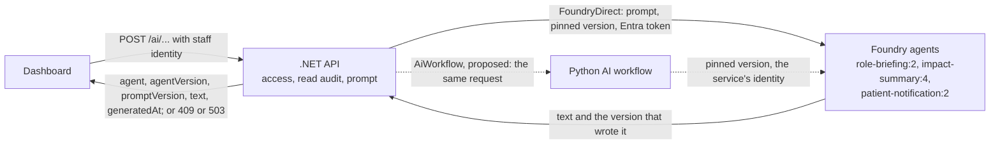

# API and AI workflow integration: the handoff summary

How the .NET API and the Python AI workflow service work together to draft a clinician handoff summary, what the API can and cannot do with AI, and what is built today.

This is FR-11, and this document is the contract. It implements decisions 8 to 11 (see [ui-design-gap-analysis.md](../ui-design-gap-analysis.md) section 5). [`ai-spec.md`](ai-spec.md) is the design proposal behind it and is superseded here where the two differ.

## The boundary

AI makes already-recorded information easier to read and hand over. It does not operate the workflow.

| Capability | Owner | What AI may do |
|---|---|---|
| Case state, ownership, deadlines, exceptions, referrals, appointments, closure | .NET API and the deadline worker | Nothing. No AI decisions, no AI writes |
| Counts, rates, denominators, timing, overdue status | API read models | Nothing in the numbers. The impact summary agent puts precomputed aggregates into words beside them (see [Foundry agents](#foundry-agents-role-briefing-impact-summary-patient-message-draft)) |
| Clinician handoff summary | Python AI workflow service, calling a Microsoft Foundry deployment | Organize supplied facts into cited sections. A draft only |
| Patient-facing wording | Approved templates under `Infrastructure/Templates/{language}/` | Nothing that is sent. A staff-only preview of a message may be drafted; it is never sent |
| Arabic | Deferred | Nothing. English only, everything language-keyed |

The four rules that do not bend, from `AGENTS.md`:

- AI output is a draft. A person approves it, and the approval is an event.
- AI cannot set urgency, alter source data, close a case or send a message. It is given no way to.
- Nothing is published until a person approves it. The FHIR publisher sends a `DocumentReference` only for an approved summary.
- Failure is visible. There is no success-shaped fallback: "no draft" and "a draft that may be wrong" must never look the same to the person about to sign it.

## Who calls the model

The Python service does (decision 8). The prompt, the response schema and the Foundry credentials live in one place, and the API holds no model credential.

A second route exists: the API can call a Foundry deployment directly. It is there so the summary still works when the Python service is not running, and so the two can be compared on the same fact set. Both sit behind `IAiProvider`, so nothing outside `AddSummaries` knows which is in use.



`Ai:Provider` selects the route:

| Value | Meaning |
|---|---|
| `NoOp` | Default. AI is off. Drafting answers 409 and every other feature runs untouched |
| `AiWorkflow` | The API calls the Python service, which calls Foundry |
| `FoundryDirect` | The API calls a Foundry deployment itself |

## Draft-request integration



The design document also proposes patient-message drafting, Arabic translation and aggregate insight narratives. These remain governed extensions; they do not alter the implemented FR-11 boundary or allow the AI service to dispatch messages or mutate case state.

## What flows between them

### The API builds the facts

`HandoffFactCollector` is the whole data boundary. Everything the model may write about passes through it, so one test can hold it to account.

Sent:

- Coordination facts from the case and its timeline: stage, owner, next action, due time, unresolved exceptions, correlated events.
- Clinical facts a clinician finalized, read from the source for the length of one draft (decision 9). They are **not** written to the coordination store; the clinical record stays in the source system.

Never sent:

- Patient names and contact details.
- Images. No imaging, pathology or radiology interpretation is ever asked for.
- Unfinalized or conflicting interpretations. These are named in `known_gaps` so the draft flags them, rather than a person discovering the silence later.

Every fact carries `fact_id`, `fact_type`, `value`, `recorded_at`, `source_reference` and `review_status`. The identifier is what a draft must cite.

### The request

`POST {Ai:AiWorkflow:BaseUrl}/summaries/handoff`

| Field | Notes |
|---|---|
| `request_id` | Correlates the call, the stored draft and the audit entry |
| `case_reference` | A coordination reference, never a direct patient identifier |
| `purpose` | `clinician_handoff`; the only purpose built |
| `trigger` | `requested` or `handoff_proposed` |
| `stage` | Backend-owned workflow stage |
| `facts[]` | At least one, all `finalized` |
| `recorded_next_step` | Absent means none is recorded, and the draft must say so rather than invent one |
| `known_gaps[]` | What the collector found unfinalized, conflicting or missing |
| `language` | `en`. An unsupported tag fails rather than falling back |
| `policy_version`, `prompt_version` | Stamped onto the draft |

The model gets this and nothing else. It cannot query the event store, call a source system or choose a tool. Text inside a fact that reads like an instruction is therefore summarised, never obeyed: there is no field through which a fact could set urgency, a stage or an action, and the output is validated against the facts before anything is stored.

### The response

```json
{
  "request_id": "request-demo-001",
  "purpose": "clinician_handoff",
  "language": "en",
  "status": "draft",
  "sections": [
    { "heading": "Recorded progress", "text": "...", "source_fact_ids": ["fact-001"] }
  ],
  "missing_or_conflicting_facts": [],
  "human_review_required": true,
  "model_deployment": "configured-deployment-name",
  "prompt_version": "fr11-v1"
}
```

`status` is always `draft` and `human_review_required` always `true`. `source_fact_ids` may be empty only for a section stating that something is missing, because an absence has no fact to cite.

### Validation, on both sides

A draft is refused, and nothing stored, when it cites a `fact_id` that was not supplied, answers another `request_id`, used another `prompt_version`, or is not in the requested language. A citation of an unsupplied fact means the model wrote something it was not given, which is the failure this design exists to catch.

The Python service checks this before returning. `HandoffSummaryDrafter` checks it again on receipt, because the provider is a service across the network and trust in it is not a safety argument.

### Failure

The service answers `422` with a reason when AI is off or unconfigured, the request exceeds `CARELOOP_AI_MAX_INPUT_BYTES`, the model times out or is refused by a content filter, or the output does not validate. The API raises `AiDraftUnavailableException` and the endpoint answers `503`, and the case screen shows "draft unavailable, human review needed". No substitute text is ever produced.

## The three things a person can do

| Action | Endpoint | Effect |
|---|---|---|
| Draft | `POST /cases/{caseId}/handoff-summary` | Stores a record in status `Draft`. 409 when AI is off or a summary is already approved; 503 when no valid draft could be produced |
| Approve | `POST /cases/{caseId}/handoff-summary/{summaryId}/approval` | Stores exactly the text submitted, which may differ from the draft, and writes a `HandoffSummaryApproved` source event naming the approver. This is what lets the FHIR publisher send the `DocumentReference` |
| Reject | `POST /cases/{caseId}/handoff-summary/{summaryId}/rejection` | Records the reviewer and reason. No case event: rejection changes no stage, owner or deadline |

Three statuses, not two. A draft a reviewer turned down must be distinguishable from one nobody has read, both on the case screen and for the evaluation question of how often reviewers reject what AI writes.

Approval happens in the CareLoop web app (decision 4). The HIS simulator receives the approved `DocumentReference` and nothing else.

### When a draft is produced

On request, and automatically when a handoff is proposed (decision 11). `AutoDraftOnHandoff` subscribes to `HandoffProposed` so the receiving clinician finds a draft waiting instead of having to ask.

It is off by default behind `Ai:AutoDraftOnHandoff`, because an automatic draft spends a model call and sends facts out of CareLoop with nobody having asked. It drafts once per case, which also makes a retried outbox delivery safe, and a failure never fails the handoff: the proposal has already happened, and the clinician can ask for a draft on the case screen.

## What is recorded

`HandoffSummaries` keeps the request identifier, the sections and their citations, the flattened text, what the draft reported as missing, the fact identifiers and source references, the provider, model deployment, prompt version, policy version, trigger and language, and the approval or rejection with its reviewer and time.

The flattened text is held rather than derived, so the text a person approved cannot be changed later by a change to how sections are flattened. Raw prompts and model reasoning are not stored, and the clinical facts a draft was built from stay in the source system: only identifiers and source references are kept here.

## Configuration

API, in the `Ai` section. No API key exists: the direct route authenticates with Entra ID. The same settings serve the handoff summary and the dashboard's agents ([below](#foundry-agents-role-briefing-impact-summary-patient-message-draft)); `Ai:Agents` adds only the agents' switch and which agent versions to call.

| Setting | Purpose |
|---|---|
| `Ai:Provider` | `NoOp`, `AiWorkflow` or `FoundryDirect`. Chooses the route for the handoff summary and for the dashboard's agents |
| `Ai:AutoDraftOnHandoff` | Draft when a handoff is proposed |
| `Ai:TimeoutSeconds` | Bounded wait before reporting a draft, or an agent's text, unavailable |
| `Ai:MaxRequestBytes` | Request-size guardrail, checked before any call |
| `Ai:PromptVersion` | Recorded with every draft |
| `Ai:AiWorkflow:BaseUrl` | The Python service |
| `Ai:FoundryDirect:ProjectEndpoint`, `:DeploymentName` | The direct route. The deployment name is the model identifier on the OpenAI-compatible path, and is often not the catalogue name. The agents use the project endpoint only: each agent version names its own model |

Python service, from the environment: `AZURE_AI_PROJECT_ENDPOINT`, `AZURE_AI_MODEL_DEPLOYMENT_NAME`, `CARELOOP_AI_ENABLED`, `CARELOOP_AI_TIMEOUT_SECONDS`, `CARELOOP_AI_MAX_INPUT_BYTES`.

Endpoint and deployment are configuration, never constants in source. Nothing live is committed, even though an endpoint URL is not itself confidential: it names a real deployment and belongs in the environment's configuration service.

Authentication is Entra ID throughout: `DefaultAzureCredential` locally with the developer's approved identity, managed identity when hosted, the narrowest inference permission the deployment supports.

One exception to keeping tokens out of configuration: `Ai:Agents:AccessToken`, a ready Entra token a developer may set to test the agents locally with their own sign-in. It is honoured in the `Development` environment only, set from the shell for one session and never committed; in any other environment it is ignored and a warning is logged, so a token copied into a deployed configuration authenticates nothing.

## What is built

| Piece | State |
|---|---|
| `IAiProvider`, `NoOpAiProvider` | Working. The default, so everything runs with AI off |
| Fact, request, draft and response contracts | Written |
| `HandoffSummaryRecord` and its EF configuration | Written. In the `InitialCreate` migration |
| `HandoffFactCollector`, `HandoffSummaryDrafter`, `AutoDraftOnHandoff` | Stubs, `TODO(WS-9)` |
| `DraftHandoffSummary`, `ApproveSummary`, `RejectSummary` | Stubs, answering 501 |
| `AiWorkflowProvider`, `FoundryDirectProvider` | Stubs |
| `POST /summaries/handoff` in `src/ai_workflow/` | Not built. Specified here and in the WS9 proposal |
| Tests | 18, skipped, in `tests/api/CareLoop.Tests/Api/HandoffSummaryTests.cs` |
| The dashboard's agents: `IAgentClient`, the three endpoints, `FoundryAgentClient` | Working behind `Ai:Agents:Enabled` and `Ai:Provider`, off by default. See below |
| `AiWorkflowAgentClient` | Written against the proposed contract below |
| `POST /agents/drafts` in `src/ai_workflow/` | Not built. Proposed below, pending the team's decision on the route |

Implementing either provider needs a dependency that is not yet agreed: `Azure.Identity` for the API, `azure-identity` plus a Foundry SDK for the Python service. `AGENTS.md` says to ask first. The Foundry agents below add `Azure.Identity` to the API, pending that agreement.

## Foundry agents: role briefing, impact summary, patient message draft

Separate from the handoff summary above and from `IAiProvider`, but on the same `Ai` settings: three agents in the team's Foundry project write a few words for the dashboard. CareLoop works out every number, deadline and order; the agents only put them into words. All three are drafts in the sense of the four rules: shown labelled as written by AI, never stored, never acted on, and absent rather than invented when the agent fails. Whether text that is only shown to staff, and never stored or sent, needs a person's approval is an open team decision (see [Open](#open)).

### The route

The dashboard calls the CareLoop API, never Foundry. Where the agents are called from is **pending the team's decision**: from the API (this pull request) or through the Python AI workflow service (decision 8 for the handoff summary). The endpoints do not depend on it. They call `IAgentClient`, and the shared `Ai:Provider` chooses the client:

| `Ai:Provider` | Client | What happens |
|---|---|---|
| `NoOp` (default) | `NoOpAgentClient` | AI is off. The endpoints answer 409 and nothing is sent |
| `FoundryDirect` | `FoundryAgentClient` | The API calls the Foundry project's Responses endpoint itself, with its own Entra identity. Built and tested |
| `AiWorkflow` | `AiWorkflowAgentClient` | The API sends the same purpose-scoped request to the Python service, which calls the agent. A thin client for the [proposed contract](#proposed-the-python-service-route) below; the Python side is not built |

On every route the API decides who may ask, builds the allowed facts and the prompt, writes the read audit and answers 409 or 503. The route only changes which identity holds the Foundry permission. `Ai:Agents:Enabled` must also be `true`, so the handoff summary can be switched on without the agents.



#### Calling a pinned agent version

`POST {Ai:FoundryDirect:ProjectEndpoint}/openai/v1/responses`, with `Authorization: Bearer <token for https://ai.azure.com/.default>` and `x-ms-client-request-id: <correlation ID>`:

```json
{
  "agent_reference": { "type": "agent_reference", "name": "role-briefing", "version": "2" },
  "input": [ { "role": "user", "content": "<prompt>" } ]
}
```

`agent_reference` with a `version` is how the Foundry Responses API addresses one agent version, and it is the request the Agent Framework's `FoundryAgent(agent_name, agent_version)` sends in `src/ai_agents/*/run_agent.py`. The agent's own endpoint (`…/agents/{agent}/endpoint/protocols/openai/responses`), which this pull request called at first, serves whichever version the project's version selector picks, the latest by default, so an edit in the portal could change the text while CareLoop's prompt version stayed the same. The answer's `agent_reference` names the version that wrote it, and an answer from any other version is refused like any other failure. The text is `output_text`, or every `output[].content[].text` in order. The agents have no tools and receive nothing but the prompt.

The request shape was checked against the Foundry REST reference ("Create a model response") and the `agent-framework-foundry` source, not yet against the live project, which the team cannot call yet. If the project answers otherwise, the change stays inside `FoundryAgentClient`.

#### Proposed: the Python service route

Proposed, pending the team's decision. For Peninah, if the team chooses the Python route:

`POST {Ai:AiWorkflow:BaseUrl}/agents/drafts`

```json
{
  "request_id": "2f4d9c1e-0b7a-4f7e-9a51-3c2d6e8f1a20",
  "purpose": "role_briefing",
  "agent": { "name": "role-briefing", "version": "2" },
  "prompt_version": "role-briefing-v2",
  "language": "en",
  "prompt": "<plain text the API built>"
}
```

```json
{
  "request_id": "2f4d9c1e-0b7a-4f7e-9a51-3c2d6e8f1a20",
  "purpose": "role_briefing",
  "agent": { "name": "role-briefing", "version": "2" },
  "prompt_version": "role-briefing-v2",
  "status": "draft",
  "text": "…"
}
```

- `purpose` is `role_briefing`, `impact_summary` or `patient_message_preview`; `request_id` is the call's correlation identifier, already in CareLoop's read audit.
- The service calls exactly the agent version named, with its own managed identity, and sends the prompt as it is: it adds nothing from case data, and the agent has no tools. The API stays the data boundary.
- It answers `200` with the same `request_id`, `purpose`, `agent` and `prompt_version`, `status` `draft` and the text, or `422` with `{ "request_id", "reason" }` when AI is off, the request is over `CARELOOP_AI_MAX_INPUT_BYTES`, the agent times out, refuses or writes nothing.
- The API checks every field again. Anything but a matching `200` draft is the same calm 503 as on the direct route.

#### The endpoints

| Endpoint | Agent (`Ai:Agents:…`) | Who may call it | Answer |
|---|---|---|---|
| `POST /ai/role-briefing` | `RoleBriefing`, `role-briefing:2` | Every staff role, scoped like the worklist | `AiTextResponse { agent, agentVersion, promptVersion, text, generatedAt }` |
| `POST /ai/impact-summary` | `ImpactSummary`, `impact-summary:4` | Every staff role, scoped like `GET /metrics` | The same |
| `POST /cases/{caseId}/patient-message-draft` | `PatientNotification`, `patient-notification:2` | Nurse navigator and clinician (pending the team's decision), for a case they may open | The same; a preview that is never sent |

409, titled "AI is switched off", while `Ai:Agents:Enabled` is `false` or `Ai:Provider` is `NoOp`, as the handoff summary answers while AI is off; 503, titled "AI could not write this", when the agent fails in any way (no token, 401, 403, 429, 5xx, a timeout, a request over `Ai:MaxRequestBytes`, an answer marked incomplete, a refusal, no text, or another agent version); 401, 403 and 404 exactly as for the reads they mirror, including the documented reason for another facility.

### What each agent is given

| Agent | Given | Never given |
|---|---|---|
| Role briefing | The reader's role in words and the facility's name; counts of open cases in scope (open, overdue, escalated, urgent, due today, needs an owner); up to five cases, overdue or escalated first, then urgent, then due today. Each is described from its full coordination state, the data `GET /cases/{caseId}` returns rather than the worklist row: its eight-character case number, programme, stage and display step, next action in words, the owner's role and who acts next, due status ("late by 18 hours") and overdue state, urgency, exception flags, the open escalation's level, the role it went to and whether it was acknowledged, each track's status (with an upcoming appointment's day and time), how contact with the patient stands (delivered, replied, asked for a call, not reached), understanding and the confidence rating where recorded, and the patient's preferred language for messages. The coordinator's scope is the cases escalated to the coordinator | Patient names, MRNs, patient references, contact details, the hospital's result identifier, staff references, and free text: escalation reasons, a referral's rejection reason, an appointment's place |
| Impact summary | The aggregate measures `GET /metrics` returns for the same reader, with [small numbers hidden](#small-numbers): counts, rates with what each is out of, median times to each step, closures by reason, confidence participation; the cohort, the period, the version of the measure definitions (`metrics-v1`) and that the data is synthetic. It is asked to say in neutral, non-causal words which steps have higher or lower completion, where open cases wait and which recorded gaps are worth checking, without saying why and without crediting or blaming anyone, and not to repeat the numbers, which the screen shows beside its words | Any case, case number or identifier; any count from 1 to 4 |
| Patient message draft | One [patient-safe step](#the-patient-safe-step) in place of the next action, the facility's name, an upcoming appointment's day and time in local time and whether its place is known, the channel (text message or email) and the two reply codes: 1 "I got this message", 2 "call me". It is told the message is category A, administrative, with no clinical result in it, writes `{first name}` and `{place}` where they go, and is told never to mention or hint at a result | The patient's name, contact details, MRN, reference, the hospital's result identifier, the case's next action, the appointment's place, and any result or clinical content |

"Urgent" means a clinician-reviewed urgency code listed in `Ai:Agents:UrgentCodes`, which must match the dashboard's table; CareLoop never sets urgency. Each prompt begins with its prompt version (`role-briefing-v2`, `impact-summary-v2`, `patient-message-v2`), so a change of wording can be traced. The agents' instructions live in the Foundry project, not in this repository, so they should expect these inputs and must not ask for anything else.

#### The patient-safe step

Several next actions reveal clinical state ("review the result", "start the treatment", "send a new referral"), and the reporting physician gives results (DoH §3.8.1). An instruction not to hint at a result cannot help once the input is the hint, so the API maps each next action to one step with no result in it, in the spirit of the category A administrative templates, and the next action itself never reaches the prompt:

| Next action | The step the agent is given |
|---|---|
| `acknowledge-notification` | Your care team sent you a message and would like to know that you got it. |
| `call-patient` | Your care team will call you back, as you asked. |
| `contact-patient-another-way` | Please contact your care team. |
| `rebook-appointment` | Your care team would like to find a new time for your appointment. |
| Every other next action (`assign-owner`, `review-result`, `answer-consultation`, `respond-to-referral`, `arrange-follow-up`, `reassign-consultation`, `arrange-alternative-referral`, `start-treatment`, `decide-closure`) and any key not listed | Your care team would like to talk with you. |

The role briefing does name next actions: it is written for staff, never for a patient.

#### Small numbers

Before the impact summary's prompt is sent, a count from 1 to 4 is written "fewer than 5", and a rate, median or average resting on fewer than 5 cases, or with fewer than 5 on either side (3 of 40 closed, or 18 of 20 attended), is not given. The screen still shows staff every exact number; only what is sent to the agent is reduced. The threshold of 5 is a placeholder: ai-spec §4.3 leaves the small-cell threshold to a governance decision, and the prompt says so and asks the agent not to work out a hidden number.

### Versions and audit

- Each agent is pinned in `Ai:Agents` as `name:version`. The defaults match `src/ai_agents/*/run_agent.py`: `role-briefing:2`, `impact-summary:4`, `patient-notification:2`. A new version in the portal changes nothing until the setting changes; change the setting and the script together.
- Each call has a correlation identifier. Before the call, the read audit (`CaseReads`) records the view, the reader and any reason, as for a read, and also the agent's name and version, the prompt version and the correlation identifier (migration `AiCallAudit`). The identifier is sent with the call (`x-ms-client-request-id` on the direct route, `request_id` on the Python route) and logged with its outcome.
- `AiTextResponse` returns `agentVersion` and `promptVersion`, and the dashboard shows them in small muted words under the caption.

### Privacy rules

- Patient names, contact details, identifiers and free text from the hospital system are never sent. One test seeds a case with a name, an MRN, a patient reference, a hospital result identifier, a phone number, an email address, an appointment's place and an escalation reason, and checks that no prompt from any of the three endpoints contains them.
- The patient message prompt never carries a next action. A test builds it for every next action the pathway defines and fails if any next action, or its wording on the dashboard, appears, or if the step is not one of the patient-safe steps.
- The patient message preview is not a message. Patient messages go out from the approved templates; the preview is shown to staff, labelled as a draft that was not sent, and is not stored.
- No AI output changes a case, an owner, a deadline, urgency or a metric. The endpoints read through no-tracking queries and write only the read audit.
- Prompts and texts are not logged. The clients log the agent version, the status, the duration, the correlation identifier and, on failure, the agent's own error code.

### Configuration

`Ai:Agents`, off by default; everything else is the shared `Ai` settings [above](#configuration):

| Setting | Purpose |
|---|---|
| `Enabled` | `false` by default. While `false`, or while `Ai:Provider` is `NoOp`, the endpoints answer 409. When `true`, the agent versions, `Ai:TimeoutSeconds` (1 to 300), `Ai:MaxRequestBytes` and the route's address (`Ai:FoundryDirect:ProjectEndpoint`, `https` only, or `Ai:AiWorkflow:BaseUrl`) are checked at start-up, and a bad value stops the host |
| `RoleBriefing`, `ImpactSummary`, `PatientNotification` | The agent versions, `name:version`: `role-briefing:2`, `impact-summary:4`, `patient-notification:2` |
| `AccessToken` | A ready token for a developer's local test, honoured in `Development` only; the exception described under [Configuration](#configuration) |
| `UrgentCodes` | Urgency codes the briefing counts as urgent; not a connection setting, and a placeholder like the pathway's codes |

Docker Compose passes `AI_PROVIDER`, `AI_TIMEOUT_SECONDS`, `AI_FOUNDRY_PROJECT_ENDPOINT`, `AI_AGENTS_ENABLED` and the agent versions through, and points `Ai:AiWorkflow:BaseUrl` at the `ai-workflow` service; see `.env.example`. The Azure deployment in `infra/azure` sets `Ai__Provider` to `NoOp` or `AiWorkflow` today; switching the agents on there needs `Ai__Agents__Enabled` and, for the direct route, `FoundryDirect` and the project endpoint, once the team has chosen the route.

### RBAC

There is no key. Whichever identity calls the agents needs the **Foundry User** role (formerly Azure AI User) on the Foundry project; without it every call answers 403 and the dashboard shows "AI could not write this".

- `FoundryDirect`: the API's identity, through `DefaultAzureCredential`. In Azure that is the API's user-assigned managed identity (`apps` in `infra/azure`, chosen with `AZURE_CLIENT_ID`); locally, the developer's own sign-in, or the `Development`-only token.
- `AiWorkflow`: the Python service's identity (`ai` in `infra/azure`), which the deployment already gives Foundry User when `AZURE_AI_FOUNDRY_ACCOUNT_ID` is set. The API's identity then needs no Foundry role at all.

## Before real data

Synthetic only today. Before any non-synthetic data reaches a Foundry endpoint, the organization must confirm the region and data residency (all patient data and AI processing stay in the UAE), retention and logging settings, ADHICS controls, access roles, the network path, and the applicable DoH and legal approvals.

Two DoH boundaries shape this design rather than being model instructions that can be relaxed: the reporting physician informs the patient of results (§3.8.1), which is why AI never discloses a result, and assessment outcomes are considered by a multidisciplinary team (§3.9.8), which is why a summary organizes what a team recorded rather than concluding anything.

## Open

- Which roles may approve a summary. Proposed as `summaryApproverRoles` in the pathway definition, so it is configuration like every other role rule.
- Who owns `src/ai_workflow/`. It has no workstream today.
- The stage-insight narrative, in part. The impact-summary agent now writes a short narrative beside the Impact numbers, from aggregates with small numbers hidden; it is shown to staff, not stored and not published. The periodic narrative of ai-spec §2.6 and §6, with a stored snapshot, a review and a publication step, is not built.
- Where the dashboard's agents are called from: the API (`FoundryDirect`) or the Python service (`AiWorkflow`, with the [proposed contract](#proposed-the-python-service-route)). A team decision for 19 November; the proposal is in [`docs/workstreams.md`](../workstreams.md#contract-points-to-settle-between-workstreams).
- Whether AI text that is shown only to staff, and never stored, published or sent, may be shown with a label and no approval (the role briefing and the impact summary). If the team agrees, the proposed exception to the rules [above](#the-boundary) is in `docs/workstreams.md`; if not, a review step is needed before the text is shown.
- The patient message preview against AG3: an exception for the prototype, or a preview that starts from the approved template with the agent filling only the adaptable parts; and who may request one (nurse navigator and clinician today, coordinator or physician in ai-spec §5.1). Proposed wording for both is in `docs/workstreams.md`.
- The small-cell threshold, report audience and review owner for aggregate narratives (ai-spec §9). The impact summary uses 5 as a placeholder.
- The patient-notification, role-briefing and impact-summary agents' instructions live in the Foundry project. Their owner should confirm they expect the inputs above, including one patient-safe step, `{first name}`, `{place}` and category A only.
