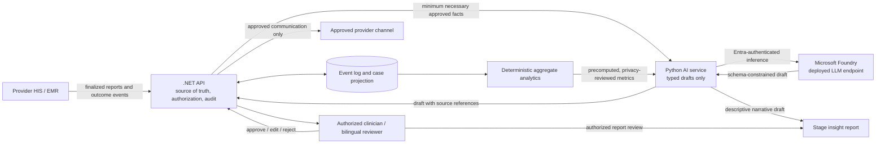

# AI specification: summaries and stage insights

**Status:** Design proposal for team and clinical review  
**Primary requirement:** FR-11, human-reviewed AI coordination summary at handoff  
**Related work:** FR-04 (patient-channel simulator), FR-07 (deterministic deadline worker), FR-09 (read-only timeline and synthetic measures)

## 1. Purpose and design boundary

Use a Microsoft Foundry-deployed large language model (LLM) to make already-recorded information easier to understand and hand off. The AI produces drafts and descriptive analysis; it does not operate the care workflow.

| Capability | Owner | AI boundary |
|---|---|---|
| Case state, event processing, ownership, deadlines, exceptions, referrals, appointments, and closure authorization | .NET orchestration API and deterministic worker | No AI decisions or independent writes |
| Exact counts, rates, denominators, timing measures, overdue status, and cohort filters | Backend analytics/read model | AI receives precomputed aggregates only |
| Clinician handoff summary | Python AI service using a Microsoft Foundry model deployment | Summarize selected, finalized facts with source references; draft only |
| Patient-friendly stage explanation | Python AI service, as a guarded extension to FR-11 | Draft from clinician-approved facts and approved next steps; never send |
| English-to-UAE-Arabic translation | Python AI service, as a guarded extension | Translate approved English text; never change clinical meaning; bilingual human approval required |
| Periodic stage insight narrative | Scheduled backend report plus optional Python AI narrative | Describe aggregate patterns and data limitations; do not infer causes or assign blame |

The handoff summary is the core FR-11 deliverable. Patient-facing drafts, translation, and narrative analytics are extensions and must not delay the core handoff summary or replace existing backend functionality.

## 2. Intended users and outputs

### 2.1 Clinician handoff summary

**User:** Receiving or responsible clinician reviewing a handoff.  
**Trigger:** An authorized user requests a summary, or the backend identifies an eligible handoff and presents a draft for review.

The draft may organize:

- The current workflow stage and the recorded reason for handoff.
- Relevant finalized, clinician-reviewed facts and outcomes, in chronological order.
- Completed and outstanding coordination steps.
- Recorded referral, consultation, appointment, and follow-up status.
- Missing, stale, conflicting, or unverified information requiring human review.
- The next action and owner **only when already recorded by the backend**.

Every included assertion will be traceable to one or more supplied source references. The summary will distinguish a source-reported fact from an absent or conflicting fact. It must not diagnose, interpret imaging/pathology, determine urgency, choose a test or provider, recommend treatment, or imply that a pending action has occurred.

### 2.2 Patient-friendly stage explanation (extension)

**User:** Patient, through an approved provider channel or a staff-assisted conversation.  
**Trigger:** A provider-authorized request for a patient-facing draft after a relevant stage outcome has been finalized.

The draft may explain, in clear and supportive language:

- What the care team has recorded as completed.
- What the care team has recorded as the next step, who will contact the patient (if known), and a timeframe only when explicitly supplied and approved.
- How to ask for clarification or request human help, using an approved contact route.

The tone should be calm, respectful, culturally appropriate, and reassuring without minimizing risk or promising an outcome. It must not create a diagnosis, medical advice, urgency, deadline, appointment, or reassurance unsupported by the clinician-approved source facts. A generated explanation is not proof of patient receipt, understanding, consent, or reassurance.

The DoH standard assigns responsibility for informing patients of screening results to the reporting physician. Therefore, a patient explanation is a **draft for qualified review**, not autonomous result disclosure or messaging. The backend patient-channel simulator continues to own simulated send, delivery, failure, acknowledgement, and call-request events.

### 2.3 English to UAE Arabic (extension)

Support English (`en`) and UAE Arabic (`ar-AE`) as explicit output-language preferences. The proposed flow is:

1. A clinician reviews the English patient-facing text and its source facts.
2. The service translates that approved text to UAE Arabic using a reviewed health-language glossary and approved template terminology.
3. The system retains language, source text version, translation version, reviewer, and approval status.

Translation must preserve negation, uncertainty, numbers, dates, instructions, and the difference between screening and diagnostic outcomes. 

### 2.4 Periodic stage insights (extension)

**Users:** Program coordinator, screening program director, and other authorized quality-improvement staff.

The backend periodically computes the exact measures from the event log. It supplies the AI only a privacy-reviewed, pre-aggregated dataset and metric definitions. The AI may create a short, descriptive narrative that:

- Calls out stage-level performance using supplied values and denominators.
- Identifies recorded process bottlenecks, overdue work, rejection codes, missing events, and unacknowledged tasks.
- Notes stages with stronger completion or timeliness relative to a stated comparison period or approved target.
- Separates patient-channel events from provider or facility events.
- Lists data-quality gaps and cautions that prevent interpretation.
- Suggests questions for human review, not patient-specific interventions or clinical decisions.

Backend rules (not the LLM) determine whether an action was expected, whether its due time passed, and which party owns it. Do not describe a patient or stakeholder as “not acting as expected” unless the event record supports the exact expected action, owner, policy deadline, and observation window. Prefer neutral language such as “acknowledgement not recorded by the configured due time” or “referral acceptance event missing.”

No causal attribution is permitted from descriptive aggregates. Do not infer patient emotions, understanding, intent, or provider performance from silence or free text. Patient understanding, reassurance, and confidence must come from explicit, separately collected measures and be reported with their response denominator.

## 3. Microsoft Foundry endpoint and Python integration

Deploy an approved model in the project's Microsoft Foundry environment and call that deployment from the existing Python AI service. The endpoint and model deployment are configuration, not constants in source code. 

For a current Foundry project, the Foundry project endpoint has the form:

```text
https://<resource-name>.services.ai.azure.com/api/projects/<project-name>
```

Use the current Foundry SDK/endpoint path supported by the selected model deployment. The Python adapter will be isolated behind a provider interface so SDK or deployment changes do not affect summary schemas or backend contracts. For models accessed through the OpenAI-compatible endpoint, use the deployment name as the model identifier; do not assume the catalog model name equals the deployment name.

**Authentication:** Microsoft Entra ID. Use `DefaultAzureCredential` locally with the developer's approved identity and a managed identity in the hosted runtime, with the narrowest inference permissions supported by the selected deployment. Do not store Foundry API keys, tokens, patient data, or model credentials in the repository or container image.

Initial configuration contract:

| Setting | Purpose |
|---|---|
| `AZURE_AI_PROJECT_ENDPOINT` | Foundry project endpoint supplied by the deployed environment |
| `AZURE_AI_MODEL_DEPLOYMENT_NAME` | Exact Foundry deployment name |
| `AZURE_AI_API_MODE` | Adapter mode selected for the deployment (for example, Foundry Responses API or supported OpenAI-compatible API) |
| `CARELOOP_AI_ENABLED` | Explicit enable/disable flag; disabled mode returns a clear unavailable status, not a fabricated summary |
| `CARELOOP_AI_MAX_INPUT_BYTES` | Request-size guardrail set during implementation |
| `CARELOOP_AI_TIMEOUT_SECONDS` | Bounded inference timeout set during implementation |

Do not commit live endpoint values. Keep them in the hosting environment's secret/configuration service even when the endpoint URL itself is not confidential. Confirm the Foundry region, model availability, data-residency requirements, retention behavior, network path, and provider approval before any non-synthetic data is sent.



## 4. Input and output contracts

The API constructs a purpose-specific request. The model never queries the event store, calls a provider system, chooses a tool, or receives an unrestricted case object.

### 4.1 Summary request

For a clinician summary, eligible report facts may include the source-authored final assessment, signed report impression, and clinician-authored recommended next step, each with its finalization/review status and source reference. The model may reorganize those facts but must not reinterpret a narrative report. Patient-facing drafts use only the subset explicitly approved for patient communication. Raw images, unreviewed findings, and unfinalized or discordant interpretations are excluded and routed back to qualified staff.

Required fields:

- `request_id`: unique correlation identifier.
- `purpose`: `clinician_handoff` or `patient_stage_explanation`.
- `case_reference`: synthetic/pseudonymous coordination reference; not a direct patient identifier.
- `stage`: backend-owned workflow stage.
- `language`: `en` or `ar-AE`.
- `facts[]`: selected, finalized facts with `fact_id`, `fact_type`, `value`, `recorded_at`, `source_reference`, and `review_status`.
- `recorded_next_step`: optional backend/clinician-authored next step; absent means the model must not invent one.
- `approved_contact_route`: optional reviewed contact information or template token; omit if not approved.
- `policy_version`, `template_version`, and `prompt_version`.

Only the content needed for the requested summary may be included. The current hackathon environment is synthetic-only. In a future regulated deployment, a separate privacy, security, clinical-governance, and DoH approval must define whether any patient-identifiable or clinical data may be transmitted to Foundry.

### 4.2 Aggregate insight request

Required fields:

- `report_id`, `period_start`, `period_end`, `cohort_definition`, and `metric_definition_version`.
- For each stage/measure: `numerator`, `denominator`, `value`, `unit`, `comparison_value` (if valid), `missing_count`, and the backend-calculated uncertainty or suppression flag.
- Aggregate exception and outcome codes, grouped only to the approved reporting threshold.
- Explicit notes on synthetic data, missingness, changes to event capture, and any known invalid comparison.

Do not include case-level timelines, direct identifiers, free-text notes, report text, or individual staff/patient scores in the analytics request. Suppress small cells according to a privacy-reviewed threshold; that threshold is an open governance decision and must not be invented by the model.

### 4.3 Response envelope

Return structured JSON validated by the Python service:

```json
{
  "request_id": "request-demo-001",
  "purpose": "clinician_handoff",
  "language": "en",
  "status": "draft",
  "sections": [
    {
      "heading": "Recorded progress",
      "text": "Draft text",
      "source_fact_ids": ["fact-001"]
    }
  ],
  "missing_or_conflicting_facts": [],
  "human_review_required": true,
  "model_deployment": "configured-deployment-name",
  "prompt_version": "fr11-v1"
}
```

The service rejects malformed output, unknown source fact IDs, unauthorized action requests, or any response that omits mandatory review status. Keep model version/deployment, prompt/template versions, timestamp, reviewer disposition, and source references in the audit metadata. Store only the minimum draft or approved artifact required by the product; do not retain hidden reasoning or raw prompts by default.

## 5. Safety, privacy, and failure handling

- **Human governance:** No model output is sent to a patient, written as a clinical record, used to change a case state, or treated as a clinical decision without the responsible authorized human and backend gate.
- **Source fidelity:** Summaries are extractive/organizational, not interpretive. The source record remains authoritative; report ambiguity rather than resolving it.
- **Untrusted text:** Treat supplied report text and event content as data, not instructions. The model receives no tools or ability to execute instructions embedded in reports.
- **Minimization:** Prototype inputs and outputs are synthetic. For production, transmit only the minimum approved facts, use pseudonymous references, and keep clinical records in source systems.
- **No raw imaging:** Never send mammography images or ask this LLM to interpret imaging, pathology, or radiology findings.
- **Language safety:** Patient-facing English and Arabic drafts require clinician approval; Arabic additionally requires qualified local-language review before use.
- **Access and audit:** Authorize requests at the API boundary. Audit request purpose, source references, deployment/prompt versions, and reviewer decision without copying unnecessary clinical content into logs.
- **Fail closed:** Timeout, endpoint outage, content-filter refusal, invalid schema, missing source facts, or unsupported language returns a visible “draft unavailable / human review needed” state. Do not create a success-shaped fallback.
- **No agentic tools:** The model has no direct access to messaging, scheduling, HIS/EMR, referral acceptance, case mutation, or closure tools.

The DoH Standard for Breast Cancer Screening & Diagnosis, V2/2025, states that the woman is central to communication, that communication should avoid direct or indirect harm, and that literacy, diversity, and linguistic needs matter (§3.5). It assigns patient-result communication to the reporting physician (§3.8.1), requires double reading and expert handling of discordant readings (§3.7.2–3.7.3), and requires assessment outcomes to be considered by an MDT (§3.9.8). These are hard boundaries for this design, not model instructions that can be relaxed.

## 6. Periodic analytics design

The backend's existing impact view remains responsible for all numeric measures. Reuse its event-derived calculations; do not create an AI-owned metric store.

Candidate stage measures include:

- Eligible cases entering and completing each stage, with numerator and denominator.
- Median and 90th-percentile time between relevant recorded events.
- Cases overdue at the reporting cutoff, using the configured pathway clock.
- Referral acceptance, appointment scheduling/attendance, and documented outcome rates.
- Failed or unacknowledged communication, patient callback requests, rejected handoffs, missing events, and unresolved cases by structured reason.
- Evidence-backed closure rate and reason; continuing follow-up remains distinguishable from closed work.
- Explicit patient-reported understanding, confidence, or experience measures, with response and eligible denominators.

Do not calculate patient emotions or comprehension from message content, acknowledgement, response speed, or silence. “Impact” comparisons must identify cohort, period, denominator, missingness, pathway/configuration version, and whether values are synthetic. Descriptive before/after differences do not establish that the tool caused an outcome.

Suggested implementation: backend schedule creates a versioned aggregate snapshot; an authorized service requests a narrative; AI produces a cited draft referencing metric IDs; a program owner reviews and publishes it. A weekly cadence is a proposal for a pilot and must be confirmed by the program owner. The deterministic snapshot is still available if the LLM is disabled.

## 7. Evaluation and acceptance criteria

### Clinician handoff summary

- Every factual statement maps to supplied, finalized source fact IDs.
- The summary preserves chronology, negation, uncertainty, attribution, and recorded status.
- Missing/conflicting evidence is flagged rather than filled in.
- It does not invent diagnosis, urgency, next steps, provider selection, treatment, or closure.
- A receiving clinician can review, edit, approve, or reject the draft; the decision is audited.

### Patient-facing draft and Arabic translation

- Patient-facing text uses only approved result interpretation, stage outcome, next step, timeframes, and contact route.
- It is understandable, respectful, supportive, and non-alarming without false reassurance or unsupported promises.
- The English source is approved before translation; the `ar-AE` version is bilingual-reviewed before use.
- A reviewer can compare both versions and identify source/template/version; failed translation never silently falls back to unreviewed text.
- No output is auto-sent, and no response is interpreted as consent or proof of understanding.

### Stage insights

- AI narrative values and comparisons match the supplied backend aggregates and name the denominator.
- It identifies missingness and limitations and makes no unsupported causal claims.
- It describes overdue or missing work with neutral, event-grounded language and distinguishes patient, provider, and system events.
- No individual patient or staff member is scored, ranked, or blamed.
- Human review is required before publication; model outage does not block the ordinary dashboard.

Evaluation should use synthetic, clinically reviewed examples and adversarial cases: contradictory reports, stale facts, absent next steps, embedded prompt-like text, uncertain wording, English/Arabic negation and number preservation, and sparse or suppressed aggregate cells. A qualified clinical and bilingual reviewer must approve the acceptance set before any real-world pilot.

## 8. Rollout

1. **Synthetic prototype:** implement the handoff summary against synthetic structured facts; no real records, model action tools, or outbound messages.
2. **Shadow review:** compare AI drafts with clinician-authored summaries; measure factual coverage, unsupported statements, reviewer edits/rejections, and language issues.
3. **Patient-language pilot:** only after approved templates, local Arabic review, provider-channel governance, data-residency approval, and a named clinician review process.
4. **Periodic insights:** publish aggregate narrative drafts only after the backend metric definitions, suppression policy, cadence, audience, and review owner are agreed.

No production patient data may be sent to a Foundry endpoint until the organization confirms model availability and data location, security/ADHICS requirements, retention and logging settings, access roles, network configuration, and applicable DoH/legal approvals.

## 9. Open decisions

- Which Foundry model deployment and supported API mode meet English and UAE Arabic quality requirements in an approved region?
- Who is the clinical owner for patient-facing drafts, and who is the qualified bilingual Arabic reviewer?
- Which pathway-approved facts/templates are available to each summary purpose?
- What data-residency, retention, logging, and ADHICS controls apply to a production deployment?
- What aggregate-cell suppression threshold, report audience, review owner, and reporting cadence are approved?
- Which patient-reported instrument will measure understanding, reassurance, and confidence?

## References

- CareLoop solution design, FR-01–FR-11, architecture and component boundaries (team-provided design).
- DoH, *Standard for Breast Cancer Screening & Diagnosis*, V2/2025, §§3.5, 3.7–3.9 and Appendix 3.
- Microsoft Learn, [Get started with Microsoft Foundry SDKs and endpoints](https://learn.microsoft.com/en-us/azure/foundry/how-to/develop/sdk-overview).
- Microsoft Learn, [Role-based access control for Microsoft Foundry](https://learn.microsoft.com/en-us/azure/foundry/concepts/rbac-foundry).
