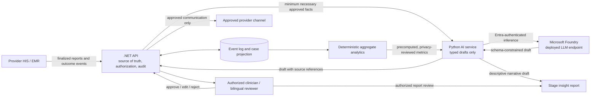

# AI specification: summaries and stage insights

**Status:** Design proposal for team and clinical review
**Primary requirement:** FR-11, human-reviewed AI coordination summary at handoff
**Related work:** FR-04 (patient-channel simulator), FR-07 (deterministic deadline worker), FR-09 (read-only timeline and synthetic measures)
**Alignment basis:** CareLoop AI Layer Engineering Design Specification v0.3; proposed extensions remain subject to team and clinical-adviser review.

## 1. Purpose and design boundary

Use a Microsoft Foundry-deployed large language model (LLM) to make already-recorded information easier to understand and hand off. The AI produces drafts and descriptive analysis; it does not operate the care workflow.

| Capability | Owner | AI boundary |
|---|---|---|
| Case state, event processing, ownership, deadlines, exceptions, referrals, appointments, and closure authorization | .NET orchestration API and deterministic worker | No AI decisions or independent writes |
| Exact counts, rates, denominators, timing measures, overdue status, and cohort filters | Backend analytics/read model | AI receives precomputed aggregates only |
| AG1 clinician handoff summary (FR-11, P0) | Python AI service using a Microsoft Foundry deployment | Organize selected finalized facts with source references; draft only |
| AG2 closure review pack (extension) | Python AI service, supplied the API's rule-based evidence checklist | Summarize present, missing, or stale evidence; cannot attach evidence, create exceptions, or close |
| AG3 patient message drafting (P1 stretch) | Python AI service using an API-selected, approved template | Fill supplied slots and adapt only approved spans; a person approves before the channel can send |
| AG4 English-to-UAE-Arabic translation (extension) | Python AI service | Translate approved English text; bilingual and clinical approval required before use |
| AG5 reply triage (proposed extension) | Deterministic reply checks first; AI may add classifications or flags | Never answer the patient or remove a deterministic flag; a nurse confirms routing |
| AG6 periodic stage insights (extension) | Backend computes measures; Python AI drafts a narrative | Describe pre-aggregated patterns and limitations; no causal claims or individual scoring |

AG1 is the core FR-11 deliverable. The other agents are extensions and must not delay it. AG3 may draft patient messages, but only the approved patient-channel provider dispatches text after a human approval event. AG5 is proposed and requires team agreement before implementation.

## 2. Intended users and outputs

### 2.1 Clinician handoff summary

**User:** Receiving or responsible clinician reviewing a handoff.
**Trigger:** An authorized user requests a summary, or the backend identifies an eligible handoff and presents a draft for review.

The draft may organize:

- The current workflow stage and the recorded reason for handoff.
- Relevant finalized, clinician-reviewed facts and outcomes, in chronological order.
- Completed and outstanding coordination steps.
- Recorded referral, consultation, appointment, and follow-up status.
- Missing, stale, conflicting, or unverified information requiring human review.
- The next action and owner **only when already recorded by the backend**.

Every included assertion will be traceable to one or more supplied source references. The summary will distinguish a source-reported fact from an absent or conflicting fact. It must not diagnose, interpret imaging/pathology, determine urgency, choose a test or provider, recommend treatment, or imply that a pending action has occurred.

### 2.2 Patient message drafting (AG3, P1 stretch)

**User:** Patient, through an approved provider channel or a staff-assisted conversation.
**Trigger:** An authorized coordinator, nurse, or physician requests a draft for a valid workflow stage. The API—not the model—selects the approved template by stage, class, clinician-reviewed urgency tier, language, and channel.

AG3 fills approved template slots and may lightly adapt only designated spans (such as greeting, tone, or reading level). It cannot choose a template, change locked text, invent slot values, or change the urgency wording. The patient channel sends nothing until a person approves the exact draft.

| Class | Purpose and examples | Approver |
|---|---|---|
| A: logistics | No result content; neutral invitation, appointment reminder, rescheduling, directions, or teach-back prompt | Authorized coordinator or nurse |
| B: result-bearing | Approved result disclosure follow-up, assessment outcome, or next-step explanation | Reporting or responsible physician |

The staged-disclosure proposal is to use a Class A neutral invitation first, with identity verification handled only through an approved process and channel. Result details are only included in a Class B message after the reporting physician has informed the patient and approved the text. Confirm this interpretation with the programme owner and clinical adviser before use. SMS must not contain result-bearing or other sensitive details.

The draft may explain, using only approved facts:

- What the care team has recorded as completed.
- What the care team has recorded as the next step, who will contact the patient (if known), and a timeframe only when explicitly supplied and approved.
- How to ask for clarification or request human help, using an approved contact route.

The tone should be calm, respectful, culturally appropriate, and reassuring without minimizing risk or promising an outcome. It must not create a diagnosis, medical advice, urgency, deadline, appointment, or reassurance unsupported by the clinician-approved source facts. A generated or approved message is not proof of patient receipt, understanding, consent, or reassurance.

The DoH standard assigns responsibility for informing patients of screening results to the reporting physician. Patient-facing text is therefore a **draft for qualified review**, not autonomous result disclosure or messaging. The backend patient channel owns dispatch, delivery, failure, acknowledgement, teach-back, and call-request events.

#### 2.2.1 Template controls

- Only approved, versioned templates can be selected. The API provides the selected template ID/version, locked and adaptable spans, and explicit slot values.
- Validators confirm locked spans are unchanged, required slots are filled, no unprovided names/numbers/dates are introduced, language and channel constraints are met, and class-specific forbidden content is absent.
- SMS omits sensitive details. Every draft records template, prompt, deployment, and source-fact versions.
- A source-fact change marks dependent drafts stale; stale drafts cannot be approved.
- Approval binds the exact text hash. Editing creates a new version that needs a separate approval. Dispatch is idempotent on approval ID.
- A validation or generation failure shows the approved template-only fallback, labelled “no AI”; it is not automatically sent.
- Batch approval may be enabled for Class A only, with an individual approval event for every message.

### 2.3 Closure review pack (AG2, extension)

The API supplies the rule-based closure checklist for the proposed typed closure reason, required evidence references, and their statuses. AG2 summarizes which required references are present, missing, or stale for the authorized reviewer.

AG2 cannot decide whether evidence is sufficient, attach or mark evidence complete, create an exception, call the closure endpoint, or close a case. The API enforces the closure gate: authorized human event, typed reason, required final evidence or a documented exception, outcome evidence, and no mandatory open task unless pathway configuration allows it to remain.

### 2.4 English to UAE Arabic (AG4, extension)

Support English (`en`) and UAE Arabic (`ar-AE`) as explicit output-language preferences. The proposed flow is:

1. A clinician reviews the English patient-facing text and its source facts.
2. The service translates that approved text to UAE Arabic using a reviewed health-language glossary and approved template terminology.
3. A qualified bilingual reviewer approves the translation, followed by clinician approval for result-bearing content.
4. The system retains language, source text version, translation version, reviewer, and approval status.

Translation must preserve negation, uncertainty, numbers, dates, instructions, and the difference between screening and diagnostic outcomes.

### 2.5 Reply triage (AG5, proposed extension)

Deterministic rules run first on incoming patient replies. If implemented, AG5 may classify free text into acknowledgement, logistics, clinical question, distress or red flag, or unclear, and propose routing for a person to confirm. AI may add flags but must never remove a deterministic flag, answer the patient, create a clinical interpretation, or initiate a workflow action.

A nurse on duty confirms routing. Potential red-flag replies must be surfaced immediately through the configured human escalation path. A human callback route remains available. AG5 is a proposed extension and is not required for the FR-11 core.

Red-flag categories and deterministic rules must be defined and approved by qualified clinical staff; this specification does not invent them. Test the rule-based detector independently. AI may add a flag or classify an unclear reply, but cannot suppress a deterministic flag or make a clinical assessment.

### 2.6 Periodic stage insights (AG6, extension)

**Users:** Program coordinator, screening program director, and other authorized quality-improvement staff.

The backend periodically computes the exact measures from the event log. It supplies the AI only a privacy-reviewed, pre-aggregated dataset and metric definitions. The AI may create a short, descriptive narrative that:

- Calls out stage-level performance using supplied values and denominators.
- Identifies recorded process bottlenecks, overdue work, rejection codes, missing events, and unacknowledged tasks.
- Notes stages with stronger completion or timeliness relative to a stated comparison period or approved target.
- Separates patient-channel events from provider or facility events.
- Lists data-quality gaps and cautions that prevent interpretation.
- Suggests questions for human review, not patient-specific interventions or clinical decisions.

Backend rules (not the LLM) determine whether an action was expected, whether its due time passed, and which party owns it. Do not describe a patient or stakeholder as “not acting as expected” unless the event record supports the exact expected action, owner, policy deadline, and observation window. Prefer neutral language such as “acknowledgement not recorded by the configured due time” or “referral acceptance event missing.”

No causal attribution is permitted from descriptive aggregates. Do not infer patient emotions, understanding, intent, or provider performance from silence or free text. Patient understanding, reassurance, and confidence must come from explicit, separately collected measures and be reported with their response denominator.

### 2.7 Support across the ten backend stages

AI attaches to backend-owned stages; it never advances a stage. A case advances only on its backend triggering event, and `Escalated` is a flag, not a stage. Sub-statuses, ownership, deadlines, and escalation remain deterministic backend responsibilities. Exceptions such as unreachable contact, rejected referral, or missed appointment stay open with an owned next action.

| Stage | AI support | Human/backend gate |
|---|---|---|
| 1 `RESULT_RECEIVED` | None; result arrives as a structured event with clinician-reviewed urgency | API validates and deduplicates |
| 2 `CASE_CREATED` | None | Backend applies ownership rules |
| 3 `OWNER_ASSIGNED` | AG3 may draft a Class A neutral invitation | Authorized coordinator or nurse approves |
| 4 `PATIENT_NOTIFIED` | AG3 may draft; AG4 may translate approved template text | Only approved text is dispatched by the patient channel |
| 5 `PATIENT_ACKNOWLEDGED` | AG3 may draft a next-step message; AG4 may translate approved text; AG5 may propose reply classification/routing | Physician approves result-bearing text; nurse confirms triage |
| 6 `CONSULTATION_PENDING` | AG1 handoff summary (FR-11 core) | Receiving clinician reviews, edits, approves, or rejects |
| 7 `FOLLOW_UP_IN_PROGRESS` | AG1 may refresh; AG3 may draft an appointment reminder; AG4 may translate approved text | Coordinator approves logistics messages; rejected referral or missed visit remains open |
| 8 `CARE_OUTCOME_DOCUMENTED` | AG3 may draft the patient next-step message; AG4 may translate approved text | Physician approves result-bearing text; a person records the outcome |
| 9 `CLOSURE_REVIEW` | AG2 evidence checklist summary | Authorized person decides; API enforces closure evidence |
| 10 `CLOSED` | AG6 may include the case in aggregate narratives | Backend closes on authorized event and evidence |

### 2.8 Autonomy and approval levels

| Level | Meaning | Capabilities |
|---|---|---|
| L0: inform | AI drafts or summarizes; a person reads and acts | AG1, AG2, AG6 |
| L1: propose with approval | AI prepares text or a routing proposal; a named person approves it before any action | AG3, AG4, AG5 |
| L2: act within limits | A deterministic system acts and logs the action | Backend API and worker only; never AI |
| L3: prohibited | Diagnosis, BI-RADS or urgency assignment, result disclosure without the responsible physician, clinical advice, provider/test choice, consent, closure, source/case mutation, or message dispatch | AI; no AI capability may do these |

## 3. Microsoft Foundry endpoint and Python integration

The API is the only component that calls the AI service. It selects the purpose, facts, template, and access controls, then sends a typed JSON request to a stateless Python drafting service. The service validates the request, builds a versioned prompt, calls the configured provider, validates the response, and returns a draft. It has no database credentials, FHIR access, tools, messaging credentials, or write role. The API owns case and draft persistence, template selection, authorization, review events, outbox dispatch, and audit.

The coordination SQL store remains the system of coordination; FHIR is used at system boundaries only. The AI receives plain JSON and never reads SQL or receives FHIR resources. Microsoft Foundry is the first provider; a no-op provider supports AI-off operation. Provider/SDK changes stay isolated behind the Python service adapter.

Deploy an approved model in the project's Microsoft Foundry environment and call that deployment from the Python AI service. The endpoint and model deployment are configuration, not constants in source code.

For a current Foundry project, the Foundry project endpoint has the form:

```text
https://<resource-name>.services.ai.azure.com/api/projects/<project-name>
```

Use the current Foundry SDK/endpoint path supported by the selected model deployment. For models accessed through the OpenAI-compatible endpoint, use the deployment name as the model identifier; do not assume the catalog model name equals the deployment name.

**Authentication:** Microsoft Entra ID. Use `DefaultAzureCredential` locally with the developer's approved identity and a managed identity in the hosted runtime, with the narrowest inference permissions supported by the selected deployment. Do not store Foundry API keys, tokens, patient data, or model credentials in the repository or container image.

Initial configuration contract:

| Setting | Purpose |
|---|---|
| `AZURE_AI_PROJECT_ENDPOINT` | Foundry project endpoint supplied by the deployed environment |
| `AZURE_AI_MODEL_DEPLOYMENT_NAME` | Exact Foundry deployment name |
| `AZURE_AI_API_MODE` | Adapter mode selected for the deployment (for example, Foundry Responses API or supported OpenAI-compatible API) |
| `CARELOOP_AI_ENABLED` | Explicit enable/disable flag; disabled mode returns a clear unavailable status, not a fabricated summary |
| `CARELOOP_AI_MAX_INPUT_BYTES` | Request-size guardrail set during implementation |
| `CARELOOP_AI_TIMEOUT_SECONDS` | Bounded inference timeout set during implementation |
| `CARELOOP_AI_SERVICE_URL` | API-to-Python service address; proposed configuration |
| `CARELOOP_APPROVAL_TTL` | Message approval validity window; proposed, adviser-configured |
| `CARELOOP_CLOCK_CONFIG_PATH` | Versioned pathway clock configuration location; proposed |

Do not commit live endpoint values. Keep them in the hosting environment's secret/configuration service even when the endpoint URL itself is not confidential. Confirm the Foundry region, model availability, data-residency requirements, retention behavior, network path, and provider approval before any non-synthetic data is sent.

The API calls the Python service using a service identity. That identity cannot write to cases, templates, messages, or closure endpoints.



## 4. Input and output contracts

The API constructs a purpose-specific request. The model never queries the event store, calls a provider system, chooses a tool, or receives an unrestricted case object. Proposed API additions below require agreement with the backend workstream; they do not change the existing event-ingestion contract.

### 4.1 Proposed service endpoints

| Method and path | Purpose |
|---|---|
| `POST /ai/v1/drafts` | AG1–AG5 purpose-specific draft request; idempotent on `request_id` |
| `POST /ai/v1/insights` | AG6 narrative over precomputed aggregates only |
| `GET /ai/v1/health` | Report enabled mode, configured provider/deployment, and service status without exposing secrets |

The backend-facing draft lifecycle is proposed as `POST /cases/{id}/drafts` (returns `202` and a draft ID), `GET /drafts/{id}`, `GET /cases/{id}/drafts`, and `POST /drafts/{id}/review`. Other proposed additions are `GET /templates`, `GET /templates/{id}`, `POST /templates/{id}/approve`, `GET /clock-config`, `POST /clock-config/approve`, service-authenticated `GET /channel/outbox`, `POST /metrics/snapshots`, and `GET /metrics/snapshots/{id}/narrative`; none is an existing contract. AI-generated internal events such as `AiDraftCreated`, `DraftReviewed`, and `MessageApproved` are produced by the API, not accepted from simulators through event intake. The v0.3 engineering document mentions `POST /events`; that conflicts with this repository's FHIR-only intake rule and must not be added as a public event endpoint. External HIS/EMR events continue through the approved `/fhir/...` boundary.

### 4.2 Draft request

For a clinician summary, eligible report facts may include the source-authored final assessment, signed report impression, and clinician-authored recommended next step, each with its finalization/review status and source reference. The model may reorganize those facts but must not reinterpret a narrative report. Patient-facing drafts use only the subset explicitly approved for patient communication. Raw images, unreviewed findings, and unfinalized or discordant interpretations are excluded and routed back to qualified staff.

Required fields:

- `request_id`: unique correlation identifier.
- `purpose`: `clinician_handoff`, `closure_review_pack`, `patient_message`, `translation`, or `reply_triage`.
- `case_reference`: synthetic/pseudonymous coordination reference; not a direct patient identifier.
- `stage`: backend-owned workflow stage.
- `language`: `en` or `ar-AE`.
- `facts[]`: selected, finalized facts with `fact_id`, `fact_type`, `value`, `recorded_at`, `source_reference`, and `review_status`.
- `recorded_next_step`: optional backend/clinician-authored next step; absent means the model must not invent one.
- `approved_contact_route`: optional reviewed contact information or template token; omit if not approved.
- `template`: for `patient_message`, the API-selected approved template ID/version, class, language, channel, locked/adaptable spans, and explicit slot values. The model does not choose the template.
- `closure_checklist`: for `closure_review_pack`, the API-produced checklist with configured requirements and evidence references/statuses.
- `reply_text`: for `reply_triage`, the minimum necessary inbound reply text; synthetic-only until a separate privacy and governance approval exists.
- `policy_version`, `template_version`, and `prompt_version`.

Only the content needed for the requested summary may be included. The current hackathon environment is synthetic-only. In a future regulated deployment, a separate privacy, security, clinical-governance, and DoH approval must define whether any patient-identifiable or clinical data may be transmitted to Foundry.

### 4.3 Aggregate insight request

Required fields:

- `report_id`, `period_start`, `period_end`, `cohort_definition`, and `metric_definition_version`.
- For each stage/measure: `numerator`, `denominator`, `value`, `unit`, `comparison_value` (if valid), `missing_count`, and the backend-calculated uncertainty or suppression flag.
- Aggregate exception and outcome codes, grouped only to the approved reporting threshold.
- Explicit notes on synthetic data, missingness, changes to event capture, and any known invalid comparison.

Do not include case-level timelines, direct identifiers, free-text notes, report text, or individual staff/patient scores in the analytics request. Suppress small cells according to a privacy-reviewed threshold; that threshold is an open governance decision and must not be invented by the model.

### 4.4 Response envelope

Return structured JSON validated by the Python service:

```json
{
  "request_id": "request-demo-001",
  "purpose": "clinician_handoff",
  "language": "en",
  "status": "draft",
  "sections": [
    {
      "heading": "Recorded progress",
      "text": "Draft text",
      "source_fact_ids": ["fact-001"]
    }
  ],
  "missing_or_conflicting_facts": [],
  "template": { "id": "configured-template-id", "version": 3 },
  "human_review_required": true,
  "model_deployment": "configured-deployment-name",
  "prompt_version": "fr11-v1"
}
```

The service rejects malformed output, unknown source fact IDs, unauthorized action requests, locked-span changes, invalid slots, or any response that omits mandatory review status. The API repeats safety and schema validation before persisting a draft; enforcement must not depend on a single layer. Keep model version/deployment, prompt/template versions, timestamp, reviewer disposition, text hash, and source references in the audit metadata. Store only the minimum draft or approved artifact required by the product; do not retain hidden reasoning or raw prompts by default.

The JSON above is the AG1 example, not a universal payload for every purpose. The validated response schema is discriminated by `purpose`:

| Purpose | Purpose-specific output |
|---|---|
| `clinician_handoff` | Summary sections linked to `source_fact_ids`, plus missing/conflicting facts |
| `closure_review_pack` | Checklist summary linked to supplied evidence-reference IDs; no evidence-status mutation |
| `patient_message` | Draft text, selected template ID/version, and source fact IDs; template constraints are revalidated |
| `translation` | UAE Arabic draft linked to the approved English text/version and template |
| `reply_triage` | Proposed category, optional routing from an API-supplied allowlist, and additive flags only |
| AG6 insight | Narrative sections linked to supplied `metric_ids`, with values/denominators checked against the aggregate input |

Every purpose-specific response keeps the common request ID, draft status, language, human-review requirement, configured deployment, and prompt version. The API computes and binds the final approved-text hash; the model does not attest to its own approval.

## 5. Safety, privacy, and failure handling

- **Human governance:** No model output is sent to a patient, written as a clinical record, used to change a case state, or treated as a clinical decision without the responsible authorized human and backend gate.
- **Source fidelity:** Summaries are extractive/organizational, not interpretive. The source record remains authoritative; report ambiguity rather than resolving it.
- **Untrusted text:** Treat supplied report text and event content as data, not instructions. The model receives no tools or ability to execute instructions embedded in reports.
- **Minimization:** Prototype inputs and outputs are synthetic. For production, transmit only the minimum approved facts, use pseudonymous references, and keep clinical records in source systems.
- **No raw imaging:** Never send mammography images or ask this LLM to interpret imaging, pathology, or radiology findings.
- **Language safety:** Class A logistics drafts require authorized coordinator/nurse review; Class B result-bearing drafts require physician review. Arabic additionally requires qualified local-language review before use, followed by physician review for result-bearing content.
- **Access and audit:** Authorize requests at the API boundary. Audit request purpose, source references, deployment/prompt versions, and reviewer decision without copying unnecessary clinical content into logs.
- **Fail closed:** Timeout, endpoint outage, content-filter refusal, invalid schema, missing source facts, or unsupported language returns a visible “draft unavailable / human review needed” state. Do not create a success-shaped fallback.
- **No agentic tools:** The model has no direct access to messaging, scheduling, HIS/EMR, referral acceptance, case mutation, or closure tools.

The DoH Standard for Breast Cancer Screening & Diagnosis, V2/2025, states that the woman is central to communication, that communication should avoid direct or indirect harm, and that literacy, diversity, and linguistic needs matter (§3.5). It assigns patient-result communication to the reporting physician (§3.8.1), requires double reading and expert handling of discordant readings (§3.7.2–3.7.3), and requires assessment outcomes to be considered by an MDT (§3.9.8). These are hard boundaries for this design, not model instructions that can be relaxed.

### 5.1 Human approval, review roles, and dispatch

The proposed draft lifecycle is `Requested` → `Generating` → `Ready` → `Approved`, `Edited`, `Rejected`, `Stale`, or `Expired`; `Unavailable` covers AI-off, timeout, invalid output, and missing facts. Every unapproved output is visibly labelled “AI draft, not reviewed,” with source facts beside it. Message reviewers see a difference view against the approved template. Approval and rejection are audited with reviewer identity and role; rejection requires a configured reason code. Editing creates a new draft version.

| Action | Proposed authorized role |
|---|---|
| Request a draft | Coordinator or Physician |
| Approve Class A logistics message | Coordinator or Physician |
| Approve Class B message or handoff summary | Responsible or receiving Physician |
| Approve Arabic translation | Bilingual Reviewer and Physician for result-bearing text |
| Approve template or clock-configuration version | Clinical Adviser |
| Authorize closure | Authorized Physician or role defined by pathway configuration |
| Review published measures and narratives | Authorized staff; Programme Coordinator owns narrative publication |

These are demo role proposals and must map to the real authorization model before production. API permissions enforce every action; hiding controls in the UI is not authorization. Draft review and approval are write actions, so the proposed review panel belongs in the HIS simulator UI, not the read-only exception dashboard. Patient views show only backend-approved status and the single recorded next step, never raw model output. Only simulator-generated records and messages carry simulation labels; the production API and dashboard do not encode or display simulated-data flags.

For approved messages, the API binds the approval to the exact text hash and checks freshness, configured approval validity, current case stage, absence of blocking hold/pause/escalation flags, channel/language preference, and idempotency before creating an outbox item. The patient-channel provider dispatches approved content; delivery, failure, acknowledgement, teach-back, and call-me remain separate inbound events. The outbox uses at-least-once delivery with idempotent consumption keyed by approval ID.

Draft generation is asynchronous so inference does not block the review screen. A correlation ID travels from the UI through the API and AI service into audit metadata. Requests are idempotent on `request_id`; allow at most one retry for transient failure, then fail closed. Bound inference with a timeout and circuit breaker. The UI handles stale draft/case (`409`), validation failure (`422`), AI unavailable (`503`), and forbidden action (`403`) distinctly. If generation or validation fails, an approved template-only fallback may be shown with a “no AI” label; it is not an approved or sent message.

### 5.2 Backend-owned clocks

The AI never determines whether an item is due or overdue. The deterministic worker reads versioned pathway configuration, raises reminders and escalations without changing the stage, and records the configuration version on escalations and measures. The following intervals are transcribed from the attached v0.3 engineering design as **proposals only**; clause references, event mappings, day-counting rules, holidays, applicability, and all values require verification against the full DoH/national source documents and clinical-adviser approval before operational use.

| Clock | v0.3 proposed interval | Start and stop (verify) |
|---|---|---|
| C1: result communicated | 15 working days | Screening mammogram date to result communicated; verify whether `PatientNotified` or physician disclosure stops it |
| C2: report ready | 5 working days; positive result reported immediately | Mammogram date to signed report; observed, not enforced |
| C3: referral to assessment unit | 5 days from screening result | Screening result to `ReferralSent` |
| C4: assessment results notified | 5 days from assessment tests | Assessment tests to results notified |
| C5: treatment referral | 10 working days from diagnosis | Confirmed cancer outcome to treatment referral accepted |
| C6: appointment where same-sex staff are limited | Not later than 15 working days | Need identified to attendance, or patient informed and referred elsewhere |

There is no source default in v0.3 for acknowledgement, consultation acceptance, referral response, or closure-review turnaround; these remain adviser-set. The v0.3 design proposes carrying the screening mammogram date in `ResultReceived`; this is a contract proposal because C1/C2 must not start from CareLoop's receipt time. Configuration records pathway ID/version, `provisional` or `approved` status, approver and effective dates, working-day calendar/holidays, clock start/stop events, warning thresholds, and escalation ladder. Provisional demo values must be labelled in the UI. Do not assume an Abu Dhabi-wide service level beyond the cited source documents or reuse Dubai referral intervals. The proposed ladder is owner reminder, facility lead, then programme coordinator; urgent-tier adjustments are configuration only. A rejected referral or missed visit remains open with an owned next action.

### 5.3 Closure evidence boundary

The API closure gate—not AG2—checks actor authorization, `CLOSURE_REVIEW` state, typed reason, final required evidence references, an outcome event, and mandatory open tasks. A sent or accepted referral is not evidence of completed care. The evidence list below is proposed pathway configuration and requires clinical-adviser validation.

| Closure reason | Example required evidence references from v0.3 |
|---|---|
| Treated | Treatment start and outcome event |
| On surveillance with next date | Surveillance plan with next review date and outcome event |
| Negative on confirmation | Clinician-confirmed result and recorded patient notification/acknowledgement |
| Declined | Documented clinician conversation, patient decision, and alternatives offered |
| Transferred and accepted elsewhere | Receiving-provider acceptance |
| Untraceable after documented attempts | Cross-channel attempt log and authorized sign-off |
| Documented exception | Typed reason, written justification, and configured senior sign-off; counted separately |

CareLoop stores evidence references/status, not source clinical records. Exact evidence sets, role authority, and allowed deferrable tasks are controlled by an approved pathway version.

### 5.4 Proposed persistence and internal events

The backend may persist `AiDraft`, `AiDraftSource`, `DraftReview`, `MessageTemplate`, `TemplateVersion`, and `OutboundMessage`; versioned `ClockConfig`, `MetricSnapshot`, and `InsightNarrative` support configuration and reporting. These are proposed entities, not commitments to alter the Domain or contracts without team agreement. The API creates internal `AiDraftCreated`, `DraftReviewed`, and `MessageApproved` audit/events; simulators do not post these through external event intake. FHIR `Provenance` or `AuditEvent` may represent AI draft provenance at the boundary, but the AI service itself never receives FHIR.

## 6. Periodic analytics design

The backend's existing impact view remains responsible for all numeric measures. Reuse its event-derived calculations; do not create an AI-owned metric store.

Candidate stage measures include:

- Eligible cases entering and completing each stage, with numerator and denominator.
- Median and 90th-percentile time between relevant recorded events.
- First successful notification time from result issuance; referral completion (attended appointment with documented outcome) divided by eligible referrals; evidence-backed closure rate divided by eligible actionable cases.
- Funnel by stage, median and 90th-percentile step time, open-case ageing/overdue status by facility, using the configured pathway clock.
- Failed or unacknowledged communication, patient callback requests, rejected handoffs, missing events, and unresolved cases by structured reason.
- Drop-off reasons derived from recorded rejection and exception codes; continuing follow-up remains distinguishable from closed work.
- Explicit teach-back pass rate and one-question patient confidence rating, with response and eligible denominators.

Do not calculate patient emotions or comprehension from message content, acknowledgement, response speed, or silence. “Impact” comparisons must identify cohort, period, denominator, missingness, pathway/configuration version, and whether values are synthetic. Descriptive before/after differences do not establish that the tool caused an outcome.

Suggested implementation: backend schedule creates a versioned aggregate snapshot; an authorized service requests a narrative; AI produces a cited draft referencing metric IDs; a program owner reviews and publishes it. A weekly cadence is a proposal for a pilot and must be confirmed by the program owner. The deterministic snapshot is still available if the LLM is disabled. The proposed API supports creating a snapshot and requesting/reading its narrative; AI input contains aggregate values, definitions, denominators, missingness, and suppression flags only.

### 6.1 AI quality and workflow measures

The backend owns numeric aggregation and storage for these measures. Proposed AI measures are: drafts approved unchanged, edited, and rejected (by reason); validation failures and template-only fallback frequency; time from draft-ready to human decision; unsupported statements found in review/evaluation (target: none); stale and expired drafts; and parity of complete journeys with AI enabled and disabled.

## 7. Evaluation and acceptance criteria

### Clinician handoff summary

- Every factual statement maps to supplied, finalized source fact IDs.
- The summary preserves chronology, negation, uncertainty, attribution, and recorded status.
- Missing/conflicting evidence is flagged rather than filled in.
- It does not invent diagnosis, urgency, next steps, provider selection, treatment, or closure.
- A receiving clinician can review, edit, approve, or reject the draft; the decision is audited.

### Patient-facing draft and Arabic translation

- Patient-facing text uses only approved result interpretation, stage outcome, next step, timeframes, and contact route.
- It is understandable, respectful, supportive, and non-alarming without false reassurance or unsupported promises.
- The English source is approved before translation; the `ar-AE` version is bilingual-reviewed before use.
- A reviewer can compare both versions and identify source/template/version; failed translation never silently falls back to unreviewed text.
- No output is auto-sent, and no response is interpreted as consent or proof of understanding.

### Stage insights

- AI narrative values and comparisons match the supplied backend aggregates and name the denominator.
- It identifies missingness and limitations and makes no unsupported causal claims.
- It describes overdue or missing work with neutral, event-grounded language and distinguishes patient, provider, and system events.
- No individual patient or staff member is scored, ranked, or blamed.
- Human review is required before publication; model outage does not block the ordinary dashboard.

Evaluation should use synthetic, clinically reviewed examples and adversarial cases: contradictory reports, stale facts, absent next steps, embedded prompt-like text, uncertain wording, English/Arabic negation and number preservation, and sparse or suppressed aggregate cells. A qualified clinical and bilingual reviewer must approve the acceptance set before any real-world pilot.

For AG3, verify locked spans, slot values, class restrictions, channel length, forbidden terms, and rejection of a stale or hash-mismatched approval. For AG5, ensure deterministic red-flag cases are never missed and AI never removes their flags. For AG2, confirm the model only restates the rule-based checklist. Exercise AI-off, timeout, invalid-output, stale-fact, unauthorized-review, and closure-without-evidence paths.

## 8. Rollout

1. **Synthetic prototype:** implement the handoff summary against synthetic structured facts; no real records, model action tools, or outbound messages.
2. **Shadow review:** compare AI drafts with clinician-authored summaries; measure factual coverage, unsupported statements, reviewer edits/rejections, and language issues.
3. **AG2 closure pack:** provide the rule-based checklist to the model and validate that the draft cannot change evidence status or closure decisions.
4. **AG3 template drafting:** only after approved/versioned templates, role permissions, exact-text approval binding, and outbox controls are tested. Keep Class A as P1 stretch; Class B remains physician-approved.
5. **AG4 translation and AG5 reply triage:** extensions only after clinical and bilingual review, approved language rules, deterministic red-flag coverage, and a decision to include AG5 in the prototype.
6. **AG6 periodic insights:** publish aggregate narrative drafts only after backend metric definitions, suppression policy, cadence, audience, and review owner are agreed.

No production patient data may be sent to a Foundry endpoint until the organization confirms model availability and data location, security/ADHICS requirements, retention and logging settings, access roles, network configuration, and applicable DoH/legal approvals.

## 9. Open decisions

- Which Foundry model deployment and supported API mode meet English and UAE Arabic quality requirements in an approved region?
- Who is the clinical owner for patient-facing drafts, and who is the qualified bilingual Arabic reviewer?
- Which pathway-approved facts/templates are available to each summary purpose?
- What data-residency, retention, logging, and ADHICS controls apply to a production deployment?
- What aggregate-cell suppression threshold, report audience, review owner, and reporting cadence are approved?
- Which patient-reported instrument will measure understanding, reassurance, and confidence?
- Does a physician-approved automated message satisfy the reporting physician's duty to inform, or must the first contact be made by a person?
- Which draft/template/clock endpoints and mammogram-date field should be added to the backend contract, and should draft review stay in the HIS simulator?
- Is AG5 reply triage in prototype scope or roadmap only? What approved reply categories, red-flag rules, approval validity window, and escalation path apply?
- Which DoH/national guideline clauses, working-day calendar, clock start/stop events, and provisional intervals are confirmed?

## References

- CareLoop solution design, FR-01–FR-11, architecture and component boundaries (team-provided design).
- Savannah Pulse / CareLoop, *AI Coordination Layer: Engineering Design Specification*, v0.3 draft (team-provided; proposed additions and clinical intervals require review).
- DoH, *Standard for Breast Cancer Screening & Diagnosis*, V2/2025, §§3.5, 3.7–3.9 and Appendix 3.
- UAE National Guideline for Breast Cancer Screening and Diagnosis (team-provided; confirm applicable clauses and intervals with the clinical adviser).
- Microsoft Learn, [Get started with Microsoft Foundry SDKs and endpoints](https://learn.microsoft.com/en-us/azure/foundry/how-to/develop/sdk-overview).
- Microsoft Learn, [Role-based access control for Microsoft Foundry](https://learn.microsoft.com/en-us/azure/foundry/concepts/rbac-foundry).
