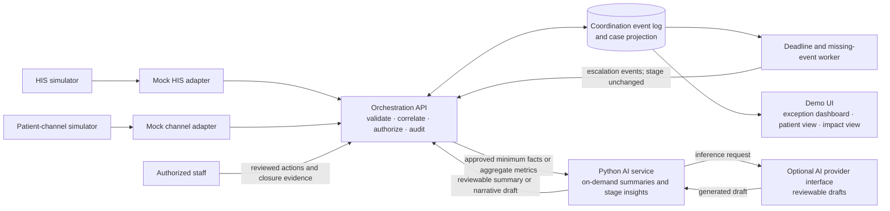

# CareLoop architecture

## Purpose and constraints

CareLoop is a coordination and accountability layer around existing provider systems. The prototype uses simulators and synthetic identifiers; it does not connect to live endpoints or hold clinical records. Clinical interpretation, urgency, pathways, and closure requirements are supplied or approved by qualified humans. Deadlines remain configuration placeholders until approved.

The orchestration API is the authority for case state. It accepts events, validates and correlates them, applies idempotency and guarded transitions, records audit history, and exposes read models. The UI is read-only for coordination. Simulators produce events; they do not edit cases or clinical data directly.

## Component view



The event log is the source for audit and timeline reconstruction; the case projection supports worklist queries. FHIR-shaped exchange may be used at the adapter boundary, but the prototype's internal coordination model is not a clinical FHIR repository. The choice of relational database and local hosting method is still a team decision.

The backend coordinates the ten-stage journey. The Python AI service is invoked on demand for the FR-11 clinician handoff summary and, as governed extensions, patient-friendly drafts, reviewed English-to-UAE-Arabic translation, and descriptive narratives over backend-computed aggregate metrics. It does not create tasks, assign owners, monitor deadlines, advance stages, calculate metrics, send messages, or write case state. Outputs are drafts with source references and require authorized human review. The .NET API remains the case-state, authorization, audit, and closure gate. See the [AI specification](ai-spec.md).

## Ten-stage case lifecycle

Stages advance only on validated, authorized events. Supporting events and exception flags do not create extra stages.

| # | Stage | Entry / progression evidence |
|---|---|---|
| 1 | `RESULT_RECEIVED` | Synthetic screening result arrives through the HIS adapter. |
| 2 | `CASE_CREATED` | Result is validated and deduplicated; one coordination case is opened. |
| 3 | `OWNER_ASSIGNED` | A coordinator is assigned or the case enters an accountable facility lead queue. |
| 4 | `PATIENT_NOTIFIED` | Channel simulator reports delivery; delivery is not acknowledgement. |
| 5 | `PATIENT_ACKNOWLEDGED` | Patient acknowledgement and any separately recorded understanding are captured. |
| 6 | `CONSULTATION_PENDING` | A consultation or handoff request is recorded with its proposed owner. |
| 7 | `FOLLOW_UP_IN_PROGRESS` | Referral and appointment events are correlated; acceptance is not completed care. |
| 8 | `CARE_OUTCOME_DOCUMENTED` | An authorized source supplies an outcome event and clinical record reference. |
| 9 | `CLOSURE_REVIEW` | Evidence or an authorized exception is awaiting a human closure decision. |
| 10 | `CLOSED` | An authorized closure event with typed reason and evidence is accepted and audited. |

Notification, consultation, referral, and appointment have their own sub-statuses. A failed or unacknowledged message, rejected referral, missed appointment, or overdue action creates an owned task/exception without erasing the case or advancing it to closure. Owner transfer is an offer followed by explicit acceptance; until acceptance, the sender remains accountable.

## Event exchange

This sequence is an implementation guide, not a finalized schema. Agree the shared envelope and event-specific payloads in `contracts/` before producers and consumers implement them.

```mermaid
sequenceDiagram
    actor Staff as Authorized clinician/coordinator
    participant HIS as HIS simulator
    participant API as Orchestration API
    participant Store as Coordination store
    participant AI as Python AI service
    participant Channel as Patient-channel simulator
    participant Worker as Deadline worker
    participant UI as Demo UI

    HIS->>API: Result event (source, patient, result, reviewed urgency)
    API->>API: Validate, correlate, deduplicate
    API->>Store: Append event, create case, assign owner or queue
    API->>AI: Approved report facts and recorded stage outcomes
    AI-->>API: Source-linked clinician handoff summary draft
    Staff->>API: Review, edit, approve, or reject draft
    API->>Store: Audit review decision
    API-->>Channel: Approved simulated communication request
    Channel->>API: Delivery / failure / acknowledgement / call request
    API->>Store: Append attributed event; update coordination projection
    HIS->>API: Consultation, referral, appointment, outcome events
    API->>Store: Validate evidence and append correlated events
    Worker->>Store: Check approved clocks and missing events
    Worker->>API: Owned escalation event (does not advance stage)
    UI->>API: Read case, timeline, exceptions, synthetic metrics
    API->>AI: Precomputed, privacy-reviewed aggregate metrics (scheduled)
    AI-->>API: Descriptive stage-insight narrative draft
    Staff->>API: Review narrative before publication
    Staff->>API: Authorized decision with evidence or documented exception
    API->>Store: Guard transition, append audit; close only if valid
```

## Cross-cutting invariants

- Preserve source system, source event, patient reference, result reference, occurrence time, and actor provenance.
- Replayed source identifiers are idempotent. Conflicting corrections or identity mismatches require visible human review.
- Every open next action has an owner or a named accountable queue; assignment and acceptance are explicit.
- A referral sent or accepted, an appointment booked, a message delivered, or an escalation acknowledged does not prove care was received.
- Patient receipt, understanding, help request, and consent are distinct. A caregiver's action is attributed to the caregiver and limited to approved permissions.
- Clinical records stay in source systems. The coordination store keeps references, evidence references, workflow status, deadlines, and audit events.
- Only an authorized human can record a clinical disposition or close a case; the API enforces the gate and records the decision.
- Python returns source-linked summary and narrative drafts only. It cannot diagnose, set urgency, infer consent, send patient messages, accept referrals, change case state, calculate metrics, or close cases.
- Deadline checks are deterministic and configured from approved rules. Missing configuration must surface review work rather than inventing a deadline or urgency.
- Mark all simulator data, AI drafts, and impact metrics as synthetic. Report cohort denominators and assumptions; do not claim real clinical improvement.

## Decisions to resolve as a team

Before implementation depends on them, record the chosen relational database, local orchestration/hosting approach, event envelope and versioning, identity/role model for the demo, pathway clock/evidence configuration, and who reviews patient-facing language. Until approved, these remain open; no production integration or credentials belong in this repository.
