# UI design

One flow, 22 screens and a guide to who sees what, for CareLoop, ready to build. Together they cover user stories US01 to US16 and every point of Challenge 05, Closing the Screening-to-Care Loop. Every person, number and facility shown is invented.

- Screens 1 to 13 are grouped by the component that builds them: 1 to 4 in the CareLoop web app, 5 to 8 in the HIS simulator, 9 to 12 in the patient-channel simulator, and 13 across all of them.
- Screen 14 is the guide to who sees what.
- Screens 15 to 23 follow one patient, Hessa Al Dhaheri, from her first visit to the all clear. Screens 22 and 23 come after the screening case closes: they are the target design, not part of the hackathon build.

The ten stages on screen are display labels. The code has five stages and four tracks, and the [flow table](#flow) maps one to the other.

On GitHub, open [ui-design.pdf](ui-design.pdf) to see every screen at full size; its text can be copied. GitHub shows HTML files as code rather than as pages, so to inspect exact sizes, spacing and colours, download [ui-design.html](ui-design.html) and open it in a browser.

## Decisions of 13 November

The design follows the seven decisions in the [UI design gap analysis](../ui-design-gap-analysis.md), section 5, and the team's decision on Arabic. Updates P1 to P18 from section 4 of the gap analysis are made in this document and in the screens.

| # | Decision | What changed in the design |
|---|---|---|
| 1 | Five stages in code; the ten on screen are display labels | The flow table maps each label to its stage and track status. The flow has a row "In code". |
| 2 | The patient does not confirm appointments. "I will come" is an acknowledgement. | Screens 9, 10, 12 and 14 say "she will come", which sends `NotificationUpdated/Acknowledged` only. |
| 3 | Build the confidence rating | Screen 10 sends `NotificationUpdated/ConfidenceRated`, from 1 to 5. Screen 3 reports it. |
| 4 | The AI handoff summary is approved in the CareLoop web app | New screen 18. Screen 6 shows the approved summary, read-only. |
| 5 | Add the roles `nurse-navigator`, `receiving-clinician` and `lab` | Who sees what gives each person their role in CareLoop. |
| 6 | Separate reply deadlines for consultations and referrals | Screens 4 and 5 show them, as placeholders. |
| 7 | Build caregiver consent | Screens 12 and 15 show how consent is given, used and withdrawn. The email is shown in the simulator, not sent. |
| Arabic | The prototype is in English and supports more than one language from the start. Arabic is added once its translations are checked. Agreed in the team chat. | Screen 11 is the target design for Arabic. Screens 9, 10 and 11 say so. |

## How the designs meet the challenge

| The challenge asks for | Where it is shown |
|---|---|
| End-to-end case visibility | Flow, 2 Case, and Hessa's journey on screens 15 to 23 |
| Clear ownership and timely progression | 1 Worklist, 2 Case, 4 Programmes, 17 Escalation |
| Patient-centred communication and reassurance | 9 Basic phone, 10 Patient view, 11 Arabic, 12 Caregiver and email, 20 Lab result, 21 Diagnosis and plan |
| Cross-provider consultation and coordination | 5 Consultation, 6 Refer to a unit, 7 Accept or decline a referral, 18 Handoff summary, 19 Assessment and biopsy |
| Safe, human-governed escalation and closure | 2 Case, 8 Close the case, 13 Empty and error states, 17 Escalation, 18 Handoff summary |
| Closure and patient impact measures | 3 Impact |

| Judging criterion | How the designs support it |
|---|---|
| Health impact and clinical relevance | Impact reports the measures the challenge names, against the same cases replayed with escalation off. Breast screening deadlines come from the DoH standard. |
| Technical depth and architecture | Every screen maps to the five stages in code, the events it sends and the endpoints it reads. |
| Working solution and demonstration quality | One continuous story follows Hessa from her first visit to the all clear, with real dates and named people. |
| Responsible AI, safety and data governance | AI only drafts, and a named person approves it in CareLoop (screen 18). Every line of a draft shows its source, and AI never writes the assessment. Each person sees only what their part of the care needs ([Who sees what](#who-sees-what)), and screen 13 shows the safety states. |
| Scalability and deployment readiness | A new programme is a settings file, not new code (screen 4). Every message and screen supports more than one language from the start, so Arabic needs no new code (screen 11). |
| Commercial viability and path to pilot | CareLoop works with existing hospital systems, basic phones and the health app patients already use. |

## Flow

Every case, in every screening programme, moves through the same ten stages on screen. In the code these are five stages (`CaseStage`) and four tracks that run side by side: notification, consultation, referral and appointment. A stage moves on only when its event arrives. Late or missing work creates a task with a named owner and escalates: a reminder to the owner, then the facility lead, then the programme coordinator. Urgent cases skip the reminder.

| # | Shown as | Stage in code | What puts the case here |
|---|---|---|---|
| 1 | Result received | `Received` | `ScreeningResultReceived` |
| 2 | Case opened | `Received` | `ScreeningResultReceived`, matched on source and result number, so a resent result opens no second case |
| 3 | Owner assigned | `ReviewPending` | An owner named by the programme's rules, or the facility lead's queue (`Unassigned`) |
| 4 | Patient notified | `FollowUpActive` | `ClinicalReviewCompleted`, then `NotificationUpdated/Delivered` or `/Failed` |
| 5 | Patient acknowledged | `FollowUpActive` | `NotificationUpdated/Acknowledged` or `/Understood` |
| 6 | Consultation | `FollowUpActive` | `ConsultationUpdated/Requested`, `/OwnerProposed`, `/Accepted`, `/Rejected` or `/OutcomeRecorded` |
| 7 | Follow-up | `FollowUpActive` | `ReferralUpdated/Sent`, `/Accepted` or `/Rejected`, and `AppointmentUpdated/Scheduled`, `/Attended` or `/Missed` |
| 8 | Outcome recorded | `ClosureReview` | `OutcomeRecorded` |
| 9 | Closure review | `ClosureReview` | Nothing new: the case waits for an authorised person to decide |
| 10 | Closed | `Closed` | `ClosureDecided` |

How the web app chooses the label (C9):

- Labels 1 to 3 and 8 to 10 follow the stage in code.
- In `FollowUpActive`, the tracks run side by side, so the label shows the furthest step reached: Follow-up once a referral or appointment exists, otherwise Consultation once one is requested, otherwise Patient acknowledged once the notification track is `Acknowledged` or `Understood`, otherwise Patient notified. Screen 2 shows each track's own status.

Some events can arrive at any stage without moving it: `NotificationUpdated/CallRequested` adds a call-back task, `NotificationUpdated/ConfidenceRated` adds a rating, and `ConsentRecorded/Granted` or `/Withdrawn` starts or stops messages to a family member. CareLoop also raises two events itself: `DeadlineElapsed` for reminders and escalations, and `HandoffSummaryApproved` when a person approves a summary (screen 18).

## Who sees what

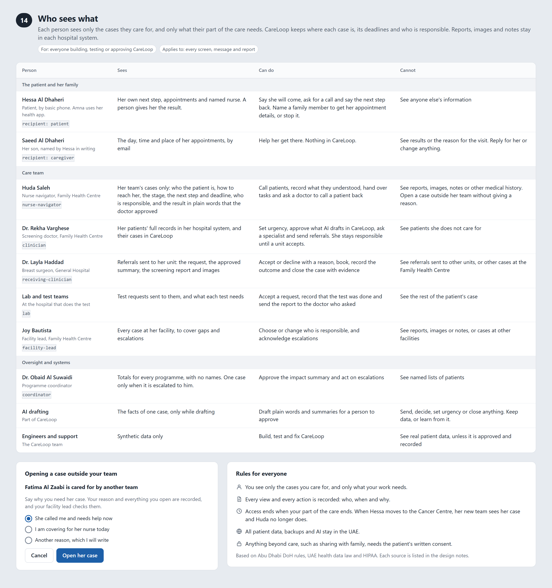

Each person sees only the cases they care for, and only what their part of the care needs. CareLoop keeps where each case is, its deadlines, who is responsible and links to records. Reports, images and notes stay in each hospital system, under that system's own access rules.

| Person | Role in CareLoop | Sees | Can do | Cannot |
|---|---|---|---|---|
| Patient: Hessa by basic phone, Amna in her health app | None. A recipient of messages (`Patient`). | Her own next step, appointments and named nurse. A person gives her the result. | Say she will come, ask for a call and say the next step back. Name a family member to get her appointment details, or stop it. | See anyone else's information |
| Family member the patient named in writing: Saeed | None. A recipient of messages (`Caregiver`), only while her consent is active. | The day, time and place of her appointments, by email | Help her get there. Nothing in CareLoop. | See results or the reason for the visit. Reply for her or change anything. |
| Nurse navigator: Huda | `nurse-navigator` | Her team's cases only: who the patient is, how to reach her, the stage, the next step and deadline, who is responsible, and the result in plain words that the doctor approved | Call patients, record what they understood, hand over tasks and ask a doctor to call a patient back | See reports, images, notes or other medical history. Open a case outside her team without giving a reason. |
| Screening doctor: Dr. Rekha | `clinician` | Her patients' full records in her hospital system, and their cases in CareLoop | Set urgency, approve what AI drafts in CareLoop, ask a specialist and send referrals. She stays responsible until a unit accepts. | See patients she does not care for |
| Receiving doctor: Dr. Layla | `receiving-clinician` | Referrals sent to her unit: the request, the approved summary, the screening report and images | Accept or decline with a reason, book, record the outcome and close the case with evidence | See referrals sent to other units, or other cases at the Family Health Centre |
| Lab and test teams | `lab` | Test requests sent to them, and what each test needs | Accept a request, record that the test was done and send the report to the doctor who asked | See the rest of the patient's case |
| Facility lead: Joy | `facility-lead` | Every case at her facility, to cover gaps and escalations | Choose or change who is responsible, and acknowledge escalations | See reports, images or notes, or cases at other facilities |
| Programme coordinator: Dr. Obaid | `coordinator` | Totals for every programme, with no names. One case only when it is escalated to him. | Approve the impact summary and act on escalations | See named lists of patients |
| AI drafting, inside CareLoop | None. Part of CareLoop. | The facts of one case, only while drafting | Draft plain words and summaries for a person to approve | Send, decide, set urgency or close anything. Keep data, or learn from it. |
| Engineers and support | None | Synthetic data only | Build, test and fix CareLoop | See real patient data, unless it is approved and recorded |

Others in Hessa's journey hold the same roles. Dr. Sara Al Hammadi, her family doctor (screen 15), is a `clinician`. Dr. Karim Nassar, her oncologist (screen 23), is a `receiving-clinician`. Mariam Al Kaabi, her cancer nurse navigator (screens 21 and 22), is a `nurse-navigator` at the Cancer Centre.

The rules behind the table:

- **Need to know.** Access depends on your role and the patients you care for, with the least access that does the job (DoH Standard on Patient Healthcare Data Privacy, 5.1 to 5.4; Federal Law No. 2 of 2019, Article 4; HIPAA, 45 CFR 164.502(b) and 164.514(d)). The API refuses any read that the role does not allow; hiding it on screen is not enough. Limiting reads to the person's team is C4, not built yet.
- **Everything is recorded.** Every view and action is logged with who, when and why, and the logs are checked (ADHICS; HIPAA, 45 CFR 164.312(b)). Logging each case read is C4, not built yet.
- **Outside your team needs a reason.** Opening a case you do not care for asks for a reason, which is logged and checked by the facility lead. In the DoH standard, an authorised user looking at data for an unauthorised purpose is a privacy breach. The prompt stays in the design. It has no endpoint yet, so it is proposed as part of C4 ([Proposed code items](#proposed-code-items)).
- **Access ends with your part of the care.** When Hessa moves to the Cancer Centre, Mariam Al Kaabi and Dr. Karim Nassar see her case, and Huda no longer does.
- **Data stays in the UAE.** All patient data, backups and AI processing stay in the UAE (DoH Standard, 4.1.4; Federal Law No. 2 of 2019, Article 13).
- **Written consent for anything beyond care.** Sharing with family, or research that names patients, needs the patient's written consent (DoH Standard, 4.2.3; Federal Law No. 2 of 2019, Article 16; HIPAA, 45 CFR 164.510(b)).
- **Automated calls check who answered.** When automated calls are added, a call gives no details until the person who answers says they are the patient.

## Screens

Names in this section are the ones in the code. Anything the code does not have yet is marked with its item number: C1 to C13 from the [gap analysis](../ui-design-gap-analysis.md), section 3, and C14 to C18 from [Proposed code items](#proposed-code-items).

Where each screen is built:

- CareLoop web app: `src/web`
- HIS simulator: `src/simulators/his/HisSimulator/ClientApp`
- Patient-channel simulator: `src/simulators/patient-channel/PatientChannelSimulator/ClientApp`

| # | Screen | Used by | Built in | Stories | Requirements |
|---|---|---|---|---|---|
| 1 | [Worklist](#1-worklist) | Care coordinators, nurse navigators and facility leads | CareLoop web app | US05, US13, US16 | FR-07, FR-09, FR-10 |
| 2 | [Case](#2-case) | Care team and clinicians | CareLoop web app | US01, US03, US08, US10, US13, US14, US16 | FR-02, FR-03, FR-06, FR-07 |
| 3 | [Impact](#3-impact) | Programme coordinators and facility leads | CareLoop web app | US16 | FR-09 |
| 4 | [Programmes](#4-programmes) | Programme coordinators and clinical advisers | CareLoop web app | US13, US14 | FR-03, FR-07 |
| 5 | [Consultation](#5-consultation) | Clinicians | HIS simulator | US05, US07 | FR-05 |
| 6 | [Refer to a unit](#6-refer-to-a-unit) | Referring clinicians | HIS simulator | US06, US07 | FR-05, FR-11 |
| 7 | [Accept or decline a referral](#7-accept-or-decline-a-referral) | Receiving clinicians, labs and appointment teams | HIS simulator | US08, US09, US10 | FR-05, FR-06 |
| 8 | [Close the case](#8-close-the-case) | Authorised clinicians | HIS simulator | US11, US12, US14, US15 | FR-08 |
| 9 | [Basic phone, no internet](#9-basic-phone-no-internet) | Patients without a smartphone or internet | Patient-channel simulator | US02, US03 | FR-04 |
| 10 | [Patient view](#10-patient-view) | Patients with a smartphone | Patient-channel simulator | US02, US03, US05 | FR-04 |
| 11 | [Arabic, right to left](#11-arabic-right-to-left) | Arabic-speaking patients and families | Patient-channel simulator | US02, US03 | FR-04 |
| 12 | [Caregiver and email](#12-caregiver-and-email) | Family members a patient has named, and email users | Patient-channel simulator | US04, US10 | FR-04, FR-10 |
| 13 | [Empty and error states](#13-empty-and-error-states) | Everyone building or testing CareLoop | All components | US03, US13, US14, US15 | FR-01, FR-04, FR-07, FR-08, FR-11 |

Hessa's journey:

| # | Screen | Used by | Built in | Stories | In the hackathon build |
|---|---|---|---|---|---|
| 15 | [First visit](#15-first-visit) | Family doctors | HIS simulator | US01, US04 | Yes, with C14 |
| 16 | [Screening result](#16-screening-result) | Screening doctors | HIS simulator | US01, US02 | Yes |
| 17 | [Escalation](#17-escalation) | Facility leads | CareLoop web app | US13 | Yes, with C15 |
| 18 | [Approve the handoff summary](#18-approve-the-handoff-summary) | Referring and responsible clinicians | CareLoop web app | US06, US07 | Yes, with C9 and C16 |
| 19 | [Assessment and biopsy](#19-assessment-and-biopsy) | Assessment clinics | HIS simulator | US10 | Yes, with C17 |
| 20 | [Lab result](#20-lab-result) | Treating clinicians | HIS simulator | US10, US11 | Yes, with C17 and C18 |
| 21 | [Diagnosis and plan](#21-diagnosis-and-plan) | Treating clinicians | HIS simulator | US11, US12 | Yes, with C17 |
| 22 | [Treatment](#22-treatment) | Cancer nurse navigators | CareLoop web app | US12, US16 | No: target design |
| 23 | [All clear](#23-all-clear) | Treating clinicians | HIS simulator | US12, US15 | No: target design |

### 1. Worklist

- The exception dashboard in the solution design. Read-only; reads `GET /cases` and `GET /exceptions`. Showing only the signed-in person's team is C4.
- Sorted by risk: urgent and overdue first, then by time left.
- Each row shows one next action, one responsible person and one due time. Status is always a word with a coloured dot.
- The filter chips are the exception queues: urgent, overdue (`Overdue`), declined (`Rejected`), not reached (`Unreachable`), not acknowledged (`Unacknowledged`) and needs a new owner (`Unassigned`). A case that needs a new owner stays with the facility lead until someone accepts it.

### 2. Case

- Read-only, except the AI handoff summary, which a clinician checks and approves from here (screen 18, C9). Reads `GET /cases/{id}` and `GET /cases/{id}/timeline`. Only the patient's care team can open it, and every view is logged (C4). Reports, images and notes are links into the hospital system, never copies.
- The next action shows its escalation ladder and who has acknowledged it (C15).
- The checklist shows what must happen before the next stage. Missing evidence blocks progress.
- The four tracks (notification, consultation, referral and appointment) each show their own status. Each timeline entry names its source system, which needs C3.

### 3. Impact

- Read-only. The "With escalation" numbers come from `GET /metrics`. The "Escalation off" numbers come from `POST /metrics/simulation`, which replays the same synthetic cases with reminders and escalation switched off. Both need the measures below, in the same shape for both (C5).
- The numbers show how the design works; they are not evidence of real-world improvement.
- The AI summary stays a draft until the programme coordinator approves it, and it names no patient.

| Measure | Counts | Out of | With escalation off |
|---|---|---|---|
| Next care step completed by the agreed deadline | Cases whose next step was done by its deadline | Cases whose deadline has passed | Shown |
| Unresolved actionable results | Open cases past their deadline | Open cases | Shown |
| Understood their next step | Patients who said it back correctly the first time (`Understood`) | Patients who acknowledged | Not measured |
| Time to patient told | Median working days from `ScreeningResultReceived` to the first `Acknowledged` | Cases that reached it | Shown |
| Time to consultation answered | Median working days from the result to `ConsultationUpdated/OutcomeRecorded` | Cases with a consultation | Shown |
| Time to confirmatory tests | Median working days from the result to the first `AppointmentUpdated/Attended` | Cases with an appointment | Shown |
| Time to care started | Median working days from the result to the `OutcomeRecorded` that shows treatment or surveillance started | Cases with that outcome | Shown |
| Referral accepted and attended | Referrals accepted, with the appointment attended | Referrals sent | Shown |
| Appointments attended | Appointments attended | Appointments whose time has passed | Shown |
| Treatment started by the deadline | People whose treatment started by its deadline | People who needed treatment | Shown |
| Closed with signed evidence | Cases closed by `ClosureDecided` with evidence | Closed cases | Not measured |
| Patient confidence | Average `ConfidenceRated` value, 1 to 5 | Answers given | Not measured |
| Cases that reached each stage | Cases that reached each of the ten labels | All actionable results | Shown |
| Why cases were delayed | Exceptions raised, by reason | All exceptions | Not shown |

### 4. Programmes

- Reads `GET /programmes` and `GET /programmes/{pathwayId}` (C1). Each programme is one versioned settings file: steps, deadlines, required evidence and owners.
- Breast screening deadlines cite the DoH clause they come from. Because every case is an actionable result, the report is due at once (DoH 3.8.1) and the patient is told within 1 working day (a placeholder inside the 15-day limit in DoH 3.7.1).
- Citations, the owner of each step and the change history need C2.
- "Other deadlines" are placeholders, one for each kind of reply (decision 6, C12): referral replies (`respond-to-referral`), questions between clinicians (`answer-consultation`) and patient call-backs (`call-patient`). Screens 1, 5 and 7 use them.
- Read-only. The clinical adviser approves changes outside CareLoop. "View change history" lists each version, and past cases keep the version they followed.

### 5. Consultation

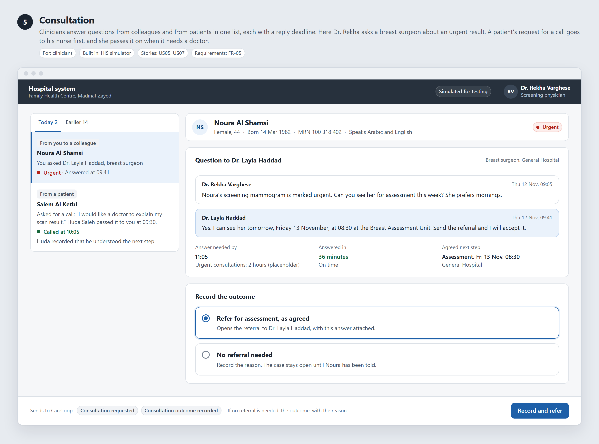

- Sends `ConsultationUpdated/Requested` and `ConsultationUpdated/OutcomeRecorded`. "Record and refer" opens screen 6 with the answer attached. If no referral is needed, the clinician records the reason with the outcome.
- A question from a colleague has a reply deadline from `answer-consultation`. The 2 hours shown for an urgent question is a placeholder (decision 6, C12).
- A patient's question arrives as `NotificationUpdated/CallRequested`. It gives her nurse a call-back task, due by the `call-patient` deadline, and the nurse passes it to a doctor when it needs one. A call-back has no "answered" event: after the call, the nurse records `Acknowledged` or `Understood`.
- The HIS simulator needs consultation request and answer actions (C6).

### 6. Refer to a unit

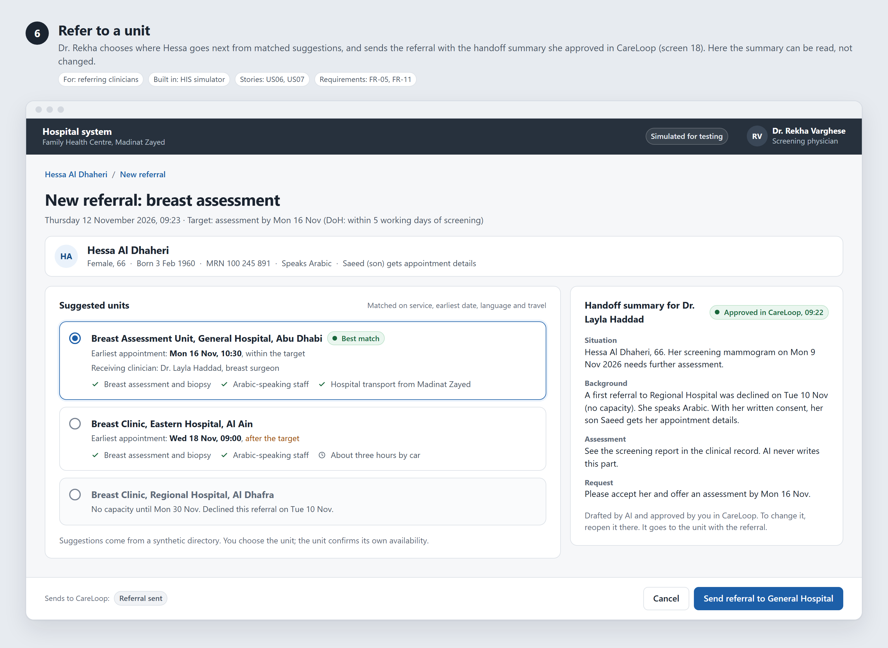

- Sends `ReferralUpdated/Sent`.
- The handoff summary is approved in CareLoop on screen 18 (decision 4) and is read-only here. The HIS receives it as a FHIR `DocumentReference`. If it is not approved yet, the screen says so.
- Suggested units come from a synthetic directory. The clinician chooses, and the unit confirms its own availability.
- The HIS simulator needs a referral action (C6).

### 7. Accept or decline a referral

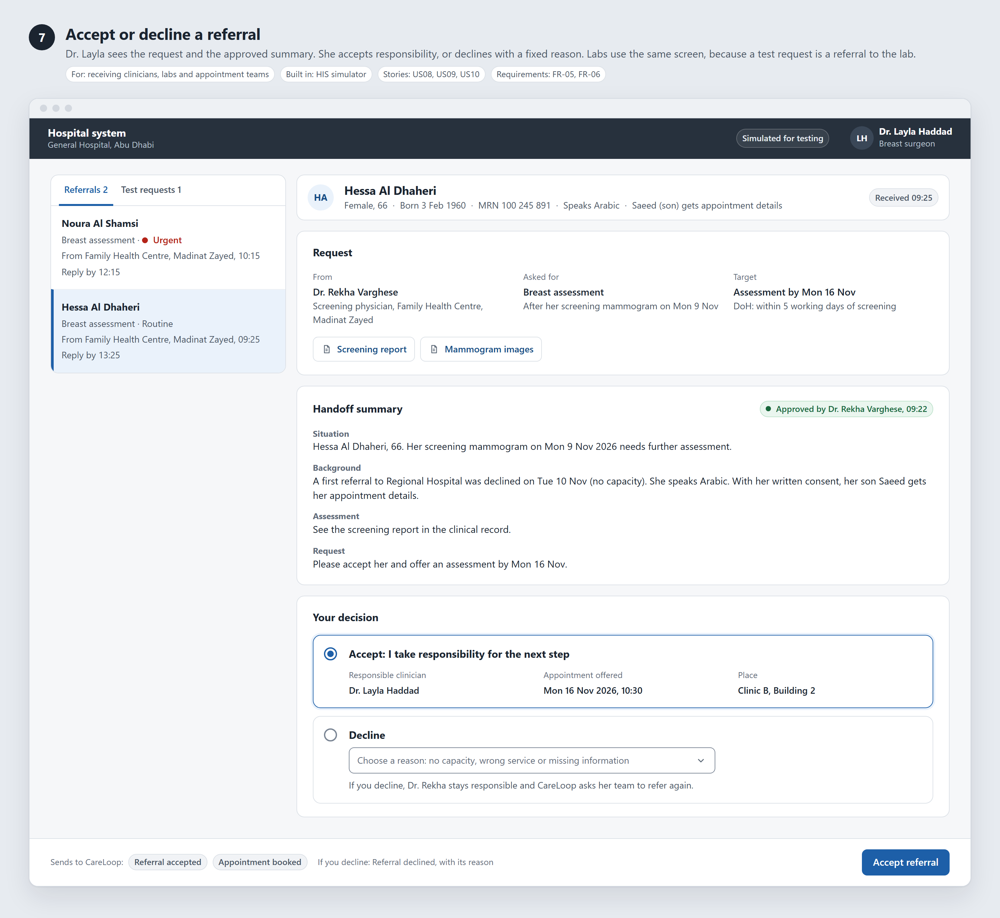

- Sends `ReferralUpdated/Accepted` and `AppointmentUpdated/Scheduled`, or `ReferralUpdated/Rejected` with a reason: no capacity, wrong service or missing information.
- Choosing "Decline" sends only `ReferralUpdated/Rejected`; nothing is booked. Until a unit accepts, the sender stays responsible.
- Labs use the same screen, because a test request is a referral to the lab. The lab accepts it and records that the test was done.
- The reply deadline is `respond-to-referral`, a placeholder. The HIS simulator needs an appointment action (C6).

### 8. Close the case

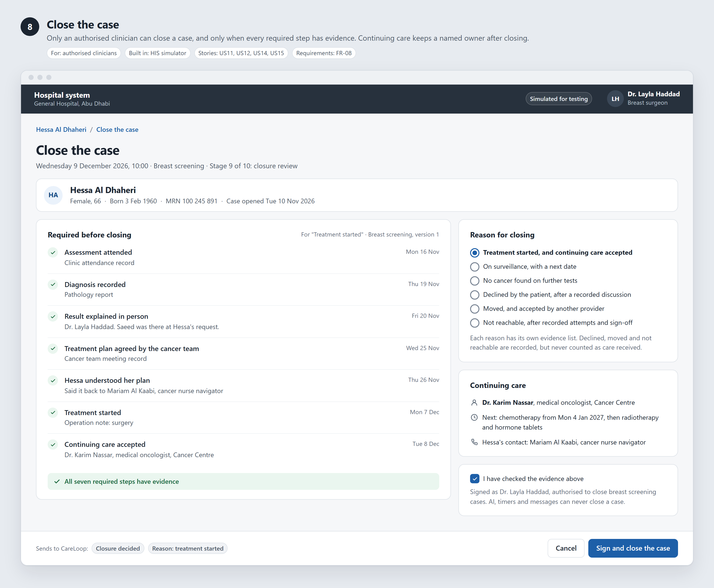

- Sends `ClosureDecided` with a reason: treatment started (`Treated`), surveillance (`OnSurveillance`), negative on confirmation (`NegativeOnConfirmation`), declined (`Declined`), transferred (`TransferredAndAccepted`) or untraceable (`Untraceable`). Each reason has its own evidence list in the programme's closure rules.
- Declined, transferred and untraceable are recorded as exceptions and never counted as care received. Untraceable also needs documented attempts and a note.
- Closing is blocked until every required step has evidence, each recorded by `OutcomeRecorded`. Continuing care keeps a named owner after the case closes.

### 9. Basic phone, no internet

- Delivery sends `NotificationUpdated/Delivered`, and failure `/Failed`. The nurse's call records `/Acknowledged`, and saying the next step back records `/Understood`.
- Replying 1 sends `/Acknowledged` (she will come), and 2 sends `/CallRequested`. Replies need two-way texts: C7 in the simulator, and an agreement with the text provider in production.
- A person gives results. Texts carry only dates and places, with no links, and come from a number the patient can reply to.
- Automated calls are future work: there is no voice channel in `NotificationChannel`. The screen shows how they would work.
- Texts are in English in the prototype (screen 11).

### 10. Patient view

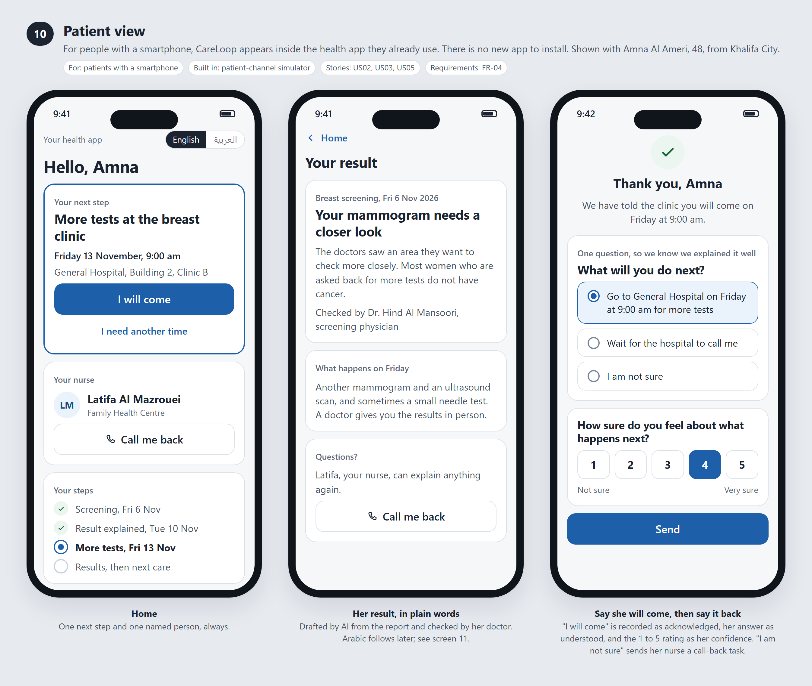

- Shown inside the health app the patient already uses. It is not a new app.
- Reads the stage and next step of the case. "I will come" sends `NotificationUpdated/Acknowledged` only (decision 2). "Call me back", "I need another time" and "I am not sure" send `/CallRequested`. Saying the next step back sends `/Understood`, and the rating sends `/ConfidenceRated` with a value from 1 to 5 (decision 3, C10).
- Acknowledgement and understanding are recorded separately.

### 11. Arabic, right to left

- Deferred: this is the target design. The prototype runs in English, and every template and screen is keyed by language from the start, as `AGENTS.md` requires, so Arabic needs no new code.
- Arabic is added once a qualified bilingual reviewer approves the wording ([AI specification](../ai-spec.md), section 2.3). The wording shown is a draft.
- The same screens and events as 9 and 10. Set `dir="rtl"` and use logical CSS properties (start and end, not left and right).
- An Arabic text holds 70 characters, or 67 per part when split, so Arabic templates are shorter. The reminder shown is 128 characters: two messages.

### 12. Caregiver and email

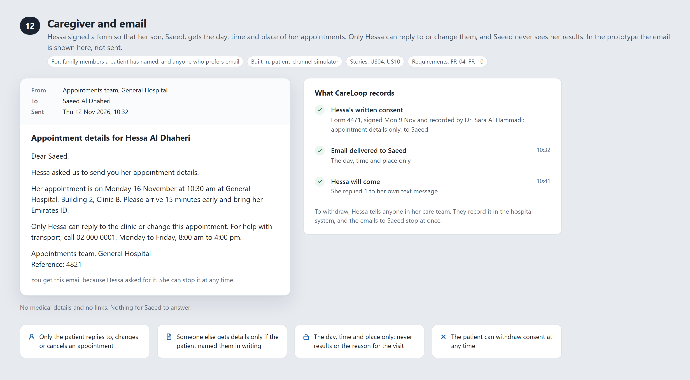

- In scope (decision 7). Only the patient replies to the clinic or changes an appointment. A family member never does this for her, so the email asks for no reply and sends no event that changes the case.
- Consent is a `Consent` on the case, recorded by `ConsentRecorded/Granted` with a reference to the signed form (C13). The family member is a recipient (`Caregiver`), not a user, and gets the day, time and place only, while consent is active: no results, no reason for the visit and no links (DoH Standard on Patient Healthcare Data Privacy, 4.2.3; Federal Law No. 2 of 2019, Article 16).
- Giving consent: the patient signs a form with her doctor, who records it in the hospital system (screen 15). CareLoop receives it when her case opens (C14).
- Withdrawing consent: the patient tells anyone in her care team, who records it in the hospital system. That sends `ConsentRecorded/Withdrawn`, and the emails stop at once.
- In the prototype, the email is shown in the patient-channel simulator, not sent. CareLoop records each email as a notification attempt.

### 13. Empty and error states

| State | Rule | Requirement |
|---|---|---|
| Nothing to do | The worklist says what is on track and when the next deadline is. If cases fail to load, it says so instead. | FR-09 |
| Patient not reached | A failed or unanswered contact becomes a task with an owner and a deadline. | FR-04, FR-07 |
| Same result received twice | Results are matched on source and result number, so a resent result never opens a second case. | FR-01 |
| No AI draft | If AI is off, slow or fails a check, screen 18 shows no draft at all. A person writes the summary, and every step still works ([AI specification](../ai-spec.md), section 5). | FR-11 |
| Closing blocked | The close button stays off until every step has evidence. | FR-08 |
| No internet | The app keeps the last next step on the phone, with when it was updated, a warning that it may have changed and a number to call. Offline storage belongs to the health app, not to CareLoop or the simulators. | FR-04 |

### 15. First visit

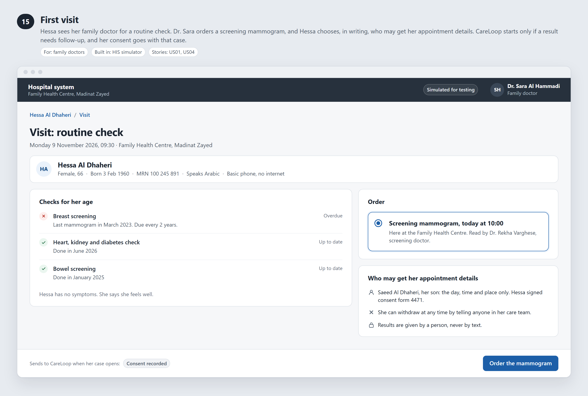

- Dr. Sara orders a screening mammogram, and Hessa chooses in writing who may get her appointment details.
- Nothing goes to CareLoop yet: CareLoop starts only when a result needs follow-up. Her consent goes to CareLoop as `ConsentRecorded/Granted` when her case opens (C14).

### 16. Screening result

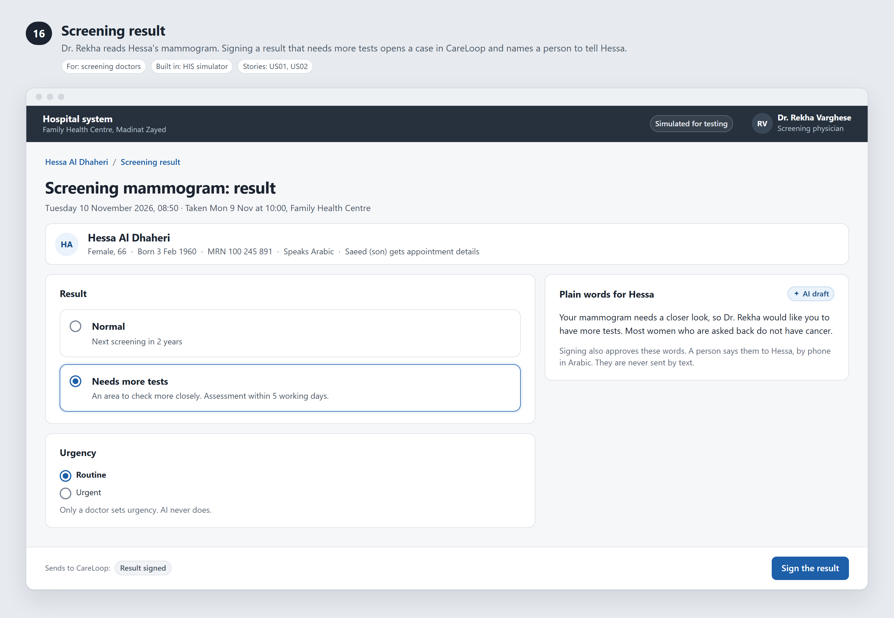

- Signing sends the result (`ScreeningResultReceived`) and the doctor's review with its urgency (`ClinicalReviewCompleted`). Only a doctor sets urgency; AI never does.
- The plain words for Hessa are an AI draft, approved by signing and said to her by a person. They are never sent by text.
- A normal result opens no case.

### 17. Escalation

- When a deadline passes, CareLoop raises an escalation (`DeadlineElapsed`) to the next person on the ladder. Here Hessa's new referral is late, so it goes to Joy, the facility lead.
- Joy sees the ladder and what happened, and acknowledges it. Acknowledging needs C15: today an escalation ends only when the late step is done.
- Reads `GET /cases/{id}` and its timeline, like screen 2.

### 18. Approve the handoff summary

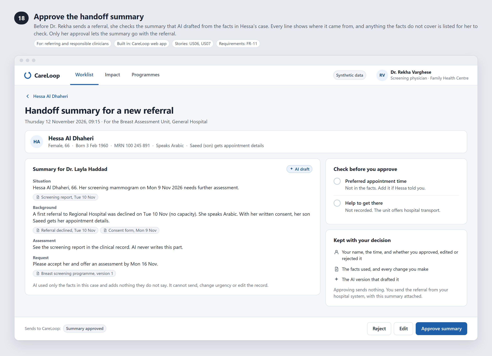

- In the CareLoop web app, opened from the case (decision 4, C9). `POST /cases/{caseId}/handoff-summary` drafts it, and `POST /cases/{caseId}/handoff-summary/{summaryId}/approval` approves it and records `HandoffSummaryApproved`.
- Every line shows the facts it came from, and anything the facts do not cover is listed for the clinician to check. AI never writes the assessment part ([AI specification](../ai-spec.md), sections 2.1 and 7).
- The clinician approves, edits or rejects the draft. Her edits go with the approval. Rejecting, and writing the summary herself, needs C16. Her name, the time, the facts used, her changes and the AI version are kept with her decision.
- Approving sends nothing. She sends the referral from her hospital system (screen 6), with the approved summary attached.
- If there is no draft, she writes the summary herself (screen 13).

### 19. Assessment and biopsy

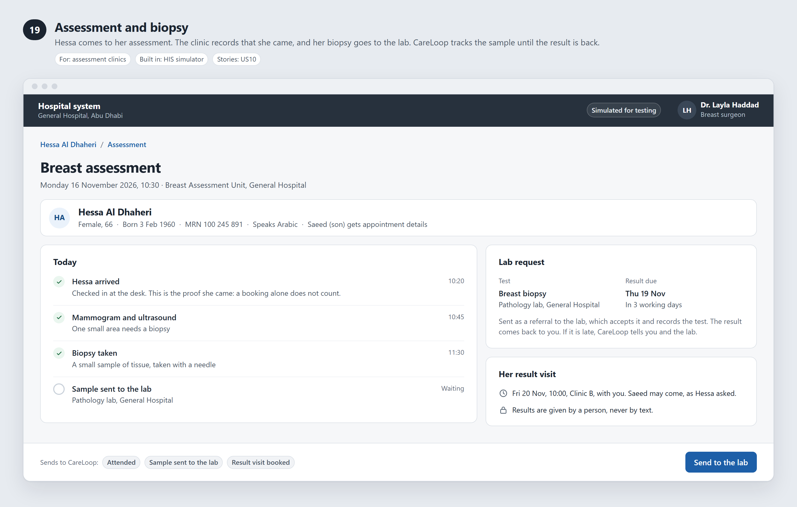

- Sends `AppointmentUpdated/Attended`: the proof she came, because a booking alone does not count.
- The biopsy goes to the lab as a referral (`ReferralUpdated/Sent`), and her result visit is booked (`AppointmentUpdated/Scheduled`). These are the case's second referral and second appointment, which need C17.

### 20. Lab result

- The lab's report stays in the hospital system. CareLoop is told only that it is back, as `OutcomeRecorded`.
- Dr. Layla must review it in time, or CareLoop reminds her. That review deadline needs C18.
- The plain words are an AI draft that her signature approves. She says them to Hessa in person; they are never sent by text.

### 21. Diagnosis and plan

- Sends `OutcomeRecorded` for the diagnosis, the plan and, later, the first treatment: the evidence that screen 8 needs.
- Mariam, a cancer nurse navigator, becomes Hessa's named contact, and Huda's access ends. The hand-over to the Cancer Centre is a referral for treatment, which needs C17.

### 22. Treatment

- Target design, not in the hackathon build: care after the screening case closes.
- Keeps every treatment, owner and appointment in one place until Hessa finishes.

### 23. All clear

- Target design, not in the hackathon build.
- Dr. Karim tells Hessa in person that there is no sign of cancer, and her follow-up is planned with one named contact.

## Proposed code items

The journey screens and the AI specification raise six gaps that C1 to C13 do not cover. Each one is proposed for the engineering team to accept, change or turn down.

| # | Screens | Gap | Proposed change | Workstreams |
|---|---|---|---|---|
| C4, added | 14 | Opening a case outside your team asks for a reason, which has no endpoint (P4) | Keep the prompt. Add the reason to the case read in C4, and record it in the same audit entry as the view. | WS6 |
| C14 | 12, 15 | Consent is given at the first visit, before any case exists | The HIS simulator records consent and its withdrawal, and sends `ConsentRecorded` when the case opens | WS3, WS7 |
| C15 | 2, 17 | An escalation cannot be acknowledged | Record who acknowledged an escalation, and when, from the web app | WS1, WS5, WS6 |
| C16 | 18 | A draft summary cannot be rejected | Add a rejected status with a reason, and record whether the approved text was edited | WS6, WS9 |
| C17 | 19, 20, 21 | A case holds one referral and one appointment | Allow more than one of each: the lab referral, the result visit and the referral for treatment | WS1, WS2, WS3, WS6 |
| C18 | 20 | No deadline to review a follow-up result | Add a review step with a placeholder deadline for the receiving clinician | WS1, WS5 |

## Design system

### Type scale

| Size | Used for |
|---|---|
| 13 px | Captions and labels on staff screens |
| 14 px | Controls, secondary text and patient fine print |
| 15 px | Body text on staff screens |
| 16 px | Body text on patient screens; card titles on staff screens |
| 18 px | Patient buttons and names |
| 20 px | Section titles on staff screens; questions on patient screens |
| 22 px | Card titles on patient screens |
| 24 px | Page titles on patient screens |
| 28 px | Page titles |
| 40 px | Headline numbers |

Type is Segoe UI, falling back to the system font. All spacing is a multiple of 4 px.

### Colours

| Name | Value | Used for |
|---|---|---|
| Accent | `#1D5FA8` | Links, selected items and main buttons |
| Text | `#1B2430` | Main text |
| Secondary text | `#4A5565` | Supporting text |
| Muted text | `#5F6B79` | Labels and captions |
| Field border | `#7A8594` | Inputs, selects and radio buttons |
| Lines | `#DCE1E7` | Borders and dividers |
| Page | `#F6F7F9` | Page background |
| Red | `#B42318` | Urgent, overdue and declined |
| Amber | `#9A4A06` | Not reached, not acknowledged and needs a new owner |
| Green | `#17663A` | Done and on track |
| Hospital system bar | `#27313D` | Header of the HIS simulator screens |

### Rules

- Sentence case for all text, and British spelling (programme, centre, authorised).
- One accent colour. Status is always a word with a coloured dot, never colour alone.
- Every case shows one next action, one responsible person and one due time.
- The same action always uses the same component: one main button per screen, and secondary choices as links or plain buttons.
- Staff screens use the 24-hour clock (15:00); patient messages use 9:00 am.
- Staff screens show two patient identifiers (name with date of birth or MRN), and the Emirates ID is always masked.
- Texts, automated calls and emails never contain results, diagnoses, body parts or links.
- AI output is labelled "AI draft" and needs a named person's approval. AI never sets urgency, sends messages or closes cases.
- Patient screens use 16 px text or larger and buttons at least 44 px tall, and are ready for right-to-left languages.
- Names from the code (stages, events and roles) appear only on the flow and on who sees what, in a monospace font. Product screens use plain words.
- Text meets WCAG 2.2 AA contrast (4.5:1), and field borders meet 3:1. Every text element was checked automatically.

## Assumptions and limitations

- Every person, number, facility and result is synthetic. No real patient data, systems or credentials are used.
- The hospital system and patient channels are simulated. No live link to Malaffi, a hospital system, SMS or email is claimed.
- Emails to a family member are shown in the patient-channel simulator, not sent. Automated calls are future work.
- The prototype runs in English. Arabic is added once a qualified bilingual reviewer approves the wording.
- Screens 22 and 23 show care after the screening case closes. They are the target design, not part of the hackathon build.
- Breast screening deadlines come from the DoH 2025 standard. All other deadlines are placeholders until a clinical adviser approves them.
- Impact numbers come from replaying the same synthetic cases with escalation off. They show how the design works, not real-world improvement.
- CareLoop does not diagnose, set urgency or make clinical decisions. AI only drafts, and a named person approves.

## Open questions

- Who approves the wording of the consent form for family members?
- Which roles may record that a patient withdraws consent? This design lets anyone in her care team record it in the hospital system, at her request.
- Who is the qualified bilingual reviewer for Arabic? The AI specification asks the same.
- The [AI specification](../ai-spec.md) names the receiving or responsible clinician as the reviewer of a handoff summary. This design has the referring clinician approve it before sending (screen 18), and the receiving clinician can decline for missing information (screen 7). Confirm this with the AI workstream.
- The placeholder reply deadlines differ: screen 4 shows 4 working hours for referrals, 1 working day for questions between clinicians and 2 working hours for call-backs, while the programme file uses 1 day for each. Agree one set until a clinical adviser approves them.
- The case closes when treatment starts, as in the solution design, and later care keeps a named owner. Confirm this with the clinical adviser.
- A patient who cannot decide for themselves is represented by a legal guardian. That needs its own design and a legal review.
- How long does CareLoop keep case records? Health records must be kept for at least 25 years after the last procedure (Federal Law No. 2 of 2019, Article 20).
- Who checks the access records, and how often: the facility lead or a privacy officer?
- The text, call and email providers need data agreements, and must keep data in the UAE.
