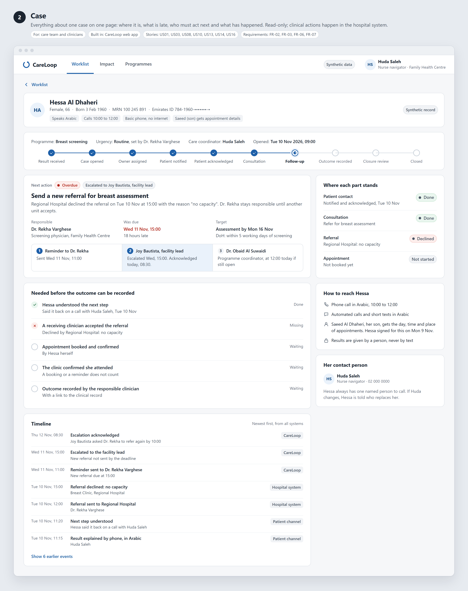
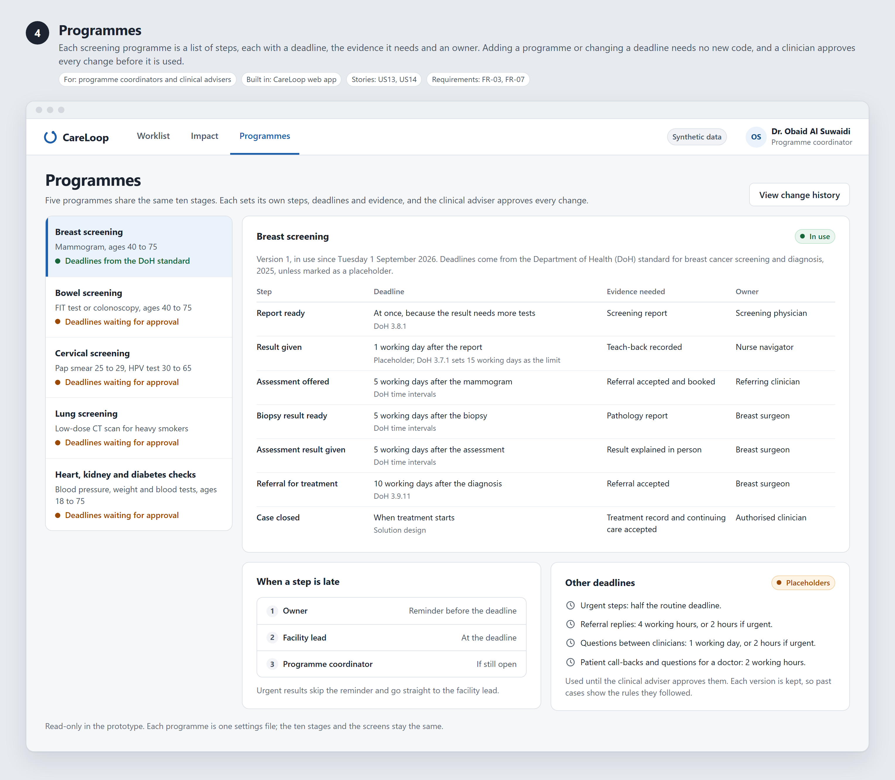
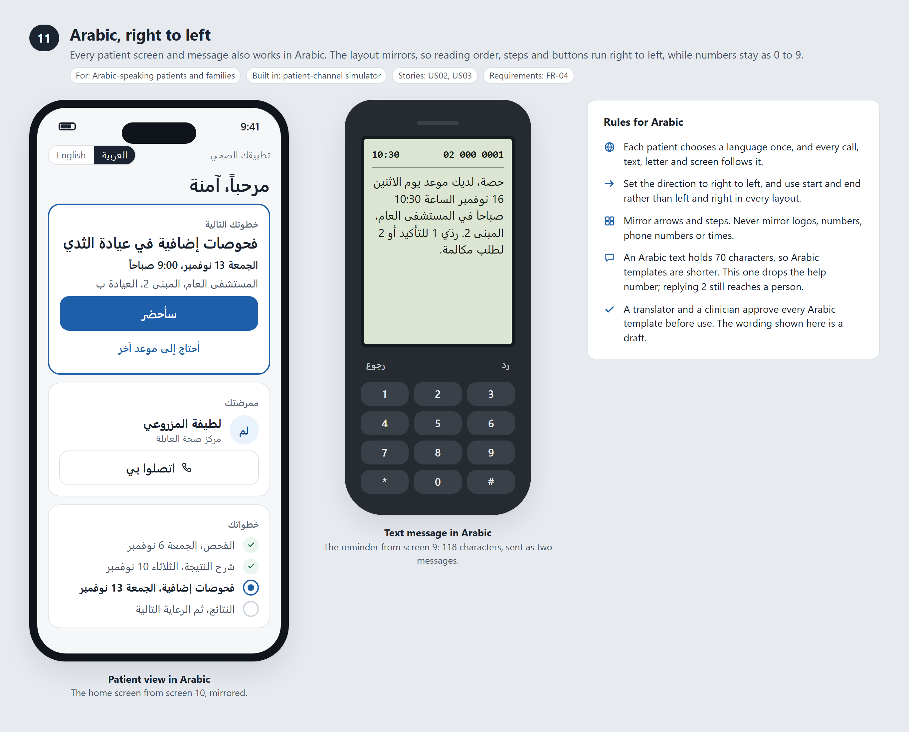
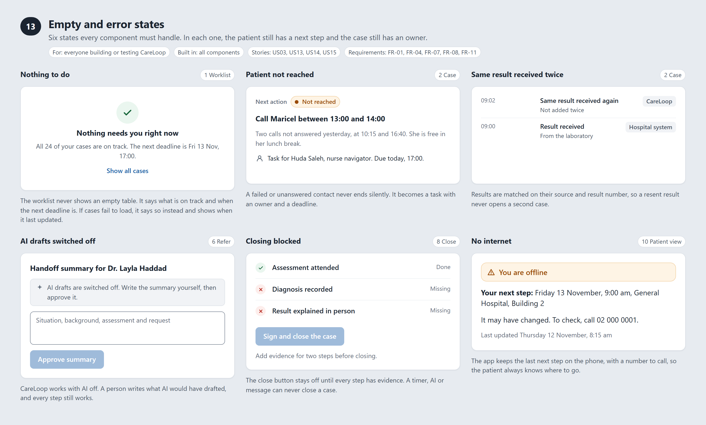

# UI design

One flow and thirteen screens for CareLoop, ready to build. They follow the ten-stage case lifecycle in [architecture.md](../architecture.md) and together cover user stories US01 to US16 and every point of Challenge 05, Closing the Screening-to-Care Loop. Every person, number and facility shown is invented.

Screens are grouped by the component that builds them: 1 to 4 in the CareLoop web app, 5 to 8 in the HIS simulator, 9 to 12 in the patient-channel simulator, and 13 across all of them.

On GitHub, open [ui-design.pdf](ui-design.pdf) to see every screen at full size; its text can be copied. GitHub shows HTML files as code rather than as pages, so to inspect exact sizes, spacing and colours, download [ui-design.html](ui-design.html) and open it in a browser.

## How the designs meet the challenge

| The challenge asks for | Where it is shown |
|---|---|
| End-to-end case visibility | Flow, 2 Case |
| Clear ownership and timely progression | 1 Worklist, 2 Case, 4 Programmes |
| Patient-centred communication and reassurance | 9 Basic phone, 10 Patient view, 11 Arabic, 12 Caregiver and email |
| Cross-provider consultation and coordination | 5 Consultation, 6 Refer to a unit, 7 Accept or decline a referral |
| Safe, human-governed escalation and closure | 2 Case, 8 Close the case, 13 Empty and error states |
| Closure and patient impact measures | 3 Impact |

| Judging criterion | How the designs support it |
|---|---|
| Health impact and clinical relevance | Impact reports the measures the challenge names, against the same cases replayed with escalation off. Deadlines come from the DoH breast screening standard. |
| Technical depth and architecture | Every screen maps to the ten stages, the events it sends and the endpoints it reads. |
| Working solution and demonstration quality | One continuous story runs through screens 1 to 12, with real dates and named people. |
| Responsible AI, safety and data governance | AI only drafts, and a named person approves. Access is limited by consent, and screen 13 shows the safety states. |
| Scalability and deployment readiness | A new programme is a settings file, not new code (screen 4). Arabic works from the start (screen 11). |
| Commercial viability and path to pilot | CareLoop works with existing hospital systems, basic phones and the health app patients already use. |

## Flow

Every case, in every screening programme, moves through the same ten stages. A stage moves on only when its event arrives. Late or missing work creates a task with a named owner and escalates: a reminder to the owner, then the facility lead, then the programme coordinator. Urgent cases skip the reminder.

| # | Shown as | Stage | Entry event |
|---|---|---|---|
| 1 | Result received | `RESULT_RECEIVED` | `ResultReceived` |
| 2 | Case opened | `CASE_CREATED` | `CaseCreated` |
| 3 | Owner assigned | `OWNER_ASSIGNED` | `OwnerAssigned` |
| 4 | Patient notified | `PATIENT_NOTIFIED` | `PatientNotified` |
| 5 | Patient acknowledged | `PATIENT_ACKNOWLEDGED` | `PatientAcknowledged` |
| 6 | Consultation | `CONSULTATION_PENDING` | `ConsultationRequested` |
| 7 | Follow-up | `FOLLOW_UP_IN_PROGRESS` | `FollowUpStarted` |
| 8 | Outcome recorded | `CARE_OUTCOME_DOCUMENTED` | `OutcomeDocumented` |
| 9 | Closure review | `CLOSURE_REVIEW` | `ClosureReviewRequested` |
| 10 | Closed | `CLOSED` | `ClosureAuthorised` |

## Screens

| # | Screen | Used by | Built in | Stories | Requirements |
|---|---|---|---|---|---|
| 1 | [Worklist](#1-worklist) | Care coordinators, nurse navigators and facility leads | `src/web` | US05, US13, US16 | FR-07, FR-09, FR-10 |
| 2 | [Case](#2-case) | Care team and clinicians | `src/web` | US01, US03, US08, US10, US13, US14, US16 | FR-02, FR-03, FR-06, FR-07 |
| 3 | [Impact](#3-impact) | Programme coordinators and facility leads | `src/web` | US16 | FR-09 |
| 4 | [Programmes](#4-programmes) | Programme coordinators and clinical advisers | `src/web` | US13, US14 | FR-03, FR-07 |
| 5 | [Consultation](#5-consultation) | Clinicians | `src/simulators/his` | US05, US07 | FR-05 |
| 6 | [Refer to a unit](#6-refer-to-a-unit) | Referring clinicians | `src/simulators/his` | US06, US07 | FR-05, FR-11 |
| 7 | [Accept or decline a referral](#7-accept-or-decline-a-referral) | Receiving clinicians, labs and appointment teams | `src/simulators/his` | US08, US09, US10 | FR-05, FR-06 |
| 8 | [Close the case](#8-close-the-case) | Authorised clinicians | `src/simulators/his` | US11, US12, US14, US15 | FR-08 |
| 9 | [Basic phone, no internet](#9-basic-phone-no-internet) | Patients without a smartphone or internet | `src/simulators/patient-channel` | US02, US03 | FR-04 |
| 10 | [Patient view](#10-patient-view) | Patients with a smartphone | `src/simulators/patient-channel` | US02, US03, US05 | FR-04 |
| 11 | [Arabic, right to left](#11-arabic-right-to-left) | Arabic-speaking patients and families | `src/simulators/patient-channel` | US02, US03 | FR-04 |
| 12 | [Caregiver and email](#12-caregiver-and-email) | Family members a patient has named, and email users | `src/simulators/patient-channel` | US04, US10 | FR-04, FR-10 |
| 13 | [Empty and error states](#13-empty-and-error-states) | Everyone building or testing CareLoop | All components | US03, US13, US14, US15 | FR-01, FR-04, FR-07, FR-08, FR-11 |

Event and endpoint names marked \* are proposed and not yet in the solution design. Agree them in [contracts](../../contracts/README.md) before building.

### 1. Worklist

- The exception dashboard in the solution design. Read-only; reads `GET /cases` and `GET /exceptions`.
- Sorted by risk: urgent and overdue first, then by time left.
- Each row shows one next action, one responsible person and one due time. Status is always a word with a coloured dot.
- The filter chips are the exception queues in the solution design: urgent, overdue, rejected (shown as "Referral declined"), unreachable ("Not reached"), unacknowledged ("Not acknowledged") and unassigned ("Needs a new owner"). A case that needs a new owner stays with the facility lead until someone accepts it.

### 2. Case

- Read-only; reads `GET /cases/{id}` and `GET /cases/{id}/timeline`.
- The next action shows its escalation ladder and who has acknowledged it.
- The checklist shows what must happen before the next stage. Missing evidence blocks progress.
- The four tracks (patient contact, consultation, referral and appointment) each show their own status, and every timeline entry names its source system.

### 3. Impact

- Read-only; reads `GET /metrics`.
- The headline measures are the three the team agreed: next care step completed by the clinically agreed deadline, unresolved actionable results and patient understanding.
- "Time to each step" and "Steps completed" report the challenge's measures: time to notification, consultation, confirmation and care; referral and appointment completion; treatment started; documented closure; and patient confidence. Each shows its denominator.
- "Escalation off" replays the same synthetic cases with reminders and escalation switched off. The numbers show how the design works; they are not evidence of real-world improvement.
- The AI summary stays a draft until the programme coordinator approves it, and it names no patient.

### 4. Programmes

- Reads the programme settings (`GET /programmes`\*). Each programme is one versioned settings file: steps, deadlines, required evidence and owners.
- Breast screening deadlines cite the DoH clause they come from. Because every case is an actionable result, the report is due at once (DoH 3.8.1) and the patient is told within 1 working day (a placeholder inside the 15-day limit in DoH 3.7.1).
- "Other deadlines" is one placeholder policy for urgent steps, referral replies, consultations and call-backs. Screens 1, 5 and 7 use it. Deadlines for other programmes are placeholders too.
- Read-only. Changes are approved by the clinical adviser outside CareLoop; "View change history" lists each version, and past cases keep the version they followed.

### 5. Consultation

- Sends `ConsultationRequested` and `ConsultationAnswered`\*. "Record and refer" opens screen 6 with the answer attached.
- One list holds questions from colleagues and from patients, each with a reply deadline. A patient's question arrives as `CallbackRequested`\*, passed on by their nurse when it needs a doctor, and is answered by phone.
- If no referral is needed, the clinician records the reason and the screen sends `ConsultationAnswered`\* only.
- Reply deadlines follow the placeholder policy on screen 4.

### 6. Refer to a unit

- Sends `SummaryApproved`\* and `ReferralSent`.
- Suggested units come from a synthetic directory. The clinician chooses, and the unit confirms its own availability.
- The AI handoff summary is a draft. Sending stays disabled until the clinician approves it, and AI never writes the assessment part.

### 7. Accept or decline a referral

- Sends `ReferralAccepted`\* and `AppointmentScheduled`\*, or `ReferralRejected` with a reason code: no capacity, wrong service or missing information.
- Choosing "Decline" sends only `ReferralRejected` with its reason; nothing is booked. Until a unit accepts, the sender stays responsible. Labs use the same screen for test requests.

### 8. Close the case

- Sends `ClosureAuthorised` with a typed reason: treatment started, surveillance, negative on confirmation, declined, transferred or untraceable. Each reason has its own evidence list.
- Declined, transferred and untraceable are recorded but never counted as care received. Untraceable also needs documented attempts and sign-off.
- Closing is blocked until every required step has evidence (`EvidenceAttached`). Continuing care keeps a named owner after the case closes.

### 9. Basic phone, no internet

- Sends `PatientNotified` on delivery and `NotificationFailed`\* on failure. The nurse's call records `PatientAcknowledged` and `TeachBackSubmitted`\*. Replying or pressing 1 sends `AppointmentConfirmed`\*, and 2 sends `CallbackRequested`\*.
- A person gives results. Texts and automated calls carry only dates and places, with no links, and come from a number the patient can reply to.

### 10. Patient view

- Shown inside the health app the patient already uses. It is not a new app.
- Reads the stage and next step of the case. Sends `PatientAcknowledged` and `AppointmentConfirmed`\* for "I will come"; `CallbackRequested`\* for "Call me back", "I need another time" or "I am not sure"; then `TeachBackSubmitted`\* and `ConfidenceRated`\*.
- Acknowledgement and understanding are recorded separately.

### 11. Arabic, right to left

- The same screens and events as 9 and 10. Set `dir="rtl"` and use logical CSS properties (start and end, not left and right).
- An Arabic text holds 70 characters, or 67 per part when split, so Arabic templates are shorter. The reminder shown is 118 characters: two messages.
- A translator and a clinician approve every Arabic template before use. The wording shown is a draft.

### 12. Caregiver and email

- Only the patient confirms, changes or cancels an appointment. A family member never does this for them, so the email asks for no reply and sends no event that changes the case.
- A family member gets appointment details only if the patient named them in writing, as DoH requires (Standard on Patient Healthcare Data Privacy, 4.2.3; Federal Law No. 2 of 2019, Article 16). They get the day, time and place only: no results, no reason for the visit and no links.
- CareLoop records the consent and each email sent. If the patient withdraws consent, the emails stop at once.

### 13. Empty and error states

| State | Rule | Requirement |
|---|---|---|
| Nothing to do | The worklist says what is on track and when the next deadline is. If cases fail to load, it says so instead. | FR-09 |
| Patient not reached | A failed or unanswered contact becomes a task with an owner and a deadline. | FR-04, FR-07 |
| Same result received twice | Results are matched on source and result number, so a resent result never opens a second case. | FR-01 |
| AI drafts switched off | A person writes what AI would have drafted, and every step still works. | FR-11 |
| Closing blocked | The close button stays off until every step has evidence. | FR-08 |
| No internet | The app keeps the last next step on the phone, with when it was updated, a warning that it may have changed and a number to call. | FR-04 |

## Design system

### Type scale

| Size | Used for |
|---|---|
| 13 px | Captions and labels on staff screens |
| 14 px | Controls, secondary text and patient fine print |
| 15 px | Body text on staff screens |
| 16 px | Body text on patient screens; card titles on staff screens |
| 18 px | Patient buttons and names |
| 20 px | Section titles on staff screens; questions on patient screens |
| 22 px | Card titles on patient screens |
| 24 px | Page titles on patient screens |
| 28 px | Page titles |
| 40 px | Headline numbers |

Type is Segoe UI, falling back to the system font. All spacing is a multiple of 4 px.

### Colours

| Name | Value | Used for |
|---|---|---|
| Accent | `#1D5FA8` | Links, selected items and main buttons |
| Text | `#1B2430` | Main text |
| Secondary text | `#4A5565` | Supporting text |
| Muted text | `#5F6B79` | Labels and captions |
| Field border | `#7A8594` | Inputs, selects and radio buttons |
| Lines | `#DCE1E7` | Borders and dividers |
| Page | `#F6F7F9` | Page background |
| Red | `#B42318` | Urgent, overdue and declined |
| Amber | `#9A4A06` | Not reached, not acknowledged and needs a new owner |
| Green | `#17663A` | Done and on track |
| Hospital system bar | `#27313D` | Header of the HIS simulator screens |

### Rules

- Sentence case for all text, and British spelling (programme, centre, authorised).
- One accent colour. Status is always a word with a coloured dot, never colour alone.
- Every case shows one next action, one responsible person and one due time.
- The same action always uses the same component: one main button per screen, and secondary choices as links or plain buttons.
- Staff screens use the 24-hour clock (15:00); patient messages use 9:00 am.
- Staff screens show two patient identifiers (name with date of birth or MRN), and the Emirates ID is always masked.
- Texts, automated calls and emails never contain results, diagnoses, body parts or links.
- AI output is labelled "AI draft" and needs a named person's approval. AI never sets urgency, sends messages or closes cases.
- Patient screens use 16 px text or larger and buttons at least 44 px tall, and work in Arabic from right to left.
- Text meets WCAG 2.2 AA contrast (4.5:1), and field borders meet 3:1. Every text element was checked automatically.

## Assumptions and limitations

- Every person, number, facility and result is synthetic. No real patient data, systems or credentials are used.
- The hospital system and patient channels are simulated. No live link to Malaffi, a hospital system, SMS or email is claimed.
- Breast screening deadlines come from the DoH 2025 standard. All other deadlines are placeholders until a clinical adviser approves them.
- Impact numbers come from replaying the same synthetic cases with escalation off. They show how the design works, not real-world improvement.
- Arabic wording is a draft until a translator and a clinician approve it.
- CareLoop does not diagnose, set urgency or make clinical decisions. AI only drafts, and a named person approves.

## Open questions

- Can texts be two-way, so patients can reply 1 or 2? The designs assume they can.
- Who checks the Arabic wording that AI drafts?
- The case closes when treatment starts, as in the solution design, and later care keeps a named owner. Confirm this with the clinical adviser.
- Deadlines other than the Department of Health (DoH) targets, including reply times for consultations, are placeholders until a clinical adviser approves them.
- The user stories (US04) let a caregiver act within approved permissions. These designs give a caregiver one permission only: getting appointment details. Agree this as a team.
- A patient who cannot decide for themselves is represented by a legal guardian. That needs its own design and a legal review.
