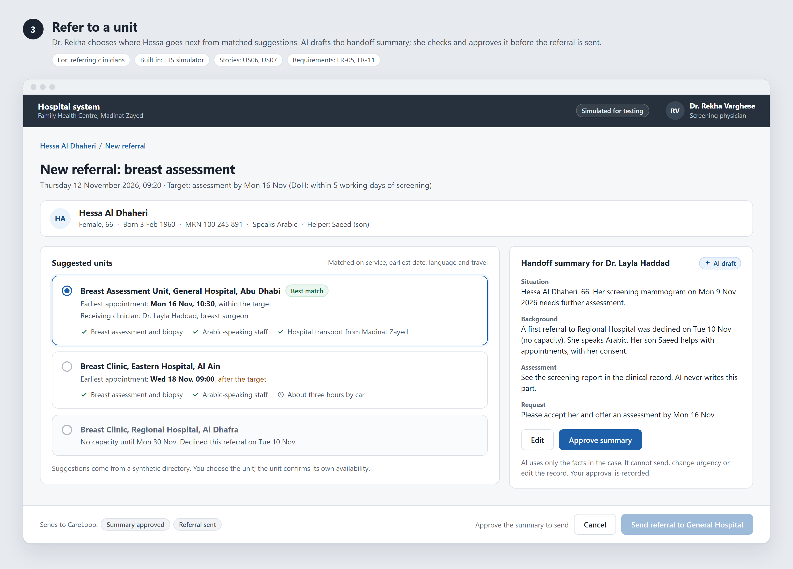
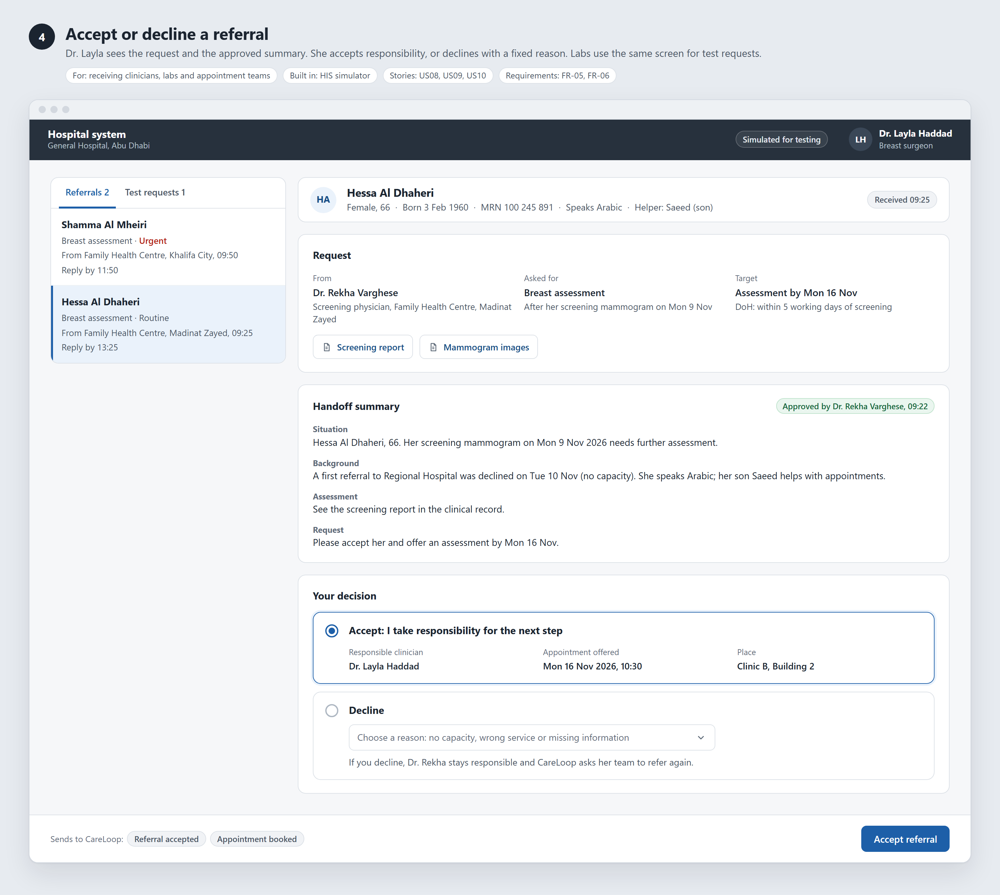
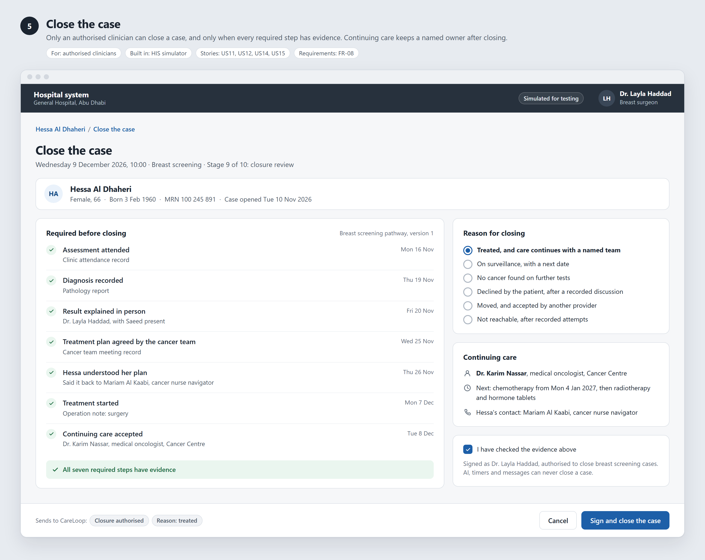
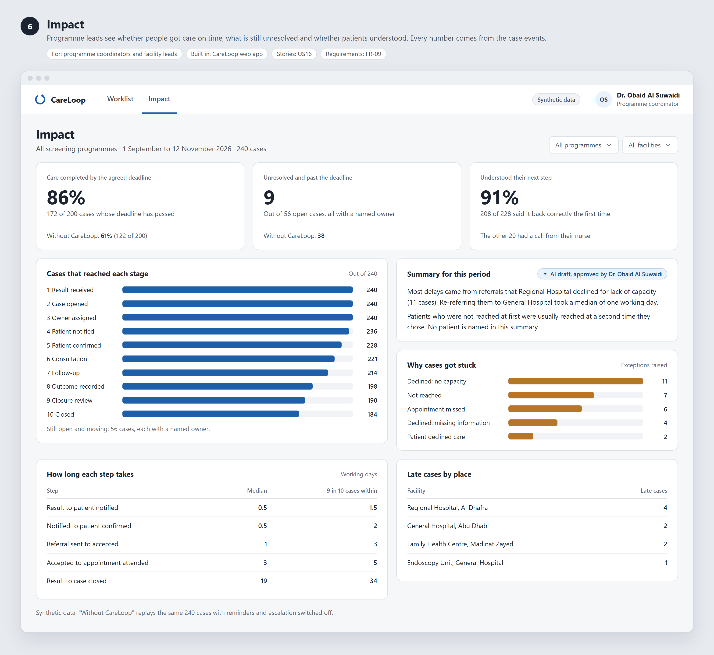
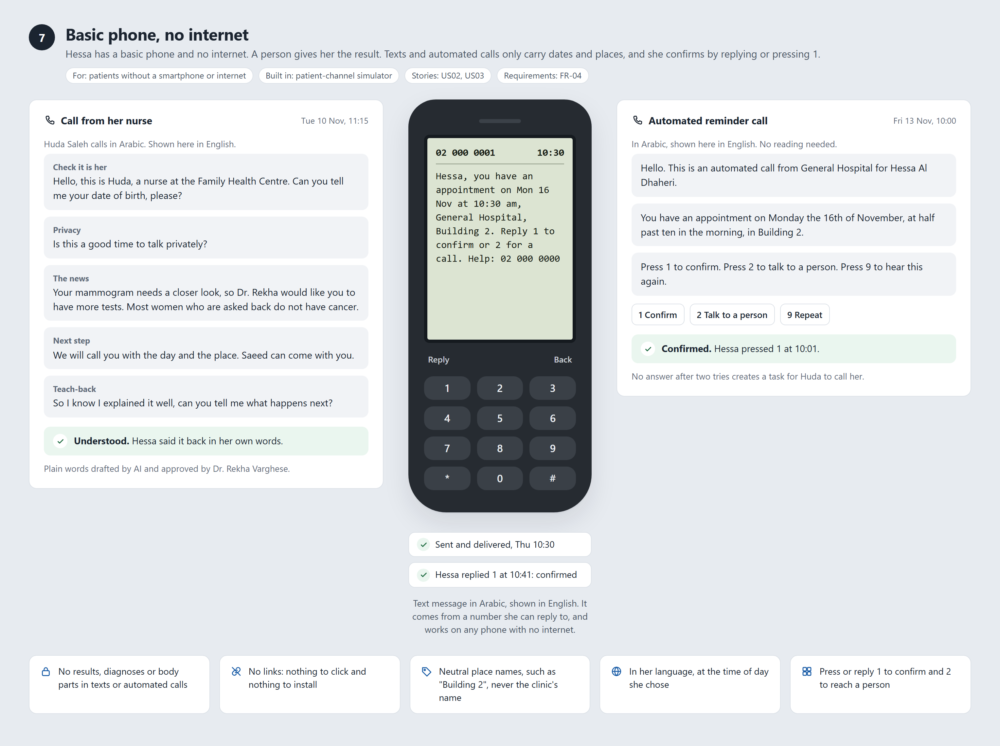
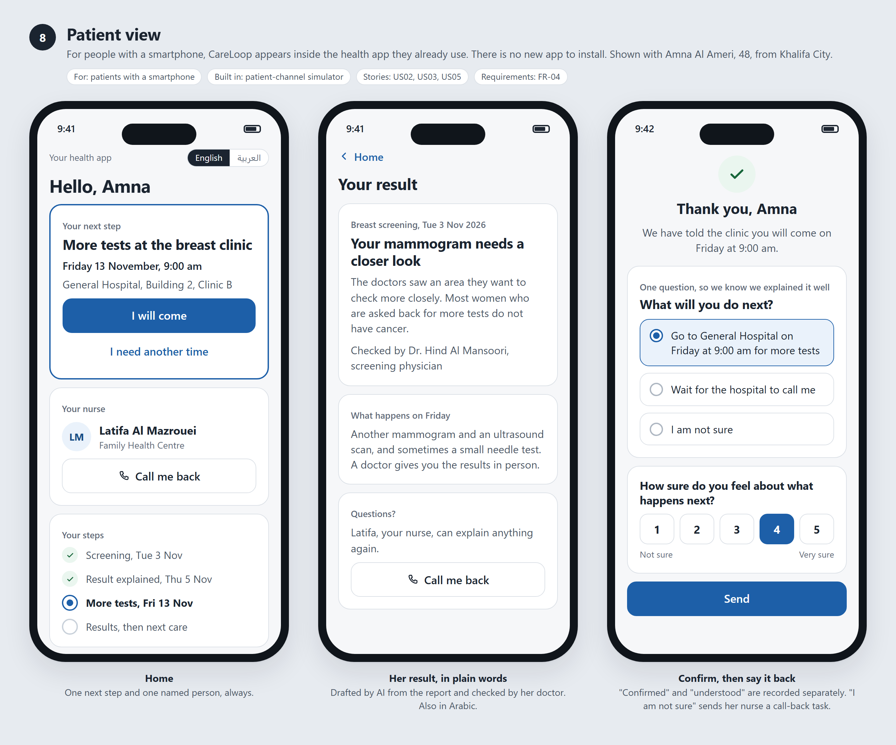
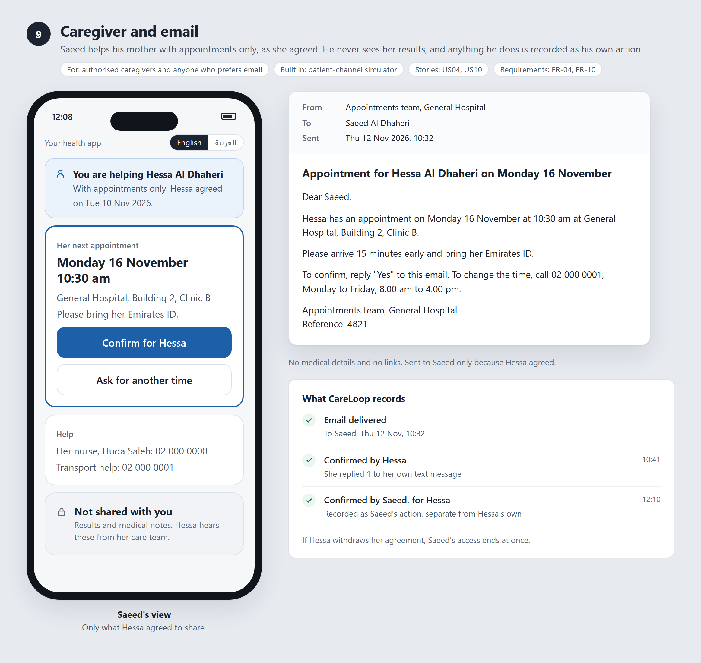

# UI design

One flow and nine screens for CareLoop, ready to build. They follow the ten-stage case lifecycle in [architecture.md](../architecture.md) and together cover user stories US01 to US16. Every person, number and facility shown is invented.

The UI component in the architecture lists an exception dashboard, a patient view and an impact view. Here they are the worklist (1), the patient view (8) and impact (6). The case screen (2) adds the read-only case timeline. Screens 3 to 5 belong to the HIS simulator, and screens 7 to 9 to the patient-channel simulator.

On GitHub, open [ui-design.pdf](ui-design.pdf) to see every screen at full size; its text can be copied. GitHub shows HTML files as code rather than as pages, so to inspect exact sizes, spacing and colours, download [ui-design.html](ui-design.html) and open it in a browser.

## Flow

Every case, in every screening programme, moves through the same ten stages. A stage moves on only when its event arrives. Late or missing work creates a task with a named owner and escalates: a reminder to the owner, then the facility lead, then the programme coordinator. Urgent cases skip the reminder.

| # | Shown as | Stage | Entry event |
|---|---|---|---|
| 1 | Result received | `RESULT_RECEIVED` | `ResultReceived` |
| 2 | Case opened | `CASE_CREATED` | `CaseCreated` |
| 3 | Owner assigned | `OWNER_ASSIGNED` | `OwnerAssigned` |
| 4 | Patient notified | `PATIENT_NOTIFIED` | `PatientNotified` |
| 5 | Patient confirmed | `PATIENT_ACKNOWLEDGED` | `PatientAcknowledged` |
| 6 | Consultation | `CONSULTATION_PENDING` | `ConsultationRequested` |
| 7 | Follow-up | `FOLLOW_UP_IN_PROGRESS` | `FollowUpStarted` |
| 8 | Outcome recorded | `CARE_OUTCOME_DOCUMENTED` | `OutcomeDocumented` |
| 9 | Closure review | `CLOSURE_REVIEW` | `ClosureReviewRequested` |
| 10 | Closed | `CLOSED` | `ClosureAuthorised` |

## Screens

| # | Screen | Used by | Built in | Stories | Requirements |
|---|---|---|---|---|---|
| 1 | [Worklist](#1-worklist) | Care coordinators, nurse navigators and facility leads | `src/web` | US05, US13, US16 | FR-07, FR-09, FR-10 |
| 2 | [Case](#2-case) | Care team and clinicians | `src/web` | US01, US03, US08, US10, US13, US14, US16 | FR-02, FR-03, FR-06, FR-07 |
| 3 | [Refer to a unit](#3-refer-to-a-unit) | Referring clinicians | `src/simulators/his` | US06, US07 | FR-05, FR-11 |
| 4 | [Accept or decline a referral](#4-accept-or-decline-a-referral) | Receiving clinicians, labs and appointment teams | `src/simulators/his` | US08, US09, US10 | FR-05, FR-06 |
| 5 | [Close the case](#5-close-the-case) | Authorised clinicians | `src/simulators/his` | US11, US12, US14, US15 | FR-08 |
| 6 | [Impact](#6-impact) | Programme coordinators and facility leads | `src/web` | US16 | FR-09 |
| 7 | [Basic phone, no internet](#7-basic-phone-no-internet) | Patients without a smartphone or internet | `src/simulators/patient-channel` | US02, US03 | FR-04 |
| 8 | [Patient view](#8-patient-view) | Patients with a smartphone | `src/simulators/patient-channel` | US02, US03, US05 | FR-04 |
| 9 | [Caregiver and email](#9-caregiver-and-email) | Authorised caregivers and email users | `src/simulators/patient-channel` | US04, US10 | FR-04, FR-10 |

FR-01 (result intake and de-duplication) has no screen of its own; it shows as stage 1 in the flow and in the case timeline.

Event names marked \* are proposed and not yet in the solution design. Agree them in [contracts](../../contracts/README.md) before building.

### 1. Worklist

- Read-only. Reads `GET /cases` and `GET /exceptions`.
- Sorted by risk: urgent and overdue first, then by time left.
- Each row shows one next action, one responsible person and one due time. Status is always a word with a coloured dot.
- The filter chips are the exception queues in the solution design: urgent, overdue, rejected (referral declined), unreachable (not reached), unacknowledged (not confirmed) and unassigned (no owner).

### 2. Case

- Read-only. Reads `GET /cases/{id}` and `GET /cases/{id}/timeline`.
- The next action shows its escalation ladder and who has acknowledged it.
- The checklist shows what must happen before the next stage. Missing evidence blocks progress.
- The four tracks (patient contact, consultation, referral and appointment) each show their own status.
- Every timeline entry names its source system.

### 3. Refer to a unit

- Sends `SummaryApproved`\* and `ReferralSent`.
- Suggested units come from a synthetic directory. The clinician chooses, and the unit confirms its own availability.
- The AI handoff summary is a draft. Sending stays disabled until the clinician approves it, and AI never writes the assessment part.

### 4. Accept or decline a referral

- Sends `ReferralAccepted`\* and `AppointmentScheduled`\*, or `ReferralRejected` with a reason code: no capacity, wrong service or missing information.
- Until a unit accepts, the sender stays responsible.
- Labs use the same screen for test requests.

### 5. Close the case

- Sends `ClosureAuthorised` with a typed reason: treated, surveillance, negative on confirmation, declined, transferred or untraceable.
- Closing is blocked until every required step has evidence (`EvidenceAttached`).
- Continuing care keeps a named owner after the case closes.

### 6. Impact

- Read-only. Reads `GET /metrics`.
- The headline measures are the three the team agreed: care completed by the clinically agreed deadline, unresolved cases and patient understanding. Each shows its denominator.
- The stage funnel, step timing (median and 90th percentile) and reasons cases got stuck follow the impact view in the solution design.
- "Without CareLoop" replays the same synthetic cases with reminders and escalation switched off.
- The AI summary stays a draft until the programme coordinator approves it, and it names no patient.

### 7. Basic phone, no internet

- Sends `PatientNotified` on delivery, `NotificationFailed`\* on failure, `PatientAcknowledged` when the patient replies or presses 1, `CallbackRequested`\* for 2, and `TeachBackSubmitted`\* when the nurse records the teach-back.
- A person gives results. Texts and automated calls carry only dates and places, with no links.
- Texts come from a number the patient can reply to.

### 8. Patient view

- Shown inside the health app the patient already uses. It is not a new app.
- Reads the stage and next step of the case.
- Sends `PatientAcknowledged` for "I will come"; `CallbackRequested`\* for "Call me back", "I need another time" or "I am not sure"; then `TeachBackSubmitted`\* and `ConfidenceRated`\*.
- "Confirmed" and "understood" are recorded separately.

### 9. Caregiver and email

- Shows only what the patient agreed to share; here, appointments only.
- A caregiver's confirmation is sent as `PatientAcknowledged` with the caregiver as the actor, never as the patient's own.
- Emails carry no medical details and no links.

## Design rules

- Sentence case for all text, and British spelling (programme, centre, authorised).
- One accent colour. Status is always a word with a coloured dot, never colour alone.
- Every case shows one next action, one responsible person and one due time.
- Staff screens use the 24-hour clock (15:00); patient messages use 9:00 am.
- Texts, automated calls and emails never contain results, diagnoses, body parts or links.
- AI output is labelled "AI draft" and needs a named person's approval. AI never sets urgency, sends messages or closes cases.
- Patient screens use 16 px text or larger and buttons at least 44 px tall, and work in Arabic from right to left.
- Text colours meet WCAG 2.2 AA contrast.

## Colours and type

| Name | Value | Used for |
|---|---|---|
| Accent | `#1D5FA8` | Links, selected items and main buttons |
| Text | `#1B2430` | Main text |
| Secondary text | `#4A5565` | Supporting text |
| Muted text | `#5F6B79` | Labels and captions |
| Lines | `#DCE1E7` | Borders and dividers |
| Page | `#F6F7F9` | Page background |
| Red | `#B42318` | Urgent, overdue and declined |
| Amber | `#9A4A06` | Not reached, not confirmed and no owner |
| Green | `#17663A` | Done and on track |
| Hospital system bar | `#27313D` | Header of the HIS simulator screens |

Type is Segoe UI, falling back to the system font: 15 px on staff screens and 16 px or larger on patient screens.

## Open questions

- Can texts be two-way, so patients can reply 1 or 2? The designs assume they can.
- Who checks the Arabic wording that AI drafts?
- The case closes when treatment starts, as in the solution design, and later care keeps a named owner. Confirm this with the clinical adviser.
- Deadlines other than the Department of Health (DoH) targets are placeholders until a clinical adviser approves them.
