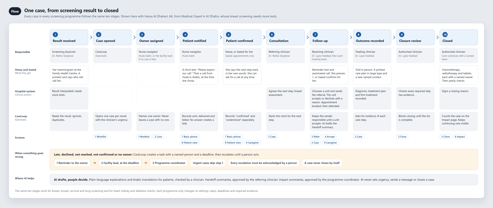
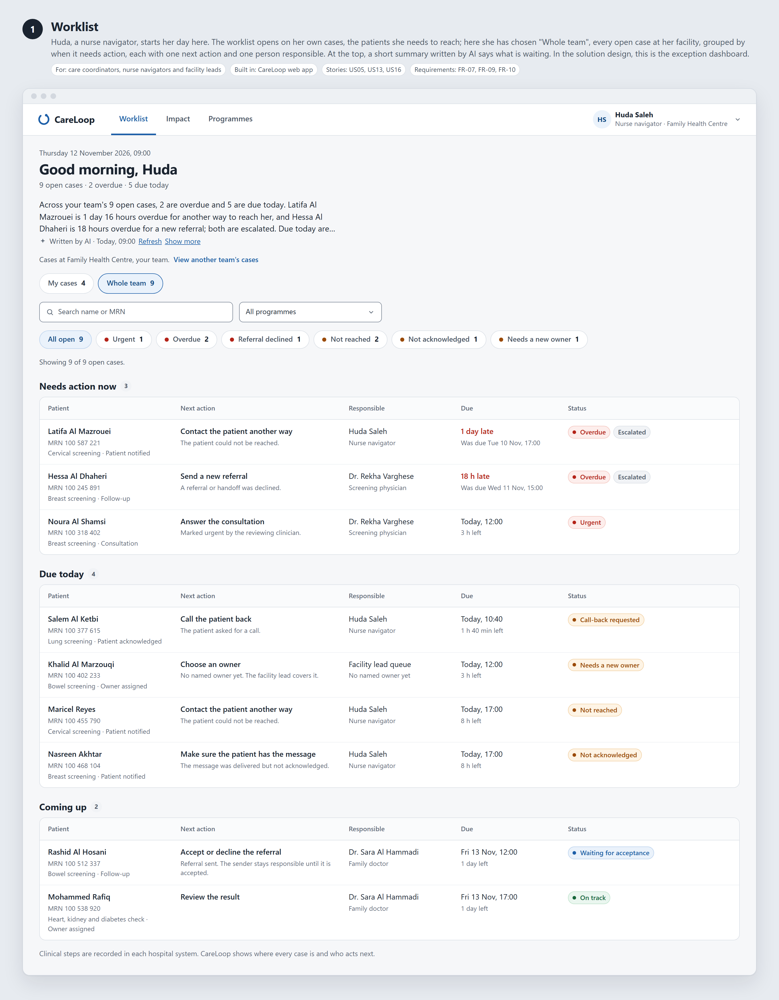
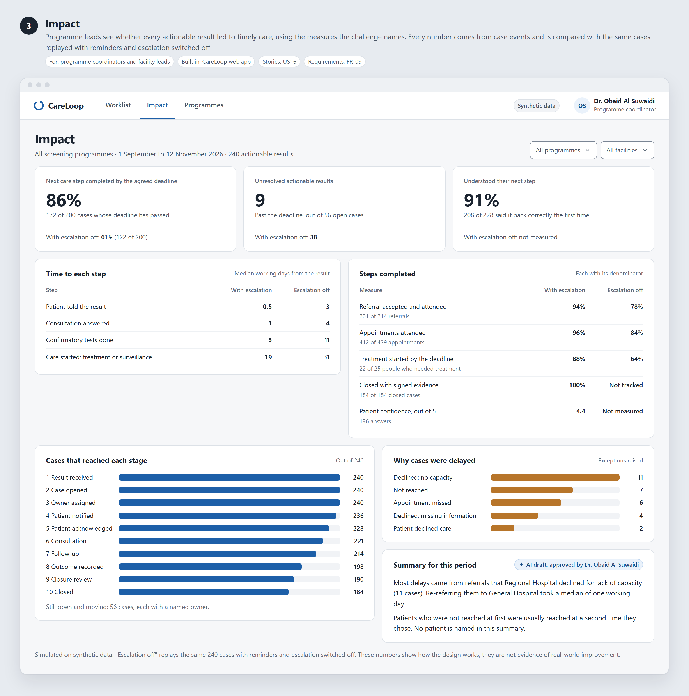
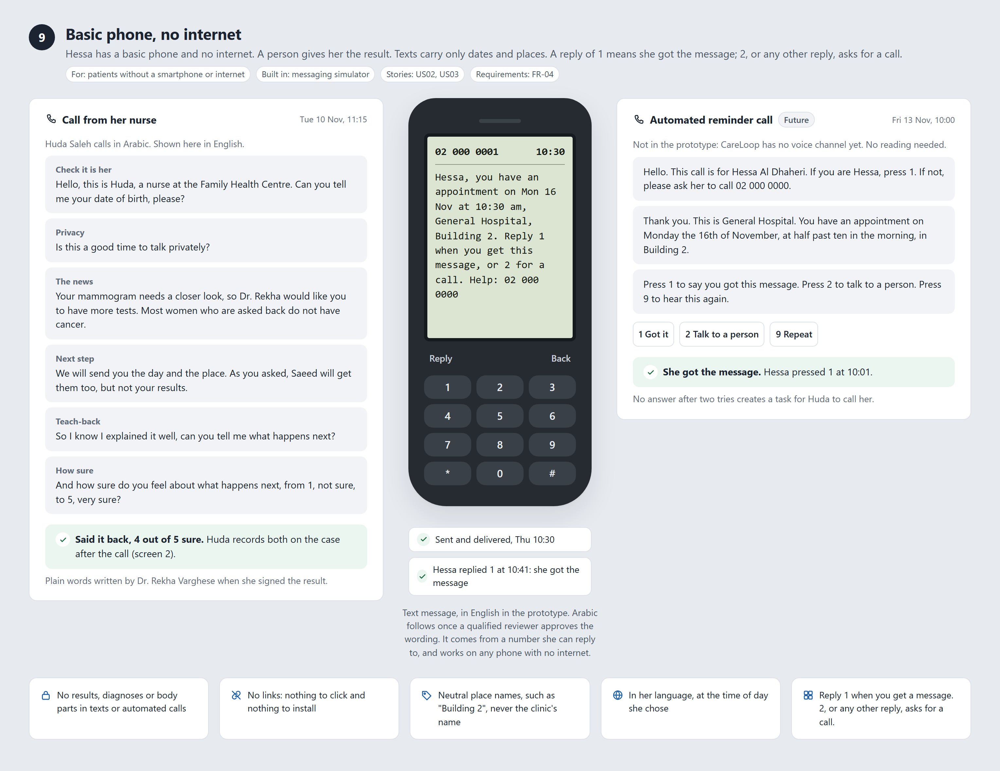
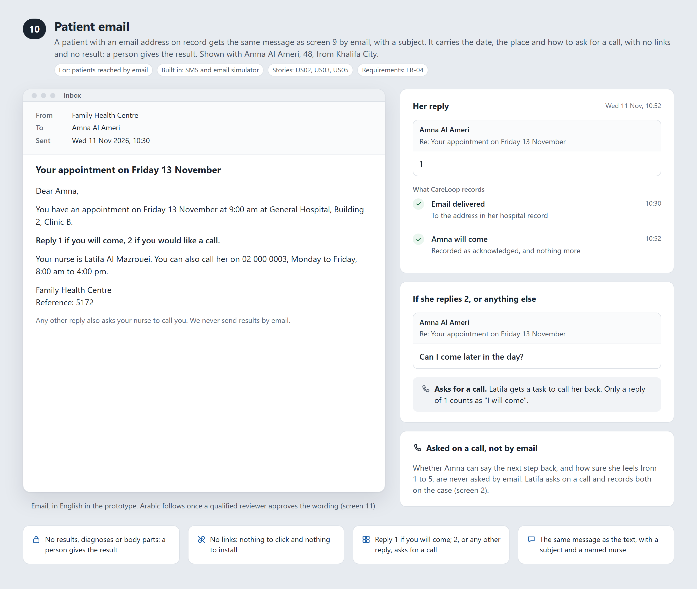
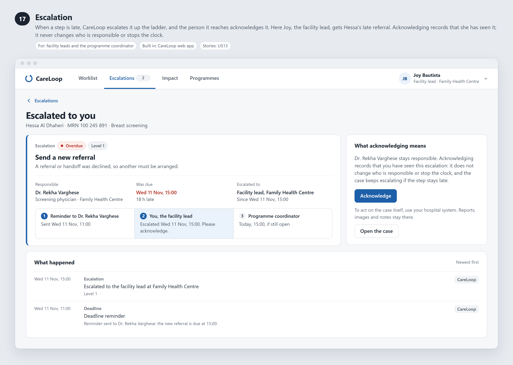
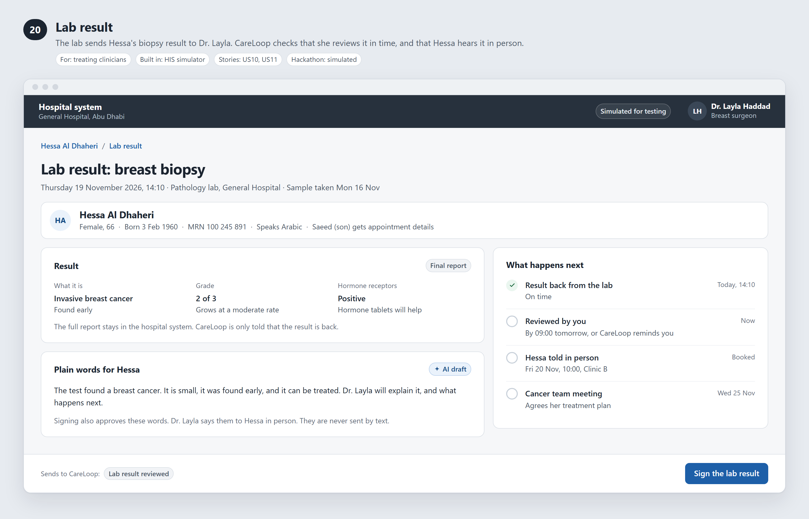
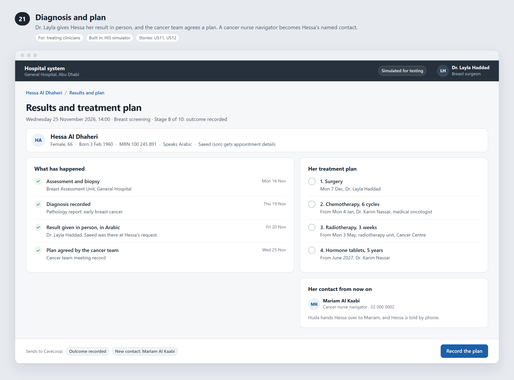
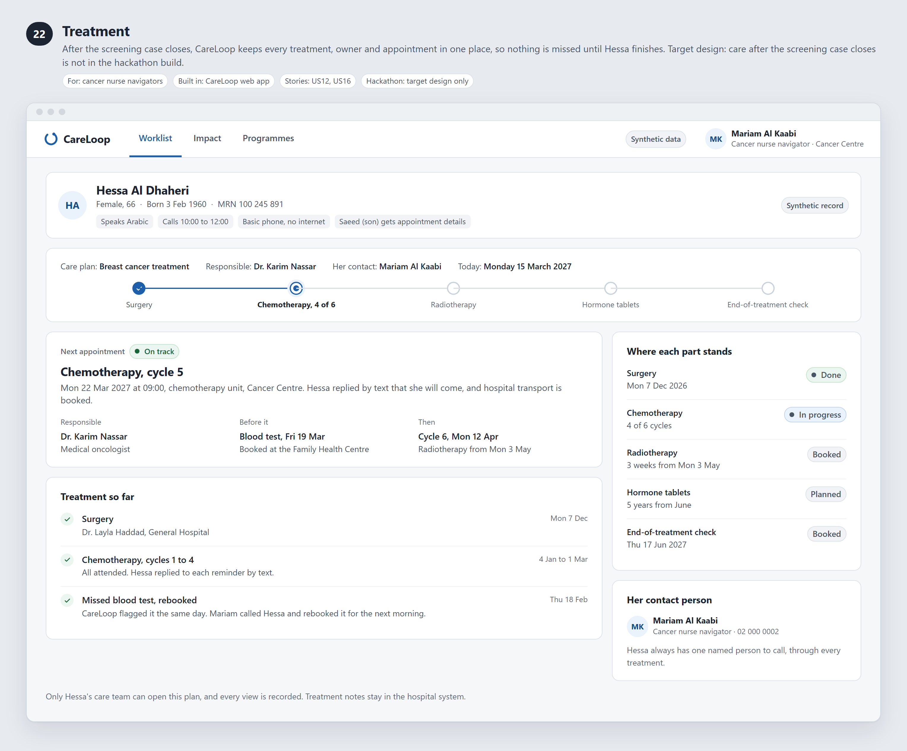
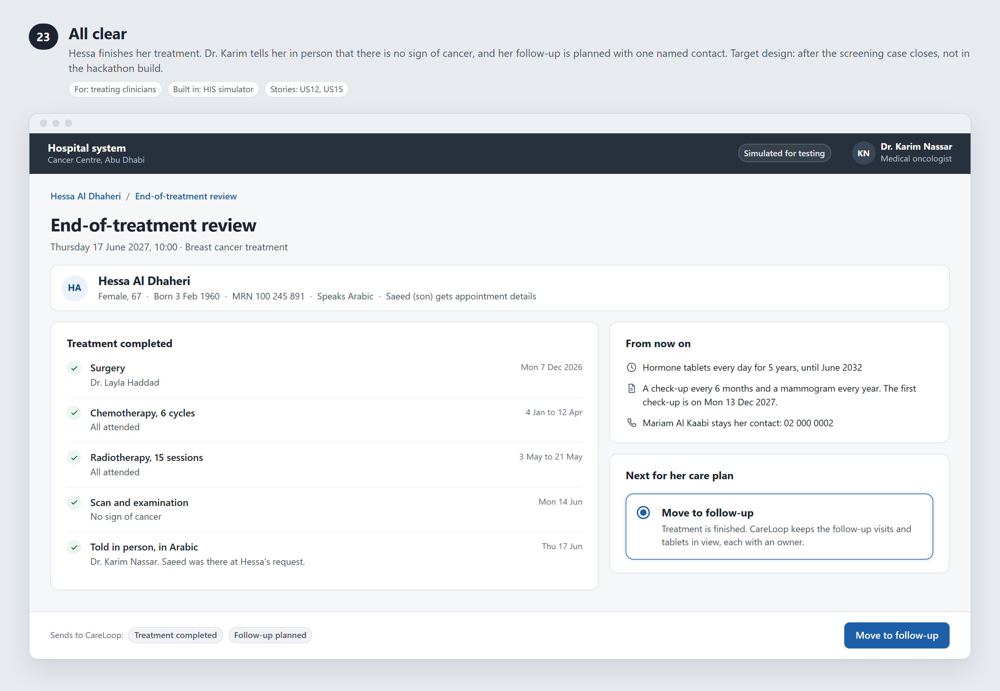

# UI design

One flow, 21 screens and a guide to who sees what, for CareLoop, ready to build. Together they cover user stories US01 to US16 and every point of Challenge 05, Closing the Screening-to-Care Loop. Every person, number and facility shown is invented.

CareLoop is built for any screening programme and, over time, any disease. Each programme is a pathway file, not new code (screen 4). The prototype uses breast screening as its example pathway, and Hessa's story follows it. More programmes come next.

- Screens 1 to 13 are grouped by the component that builds them: 1 to 4 in the CareLoop web app, 5 to 8 in the HIS simulator, 9 to 12 in the messaging simulator, and 13 across all of them.
- CareLoop reaches patients, caregivers and staff by text message and email only; there is no patient app or portal (decisions 21 to 31 in the [gap analysis](../ui-design-gap-analysis.md), C22). Screen 10 is the patient's email, and a nurse navigator records what a patient says on a call on screen 2. A reply of 1 means "I got this message" (decision 31).
- Screen 14 is the guide to who sees what.
- Screens 15 to 23 follow one patient, Hessa Al Dhaheri, from her first visit to the all clear. Screens 22 and 23 come after the screening case closes: they are the target design, not part of the hackathon build.
- Screen 18, Approve the handoff summary, was removed on 19 November 2026 ([Decisions of 19 November](#decisions-of-19-november)). The other screens keep their numbers.
- For the hackathon, only CareLoop's own screens and the patient's phone are shown. Steps in the hospital system are simulated ([What the judges see](#what-the-judges-see)).

The ten stages on screen are display labels. The code has five stages and four tracks, and the [flow table](#flow) maps one to the other.

On GitHub, open [ui-design.pdf](ui-design.pdf) to see every screen at full size; its text can be copied. GitHub shows HTML files as code rather than as pages, so to inspect exact sizes, spacing and colours, download [ui-design.html](ui-design.html) and open it in a browser.

## Decisions of 13 November

The design follows the seven decisions in the [UI design gap analysis](../ui-design-gap-analysis.md), section 5, the team's decision on Arabic, and two points from the team call that day. Updates P1 to P18 from section 4 of the gap analysis are made in this document and in the screens.

| # | Decision | What changed in the design |
|---|---|---|
| 1 | Five stages in code; the ten on screen are display labels | The flow table maps each label to its stage and track status. The flow has a row "In code". |
| 2 | The patient does not confirm appointments. "I will come" is an acknowledgement. | Since decision 31, a reply of 1 means "I got this message" and sends `NotificationUpdated/Acknowledged` only; screens 9, 10, 12 and 14 say so (P22). Whether she will come is asked on a call, and the nurse records it on screen 2. |
| 3 | Build the confidence rating | A nurse navigator records it after a call, on screen 2 (decision 30), as `NotificationUpdated/ConfidenceRated` from 1 to 5. Screen 3 reports it. |
| 4 | The AI handoff summary is approved in the CareLoop web app. No longer applies since 19 November 2026: the AI handoff summary is removed. | New screen 18, since removed. Screen 6 no longer shows a summary from CareLoop. |
| 5 | Add the roles `nurse-navigator`, `receiving-clinician` and `lab` | Who sees what gives each person their role in CareLoop. |
| 6 | Separate reply deadlines for consultations and referrals | Screens 4 and 5 show them, as placeholders. |
| 7 | Build caregiver consent | Screens 12 and 15 show how consent is given, used and withdrawn. The email is shown in the simulator, not sent. |
| Arabic | The prototype is in English and supports more than one language from the start. Arabic is added once its translations are checked. Agreed in the team chat. | Screen 11 is the target design for Arabic. Screens 9, 10 and 11 say so. |
| Scope | Agreed in the team call: show CareLoop's own screens and the patient's phone. Steps in the hospital system are simulated, not shown. | [What the judges see](#what-the-judges-see). Simulated screens are marked "Hackathon: simulated", and dashed on the flow. The prototype follows the same scope. |
| Context | Raised in the team call: a doctor should see a patient's other screening, not only this one. | Screen 2 shows her other screening to doctors (C19). |

## Decisions of 19 November

Taken in the team call on 19 November 2026. This document and the screens are updated to match the app.

| # | Decision | What changed in the design |
|---|---|---|
| Handoffs | Doctors make referrals and handoffs in their hospital system, and CareLoop receives the resulting events through FHIR. The AI handoff summary is removed. | Screen 18 is removed, and the other screens keep their numbers. Screens 6 and 7 show the referring doctor's own note. Screen 2 says under the next action who takes the step and how: a call is recorded in CareLoop, and every other step is done in the hospital system. Decision 4 no longer applies. |
| AI | The Python AI workflow service is retired. The API asks Microsoft Foundry agents directly and returns the text to the page. AI writes three texts for staff: a role briefing, an impact summary and a draft of a patient message. The workflow is led by people: AI never sends, decides or closes anything. | Screen 1 shows the role briefing, screen 3 the impact summary and screen 2 the patient message draft. The plain words on screens 9, 16 and 20 are written by the doctor. |
| Programmes | CareLoop is for any screening programme and, over time, any disease. Each programme is a pathway file, not new code. The prototype uses breast screening as its example pathway, and more programmes come next. | The introduction, screen 4 and the open questions say so. |

## What the judges see

The team agreed on 13 November to keep the focus on the loop that CareLoop closes. Steps that happen in the hospital system, such as ordering a mammogram, signing a result, sending or accepting a referral, booking and closing, are sent by a test scenario as the same events a hospital system would send. Their screens are not shown.

| Hackathon | Screens |
|---|---|
| Shown: CareLoop web app | 1 Worklist, 2 Case, 3 Impact, 4 Programmes, 17 Escalation |
| Shown: the patient's text messages and email, in the messaging simulator | 9 Basic phone, 10 Patient email, 12 Caregiver and email |
| Simulated: a test scenario sends their events | 5 Consultation, 6 Refer, 7 Accept or decline, 8 Close, 15 First visit, 16 Screening result, 19 Assessment, 20 Lab result, 21 Diagnosis and plan |
| Later | 11 Arabic (deferred), 22 Treatment and 23 All clear (target design) |
| Reference for everyone | Flow, 13 Empty and error states, 14 Who sees what |

The simulated screens stay in this document because they show which events the hospital system sends, and what a hospital-system screen would look like. The HIS simulator keeps its screens (decision 16 in the gap analysis).

## How the designs meet the challenge

| The challenge asks for | Where it is shown |
|---|---|
| End-to-end case visibility | Flow, 2 Case, 17 Escalation |
| Clear ownership and timely progression | 1 Worklist, 2 Case, 4 Programmes, 17 Escalation |
| Patient-centred communication and reassurance | 9 Basic phone, 10 Patient email, 12 Caregiver and email; 11 Arabic later |
| Cross-provider consultation and coordination | 2 Case and 17 Escalation; in the hospital system, simulated: 5 Consultation, 6 Refer, 7 Accept or decline |
| Safe, human-governed escalation and closure | 2 Case, 13 Empty and error states, 17 Escalation; closing in the hospital system, simulated: 8 Close |
| Closure and patient impact measures | 3 Impact |

| Judging criterion | How the designs support it |
|---|---|
| Health impact and clinical relevance | Impact reports the measures the challenge names. Its comparison with the same cases replayed with escalation off is designed, but the replay is not built yet. The example pathway's deadlines are placeholders until a clinical adviser cites them from the DoH breast screening standard. |
| Technical depth and architecture | Every screen maps to the five stages in code, the events it sends and the endpoints it reads. |
| Working solution and demonstration quality | One continuous story follows Hessa's case in CareLoop, from her screening result to the start of her treatment, with real dates and named people. Hospital steps arrive as simulated events, so the story stays on the loop. |
| Responsible AI, safety and data governance | AI writes three short texts for staff to read, each labelled as written by AI: a role briefing on the worklist (screen 1), an impact summary (screen 3) and a draft of a patient message (screen 2). AI never sends, decides or closes anything, and nothing acts on what it writes. It is never given a person's name or contact details, or a result. Each person sees only what their part of the care needs ([Who sees what](#who-sees-what)), and screen 13 shows the safety states. |
| Scalability and deployment readiness | CareLoop is built for any screening programme and, over time, any disease: a new programme is a pathway file, not new code (screen 4). Every message and screen supports more than one language from the start, so Arabic needs no new code (screen 11). |
| Commercial viability and path to pilot | CareLoop works with existing hospital systems and reaches patients by text message and email, which every patient already has. Nothing new to install. |

## Flow

On the flow, dashed screens are not shown in the hackathon. Every case, in every screening programme, moves through the same ten stages on screen. In the code these are five stages (`CaseStage`) and four tracks that run side by side: notification, consultation, referral and appointment. A stage moves on only when its event arrives. Late or missing work creates a task with a named owner and escalates: a reminder to the owner, then the facility lead, then the programme coordinator. Urgent cases skip the reminder.

| # | Shown as | Stage in code | What puts the case here |
|---|---|---|---|
| 1 | Result received | `Received` | `ScreeningResultReceived` |
| 2 | Case opened | `Received` | `ScreeningResultReceived`, matched on source and result number, so a resent result opens no second case |
| 3 | Owner assigned | `ReviewPending` | An owner named by the programme's rules, or the facility lead's queue (`Unassigned`) |
| 4 | Patient notified | `FollowUpActive` | `ClinicalReviewCompleted`, then `NotificationUpdated/Delivered` or `/Failed` |
| 5 | Patient acknowledged | `FollowUpActive` | `NotificationUpdated/Acknowledged` or `/Understood` |
| 6 | Consultation | `FollowUpActive` | `ConsultationUpdated/Requested`, `/OwnerProposed`, `/Accepted`, `/Rejected` or `/OutcomeRecorded` |
| 7 | Follow-up | `FollowUpActive` | `ReferralUpdated/Sent`, `/Accepted` or `/Rejected`, and `AppointmentUpdated/Scheduled`, `/Attended` or `/Missed` |
| 8 | Outcome recorded | `ClosureReview` | `OutcomeRecorded` |
| 9 | Closure review | `ClosureReview` | Nothing new: the case waits for an authorised person to decide |
| 10 | Closed | `Closed` | `ClosureDecided` |

How CareLoop chooses the label (decision 19 in the gap analysis: the API works it out, and the web app shows it):

- Labels 1 to 3 and 8 to 10 follow the stage in code.
- In `FollowUpActive`, the tracks run side by side, so the label shows the furthest step reached: Follow-up once a referral or appointment exists, otherwise Consultation once one is requested, otherwise Patient acknowledged once the notification track is `Acknowledged` or `Understood`, otherwise Patient notified. Screen 2 shows each track's own status.

Some events can arrive at any stage without moving it: `NotificationUpdated/CallRequested` adds a call-back task, `NotificationUpdated/ConfidenceRated` (recorded by a nurse after a call) adds a rating, and `ConsentRecorded/Granted` or `/Withdrawn` starts or stops messages to a family member. CareLoop also raises two events itself: `DeadlineElapsed` for reminders and escalations, and `EscalationAcknowledged` when a person acknowledges an escalation (screen 17).

## Who sees what

Each person sees only the cases they care for, and only what their part of the care needs. CareLoop keeps where each case is, its deadlines, who is responsible and references to records. Reports, images and notes stay in each hospital system, under that system's own access rules. Patients and the family members they name are reached by text message and email only, with no app or portal.

| Person | Role in CareLoop | Sees | Can do | Cannot |
|---|---|---|---|---|
| Patient: Hessa by text message on a basic phone, Amna by email | None. A recipient of messages (`Patient`). | Her own next step, appointments and named nurse, by text message or email. A person gives her the result. | Reply 1 to say she got the message or 2 to ask for a call; on a call, say whether she will come, say the next step back and say how sure she feels. Name a family member to get her appointment details, or stop it. | See anyone else's information |
| Family member the patient named in writing: Saeed | None. A recipient of messages (`Caregiver`), only while her consent is active. | The day, time and place of her appointments, by email | Help her get there. Nothing in CareLoop. | See results or the reason for the visit. Reply for her or change anything. |
| Nurse navigator: Huda | `nurse-navigator` | Her team's cases only: who the patient is, the stage, the next step and deadline, and who is responsible. How to reach the patient, and the result in plain words that the doctor wrote, are in the hospital system. | Call patients and record on the case what they said (will come, said the next step back, a 1 to 5 confidence rating). Hand over tasks and ask a doctor to call a patient back, in the hospital system. | See reports, images, notes or other medical history. Open a case outside her team without giving a reason. |
| Screening doctor: Dr. Rekha | `clinician` | Her patients' full records in her hospital system, and their cases in CareLoop | Set urgency, ask a specialist and send referrals, in her hospital system. She stays responsible until a unit accepts. | See patients she does not care for |
| Receiving doctor: Dr. Layla | `receiving-clinician` | Referrals sent to her unit: the request, the referring doctor's note, the screening report and images | Accept or decline with a reason, book, record the outcome and close the case with evidence | See referrals sent to other units, or other cases at the Family Health Centre |
| Lab and test teams | `lab` | Test requests sent to them, and what each test needs. Not built yet: today the lab reads its facility's cases like the rest of the team. | Accept a request, record that the test was done and send the report to the doctor who asked | See the rest of the patient's case |
| Facility lead: Joy | `facility-lead` | Every case at her facility, to cover gaps and escalations | Choose or change who is responsible, in the hospital system, and acknowledge escalations in CareLoop | See reports, images or notes, or cases at other facilities |
| Programme coordinator: Dr. Obaid | `coordinator` | Totals for every programme, with no names. One case, by its case number only, when it is escalated to him (decision 35). | Acknowledge escalations sent to him | See named lists of patients |
| AI writing, inside CareLoop | None. Part of CareLoop. | Only what each text needs, while writing it: never a person's name or contact details, or a result | Write three texts for staff to read, each labelled as written by AI: a role briefing on the worklist, an impact summary and a draft of a message to a patient, which is never sent | Send, decide, set urgency or close anything. Keep data, or learn from it. |
| Engineers and support | None | Synthetic data only | Build, test and fix CareLoop | See real patient data, unless it is approved and recorded |

Others in Hessa's journey hold the same roles. Dr. Sara Al Hammadi, her family doctor (screen 15), is a `clinician`. Dr. Karim Nassar, her oncologist (screen 23), is a `receiving-clinician`. Mariam Al Kaabi, her cancer nurse navigator (screens 21 and 22), is a `nurse-navigator` at the Cancer Centre.

The rules behind the table:

- **Need to know.** Access depends on your role and the patients you care for, with the least access that does the job (DoH Standard on Patient Healthcare Data Privacy, 5.1 to 5.4; Federal Law No. 2 of 2019, Article 4; HIPAA, 45 CFR 164.502(b) and 164.514(d)). The API refuses any read that the role does not allow; hiding it on screen is not enough. Reads are limited to the person's facility (C4).
- **Everything is recorded.** Every view and action is logged with who, when and why, and the logs are checked (ADHICS; HIPAA, 45 CFR 164.312(b)). The API records each case read (C4).
- **Outside your team needs a reason.** Opening a case you do not care for asks for a reason, which is logged and checked by the facility lead. In the DoH standard, an authorised user looking at data for an unauthorised purpose is a privacy breach. The API refuses the read without a reason, and the web app asks for one: on a case, "Opening a case outside your team", and on the worklist, "View another team's cases" (C4).
- **Access ends with your part of the care.** When Hessa moves to the Cancer Centre, Mariam Al Kaabi and Dr. Karim Nassar see her case, and Huda no longer does.
- **Data stays in the UAE.** All patient data, backups and AI processing stay in the UAE (DoH Standard, 4.1.4; Federal Law No. 2 of 2019, Article 13).
- **Written consent for anything beyond care.** Sharing with family, or research that names patients, needs the patient's written consent (DoH Standard, 4.2.3; Federal Law No. 2 of 2019, Article 16; HIPAA, 45 CFR 164.510(b)).
- **Automated calls check who answered.** When automated calls are added, a call gives no details until the person who answers says they are the patient.
- **Staff notices come by email or text message.** Staff are told about tasks and escalations at one address per role, kept in CareLoop's settings (decisions 27 and 28), not in the hospital system's inbox. A notice says only that a case at their facility needs action and gives the case number to look for in CareLoop: no link, no patient details and no result (decision 36).

## Screens

Names in this section are the ones in the code. Item numbers show where a feature came from: C1 to C13 from the [gap analysis](../ui-design-gap-analysis.md), section 3, and C15 and C19 from [Proposed code items](#proposed-code-items). Most are built; anything still missing says so.

Where each screen is built:

- CareLoop web app: `src/web`
- HIS simulator: `src/simulators/his/HisSimulator/ClientApp`
- Messaging simulator: `src/simulators/messaging/MessagingSimulator/ClientApp`

| # | Screen | Used by | Built in | Stories | Requirements | Hackathon |
|---|---|---|---|---|---|---|
| 1 | [Worklist](#1-worklist) | Care coordinators, nurse navigators and facility leads | CareLoop web app | US05, US13, US16 | FR-07, FR-09, FR-10 | Shown |
| 2 | [Case](#2-case) | Care team and clinicians | CareLoop web app | US01, US03, US08, US10, US13, US14, US16 | FR-02, FR-03, FR-06, FR-07 | Shown |
| 3 | [Impact](#3-impact) | Programme coordinators and facility leads | CareLoop web app | US16 | FR-09 | Shown |
| 4 | [Programmes](#4-programmes) | Programme coordinators and clinical advisers | CareLoop web app | US13, US14 | FR-03, FR-07 | Shown |
| 5 | [Consultation](#5-consultation) | Clinicians | HIS simulator | US05, US07 | FR-05 | Simulated |
| 6 | [Refer to a unit](#6-refer-to-a-unit) | Referring clinicians | HIS simulator | US06, US07 | FR-05 | Simulated |
| 7 | [Accept or decline a referral](#7-accept-or-decline-a-referral) | Receiving clinicians, labs and appointment teams | HIS simulator | US08, US09, US10 | FR-05, FR-06 | Simulated |
| 8 | [Close the case](#8-close-the-case) | Authorised clinicians | HIS simulator | US11, US12, US14, US15 | FR-08 | Simulated |
| 9 | [Basic phone, no internet](#9-basic-phone-no-internet) | Patients without a smartphone or internet | Messaging simulator | US02, US03 | FR-04 | Shown |
| 10 | [Patient email](#10-patient-email) | Patients reached by email | Messaging simulator | US02, US03, US05 | FR-04 | Shown |
| 11 | [Arabic, right to left](#11-arabic-right-to-left) | Arabic-speaking patients and families | Messaging simulator | US02, US03 | FR-04 | Deferred |
| 12 | [Caregiver and email](#12-caregiver-and-email) | Family members a patient has named | Messaging simulator | US04, US10 | FR-04, FR-10 | Shown |
| 13 | [Empty and error states](#13-empty-and-error-states) | Everyone building or testing CareLoop | All components | US03, US13, US14, US15 | FR-01, FR-04, FR-07, FR-08, FR-09 | Reference |

Hessa's journey:

| # | Screen | Used by | Built in | Stories | Hackathon |
|---|---|---|---|---|---|
| 15 | [First visit](#15-first-visit) | Family doctors | HIS simulator | US01, US04 | Simulated |
| 16 | [Screening result](#16-screening-result) | Screening doctors | HIS simulator | US01, US02 | Simulated |
| 17 | [Escalation](#17-escalation) | Facility leads and the programme coordinator | CareLoop web app | US13 | Shown, with C15 |
| 19 | [Assessment and biopsy](#19-assessment-and-biopsy) | Assessment clinics | HIS simulator | US10 | Simulated |
| 20 | [Lab result](#20-lab-result) | Treating clinicians | HIS simulator | US10, US11 | Simulated |
| 21 | [Diagnosis and plan](#21-diagnosis-and-plan) | Treating clinicians | HIS simulator | US11, US12 | Simulated |
| 22 | [Treatment](#22-treatment) | Cancer nurse navigators | CareLoop web app | US12, US16 | Target design only |
| 23 | [All clear](#23-all-clear) | Treating clinicians | HIS simulator | US12, US15 | Target design only |

Screen 18, Approve the handoff summary, was removed on 19 November 2026, with the AI handoff summary. Doctors make referrals and handoffs in their hospital system, and CareLoop receives the resulting events through FHIR.

### 1. Worklist

- The exception dashboard in the solution design. Read-only; reads `GET /cases`, page by page. It opens on "My cases": a clinician's own cases, the nurse navigator's call-backs, unacknowledged messages and patients to reach another way, the facility lead's escalated and unowned cases, and the lab's cases waiting for an outcome. "Whole team" shows every open case at the facility, and "View another team's cases" asks for the team and a reason (C4).
- Under the greeting and the count line, the role briefing sums up the team's open cases (`GET /ai/role-briefing`). CareLoop writes the first sentence, so its counts are always right, for example "Across your team's 24 open cases, 1 is overdue and 5 are due today." AI writes the rest: overdue and escalated cases first, then the other work grouped by next action. AI never sees a name: where it mentions a case, CareLoop puts in the patient's name as the list shows it. The programme coordinator's briefing counts the cases escalated to him ("Of the 9 open cases escalated to you, …") and names them by case number.
- The briefing is labelled "Written by AI" with the time it was written, for example "Written by AI · Today, 09:00", and "Refresh" asks for a new one. A briefing longer than three lines is cut there, with "Show more", and then "Show less". It is read again when the list changes. It is shown only on the reader's own team's list, not on another team's list opened with a reason, and only when the team has open cases. When AI is off or fails, nothing is shown, and the worklist works the same. The list below is the record.
- Cases are grouped by when they need action: "Needs action now" (overdue, urgent or escalated), "Due today" and "Coming up". Each group is a table: Patient, Next action, Responsible, Due and Status.
- Each row shows the patient with the MRN, the programme and the stage, one next action with why, one responsible person and one due time. Status is always a word with a coloured dot.
- The filter chips are the exception queues: urgent, overdue (`Overdue`), declined (`Rejected`), not reached (`Unreachable`), not acknowledged (`Unacknowledged`) and needs a new owner (`Unassigned`). A case that needs a new owner stays with the facility lead until someone accepts it. Above them are a search by name or MRN and a programme filter.

### 2. Case

- Read-only, except one thing: a nurse navigator records what a patient said on a call (decision 30). Reads `GET /cases/{id}`, `GET /cases/{id}/timeline` and `GET /programmes/{id}` for the escalation ladder. Only the patient's care team can open it, and every view is logged (C4).
- The header gives the patient's name and MRN, the programme, the facility, when the case opened and the result number from the hospital system. Reports, images and other details, and how to reach the patient, stay in the hospital record.
- The next action shows its escalation ladder and who has acknowledged it (C15).
- Under the next action, a line says who takes the step and how, which is not always the person responsible. A nurse navigator's step is a call, recorded on this screen; every other step is done in the hospital system. When someone other than the person responsible takes the step, the line also says who stays responsible: "You stay responsible for the case." or, for example, "Dr. Rekha Varghese stays responsible for the case." Taking a step never changes that. A closed case has no line. The table below gives the wording.
- There is no checklist card on the case. The evidence each outcome needs is on screen 4, and the API blocks closing until it is recorded (screen 8).
- "How each part is going" shows the four tracks (patient contact, consultation, referral and appointment), each with its status and when it last changed. The timeline is grouped by day, newest first, and each entry names where it came from, as the API records it: CareLoop, the hospital system, a text message or an email (C3, decision 34). What a nurse records after a call shows as CareLoop, with her name.
- "After a call with the patient" is shown to nurse navigators only. After a call, the nurse ticks that the patient said they will come (`NotificationUpdated/Acknowledged`) and that they said the next step back in their own words (`/Understood`), and chooses how sure the patient feels, from 1 (not sure) to 5 (very sure), or "Not asked" (`/ConfidenceRated`). "Record call outcome" sends `POST /cases/{caseId}/call-outcome` and stays off until she ticks something or chooses a rating. The card shows the confidence on record and, once she records a call, what she recorded and when, for example "Recorded at 11:20: said the next step back, 4 out of 5." Recording never changes who is responsible.
- The card is the only way "will come", understanding and the rating reach CareLoop: a reply by text or email can only say "I got this message" or ask for a call (decisions 24, 30 and 31).
- Doctors also see the patient's other screening, for context: her other cases in CareLoop, with a pointer to her full history in the hospital record (C19). Nurses do not see this card.
- Below "After a call with the patient", nurse navigators and clinicians see "Draft a message to the patient" while the case is open: "AI writes a draft for you to read. Nothing is sent from here, and the patient's name and details are left as placeholders." The reader chooses "Text message" or "Email" and presses "Write a draft"; nothing is asked before that. The button says "Writing…" while AI writes, then "Write another draft". The draft is labelled "Written by AI · 09:05 · Draft, not sent". If AI is off or fails, the card says so calmly, for example "AI is switched off here, so no draft can be written."
- The draft (`GET /cases/{caseId}/patient-message-draft`) is one of four approved administrative templates, chosen by CareLoop from what is recorded on the case: an appointment reminder, a missed appointment, an unsuccessful contact or a request to call the care team. AI only fills in the clinic's name and contact, and the appointment's day and time when there is one. The patient's name stays `{first name}`, and AI is never given her name, contact details or result. Nothing is sent or stored, and patients still get CareLoop's approved message templates.

What the line under the next action says:

| The next step is | The line says |
|---|---|
| A call, and the reader is a nurse navigator | Your step: call Hessa Al Dhaheri, then record it in "After a call with the patient". |
| A call, and the reader is anyone else | A nurse navigator calls the patient and records the call here. |
| In the hospital system, and the reader's own | You do this in the hospital system. CareLoop moves on once it is recorded there. |
| In the hospital system, and a named person's, as on the screen above | Dr. Rekha Varghese does this in the hospital system. CareLoop moves on once it is recorded there. |
| In the hospital system, for a role | The facility lead does this in the hospital system. CareLoop moves on once it is recorded there. |

### 3. Impact

- Read-only. The figures come from `GET /metrics`, for the reader's facility, or every facility for the programme coordinator (C5). "What reminders and escalation change" compares four of them with the same cases replayed with reminders and escalation switched off (`POST /metrics/simulation`). The API does not build the replay yet (WS10), so the page leaves that card out until it does.
- The page ends: "These numbers show how CareLoop works. They are not evidence of real-world results."
- Under the page heading, AI writes a short summary of the figures below, for the same scope (`GET /ai/impact-summary`): how timely the steps were, how cases are moving and what the figures cannot show. While the data is synthetic, CareLoop adds the last sentence itself: "Simulated on synthetic data; not evidence of real-world improvement." It is labelled "Written by AI · Today, 09:00", with "Refresh", and is cut at three lines, with "Show more". It is shown only when there are cases to describe.
- The summary is sent totals only, never a case, and counts from 1 to 4 are withheld, so it names no patient. It is a reading aid: it is not stored, nothing acts on it, and the figures below are the record.

| Measure | Counts | Out of |
|---|---|---|
| Next care step done by the deadline | Cases whose next step was done by its deadline | Cases whose deadline has passed |
| Unresolved actionable results | Open cases past their deadline, with how many are escalated or need a new owner | Open cases |
| Understood their next step | Patients who said it back (`Understood`) | Patients who acknowledged |
| Time to each step | Median clock time from the result to the patient acknowledging, the consultation answered, the appointment attended, care started and the case closed | Cases that reached each step |
| Patients who acknowledged the message | Patients who acknowledged (`Acknowledged`) | Patients told |
| Cases closed | Cases closed by `ClosureDecided` | All cases |
| Referral accepted and attended | Referrals accepted, with the appointment attended | Referrals sent |
| Appointments attended | Appointments attended | Appointments due |
| Treatment started by the deadline | People whose treatment started by its deadline | People who needed treatment |
| Closed with signed evidence | Cases closed with evidence | Closed cases |
| Patient confidence | Average `ConfidenceRated` value, 1 to 5 | Answers given, out of patients told |
| Cases that reached each stage | Cases that reached each of the ten labels | All cases |
| Where open cases are now | Open cases at each label | Open cases |
| Why cases are waiting | Open cases with each exception | Open cases |
| Closures by reason | Closed cases by closing reason | Closed cases |
| What reminders and escalation change | Cases closed, cases left waiting past their deadline, escalations raised and the typical time to close, with and without reminders and escalation | The same cases, replayed; not built yet (WS10) |

### 4. Programmes

- Reads `GET /programmes` and `GET /programmes/{pathwayId}` (C1). Each programme is one versioned pathway file: steps, deadlines, required evidence and owners. Adding a programme, and over time a disease, means adding a file, not new code.
- The prototype ships one example pathway, breast screening (`breast-screening.json`, version 0.0.1-placeholder); the other four programmes on the screen show how more are added. Every deadline in it is a placeholder, in clock time, waiting for a clinical adviser, and the screen says so: "Source for every deadline: No clinical source yet; to be cited by the clinical adviser". The adviser will take them from the DoH breast screening standard: for example, the report of an actionable result is due at once (DoH 3.8.1), and the patient must be told within 15 working days (DoH 3.7.1).
- Each step shows its deadline, its reminder and who holds the case, with the source of the deadlines, and "View change history" lists each version (C2). "When a step is late" shows who is told and when, and "Evidence and closing" lists the evidence each outcome needs and how a case closes.
- The reply deadlines are steps like any other, still placeholders (decisions 6 and 18): accept or decline the referral within 4 h, answer the consultation within 1 day and call the patient back within 2 h.
- Read-only. The clinical adviser approves changes outside CareLoop. "View change history" lists each version, and past cases keep the version they followed.

### 5. Consultation

- Hackathon: simulated. A test scenario sends these events, and the screen is not shown.
- Sends `ConsultationUpdated/Requested` and `ConsultationUpdated/OutcomeRecorded`. "Record and refer" opens screen 6 with the answer attached. If no referral is needed, the clinician records the reason with the outcome.
- A question from a colleague has a reply deadline from `answer-consultation`. The 2 hours shown for an urgent question is a placeholder (decision 6, C12).
- A patient's question arrives as `NotificationUpdated/CallRequested`. It gives her nurse a call-back task, due by the `call-patient` deadline, and the nurse passes it to a doctor when it needs one. A call-back has no "answered" event: after the call, the nurse records `Acknowledged` or `Understood`.
- If the HIS simulator gets screens, it needs consultation request and answer actions (C6).

### 6. Refer to a unit

- Hackathon: simulated. A test scenario sends these events, and the screen is not shown.
- Sends `ReferralUpdated/Sent`.
- The referral note is Dr. Rekha's own, written here in her hospital system, and it goes to the unit with the referral. CareLoop drafts no summary and sends the hospital system no `DocumentReference`: decision 4 no longer applies since 19 November 2026.
- Suggested units come from a synthetic directory. The clinician chooses, and the unit confirms its own availability.
- If the HIS simulator gets screens, it needs a referral action (C6).

### 7. Accept or decline a referral

- Hackathon: simulated. A test scenario sends these events, and the screen is not shown.
- Sends `ReferralUpdated/Accepted` and `AppointmentUpdated/Scheduled`, or `ReferralUpdated/Rejected` with a reason: no capacity, wrong service or missing information.
- Choosing "Decline" sends only `ReferralUpdated/Rejected`; nothing is booked. Until a unit accepts, the sender stays responsible.
- Labs use the same screen, because a test request is a referral to the lab. The lab accepts it and records that the test was done.
- The reply deadline is `respond-to-referral`, a placeholder. If the HIS simulator gets screens, it needs an appointment action (C6).

### 8. Close the case

- Hackathon: simulated. A test scenario sends these events, and the screen is not shown.
- Sends `ClosureDecided` with a reason: treatment started (`Treated`), surveillance (`OnSurveillance`), negative on confirmation (`NegativeOnConfirmation`), declined (`Declined`), transferred (`TransferredAndAccepted`) or untraceable (`Untraceable`). Each reason has its own evidence list in the programme's closure rules.
- Declined, transferred and untraceable are recorded as exceptions and never counted as care received. Untraceable also needs documented attempts and a note.
- Closing is blocked until every required step has evidence, each recorded by `OutcomeRecorded`. Continuing care keeps a named owner after the case closes.

### 9. Basic phone, no internet

- Delivery sends `NotificationUpdated/Delivered`, and failure `/Failed`.
- The text on screen is the appointment message, sent when the appointment is booked (decision 33). It asks her to reply 1 when she gets it, not whether she will come (decision 31).
- Huda's call ends with two questions: can Hessa say the next step back, and how sure does she feel, from 1 to 5. After the call, Huda records on screen 2 that she said it back (`/Understood`) and how sure she feels (`/ConfidenceRated`), and that she will come (`/Acknowledged`) when she says so on a call.
- Replying 1 sends `/Acknowledged` (she got the message, decision 31), and 2 sends `/CallRequested`. Any other reply also sends `/CallRequested`: someone should call her (decision 29). Replies need two-way texts: C7 and C22 in the simulator, and an agreement with the text provider in production.
- A person gives results. Texts carry only dates and places, with no links, and come from a number the patient can reply to.
- Automated calls are future work: there is no voice channel in `NotificationChannel`. The screen marks the call "Future" and shows how it would work.
- Texts are in English in the prototype (screen 11).

### 10. Patient email

- There is no patient app or portal (decision 21). A patient with an email address on record gets the same message as screen 9 by email: a subject, the dates and places, and how to reply. No links, and no result: a person gives it.
- Shown with Amna Al Ameri in a plain mail window. The email from the Family Health Centre has the subject "Your appointment on Friday 13 November", the date, time and place, "Reply 1 when you get this message, 2 if you would like a call", and her named nurse with a number to call. There are no buttons, links, questions or ratings.
- She replies by email the same way as by text: 1 sends `NotificationUpdated/Acknowledged` (she got the message, decision 31), and 2 or any other reply sends `/CallRequested` (decision 29). The screen shows both: her reply of 1, and a reply such as "Can I come later in the day?", which gives her nurse a call-back task.
- Whether she will come, saying the next step back (`/Understood`) and the confidence rating (`/ConfidenceRated`, 1 to 5) are not asked by email. The nurse records them on screen 2 after a call (decision 30). Acknowledgement and understanding are still recorded separately.
- In the prototype, the email is shown in the messaging simulator, not sent, and it is in English (screen 11).

### 11. Arabic, right to left

- Deferred: this is the target design. The prototype runs in English, and every template and screen is keyed by language from the start, as `AGENTS.md` requires, so Arabic needs no new code.
- Arabic is added once a qualified bilingual reviewer approves the wording ([AI specification](../ai-design/ai-spec.md), section 2.3). The wording shown is a draft.
- The same messages and events as 9 and 10: the screen shows the email from screen 10 and the text from screen 9 in Arabic. Set `dir="rtl"` and use logical CSS properties (start and end, not left and right).
- An Arabic text holds 70 characters, or 67 per part when split, so Arabic templates are shorter. The reminder shown is 130 characters: two messages.

### 12. Caregiver and email

- In scope (decision 7). Only the patient replies to the clinic or changes an appointment. A family member never does this for her, so the email asks for no reply and sends no event that changes the case.
- Consent is a `Consent` on the case, recorded by `ConsentRecorded/Granted` with a reference to the signed form (C13). The family member is a recipient (`Caregiver`), not a user, and gets the day, time and place only, while consent is active: no results, no reason for the visit and no links (DoH Standard on Patient Healthcare Data Privacy, 4.2.3; Federal Law No. 2 of 2019, Article 16).
- The email to Saeed carries the day, time and place, a number for help with transport, and why he gets it. Nothing in it is about her health.
- Giving consent: the patient signs a form with her doctor, who records it in the hospital system (screen 15). CareLoop receives `ConsentRecorded/Granted` when her case opens; in the hackathon, the test scenario sends it.
- Withdrawing consent: the patient tells anyone in her care team, who records it in the hospital system. That sends `ConsentRecorded/Withdrawn`, and the emails stop at once.
- In the prototype, the email is shown in the messaging simulator, not sent. CareLoop records each email as a notification attempt.

### 13. Empty and error states

| State | Rule | Requirement |
|---|---|---|
| Nothing to do | The worklist never shows an empty table. With nothing waiting for the reader, it says what the team has, for example "No open case is waiting for you. Your team has 9 open cases, 2 overdue.", with "Show the whole team", or that every case is on track and when the next deadline is. If cases fail to load, it says so and offers "Try again". | FR-09 |
| Patient not reached | A failed or unanswered contact becomes the next action, "Contact the patient another way", with an owner and a deadline. | FR-04, FR-07 |
| Same result received twice | Results are matched on source and result number, so a resent result never opens a second case. | FR-01 |
| No AI text | If AI is off or fails, the worklist and Impact show no summary at all, and nothing in its place. On a case, the message card says calmly that no draft can be written. Nothing else depends on AI, and every step still works ([AI integration](../ai-design/integration.md)). | FR-09 |
| Closing blocked | The close button stays off until every step has evidence. | FR-08 |
| No signal or internet | There is no app to work offline. A text needs no internet and arrives when the phone has signal; an email arrives when the patient is next online. A message that cannot be delivered raises `Unreachable`, shown as not reached, and her nurse gets a task to reach her another way (P16). | FR-04 |

### 15. First visit

- Hackathon: simulated. The test scenario sends her consent as `ConsentRecorded/Granted` when her case opens, and the screen is not shown.
- Dr. Sara orders a screening mammogram, and Hessa chooses in writing who may get her appointment details.
- Nothing goes to CareLoop yet: CareLoop starts only when a result needs follow-up.

### 16. Screening result

- Hackathon: simulated. A test scenario sends these events, and the screen is not shown.
- Signing sends the result (`ScreeningResultReceived`) and the doctor's review with its urgency (`ClinicalReviewCompleted`). Only a doctor sets urgency; AI never does.
- Dr. Rekha writes the plain words for Hessa and signs them with the result. A person says them to her; they are never sent by text.
- A normal result opens no case.

### 17. Escalation

- When a deadline passes, CareLoop raises an escalation (`DeadlineElapsed`) to the next person on the ladder. Here Hessa's new referral is late, so it goes to Joy, the facility lead.
- Joy sees the ladder and what happened, and acknowledges it (C15). Acknowledging records that she has seen it and changes no owner or deadline: the escalation ends only when the late step is done.
- The screen says "What acknowledging means", with "Acknowledge" and "Open the case"; acting on the case itself happens in the hospital system. "What happened" lists the escalation's own entries.
- Reads `GET /cases/{id}`, its timeline and `GET /programmes/{id}` for the ladder; "Acknowledge" sends `POST /cases/{caseId}/escalations/{escalationId}/acknowledgement`. The facility lead and the programme coordinator also have an Escalations list, with a count in the header.

### 19. Assessment and biopsy

- Hackathon: simulated. A test scenario sends these events, and the screen is not shown.
- Sends `AppointmentUpdated/Attended`: the proof she came, because a booking alone does not count.
- The biopsy goes to the lab as a referral (`ReferralUpdated/Sent`), and her result visit is booked (`AppointmentUpdated/Scheduled`). A case tracks one referral and one appointment today, so tracking a second of each is future work.

### 20. Lab result

- Hackathon: simulated. A test scenario sends these events, and the screen is not shown.
- The lab's report stays in the hospital system. CareLoop is told only that it is back, as `OutcomeRecorded`.
- Dr. Layla must review it in time, or CareLoop reminds her. A deadline for that review is future work.
- Dr. Layla writes the plain words and signs them with her review. She says them to Hessa in person; they are never sent by text.

### 21. Diagnosis and plan

- Hackathon: simulated. A test scenario sends these events, and the screen is not shown.
- Sends `OutcomeRecorded` for the diagnosis, the plan and, later, the first treatment: the evidence that screen 8 needs.
- Mariam, a cancer nurse navigator, becomes Hessa's named contact, and Huda's access ends. The hand-over to the Cancer Centre is a referral for treatment; tracking it on the same case is future work.

### 22. Treatment

- Target design, not in the hackathon build: care after the screening case closes.
- Keeps every treatment, owner and appointment in one place until Hessa finishes.

### 23. All clear

- Target design, not in the hackathon build.
- Dr. Karim tells Hessa in person that there is no sign of cancer, and her follow-up is planned with one named contact.

## Proposed code items

The screens shown in the hackathon raise six gaps that C1 to C13 do not cover. C20 to C22 were found while starting the CareLoop web app against the contract. Each one is proposed for the engineering team to accept, change or turn down.

| # | Screens | Gap | Proposed change | Workstreams |
|---|---|---|---|---|
| C4, added | 14 | Opening a case outside your team asks for a reason, which has no endpoint (P4) | Keep the prompt. Add the reason to the case read in C4, and record it in the same audit entry as the view. | WS6 |
| C15 | 2, 17 | An escalation cannot be acknowledged | Record who acknowledged an escalation, and when, from the web app | WS1, WS5, WS6 |
| C19 | 2 | Doctors cannot see a patient's other cases | Add a `patientReference` filter to `GET /cases`, allowed for `clinician` and `receiving-clinician` only, that returns each case's programme, dates, stage and closure reason | WS6 |
| C20 | 1, 2, 17 | Staff screens show names: the patient's name with a second identifier (date of birth or MRN), and each owner's name and role. Case reads and the timeline return only references. | Either return display names with each case read for staff roles, taken from the result event or from the hospital system's FHIR `Patient` and `Practitioner`, or agree that staff screens show references only. Storing names in CareLoop widens what it holds, so decide this as a team. | WS1, WS2, WS3, WS6 |
| C21 | 1 | The worklist shows each case's display stage (one of ten), which needs track statuses, but `CaseSummaryResponse` has the code stage only | Add the four track statuses, or the computed display stage, to `CaseSummaryResponse` | WS6 |
| C22 | 13 | A summary cannot be read back after drafting, and a person cannot submit a summary they wrote when there is no AI draft or after rejecting one. No longer applies since 19 November 2026: the AI handoff summary is removed. | Add a read of the case's latest summary, and a way to submit a summary written by a person for approval | WS6, WS9 |

Withdrawn after the 13 November call: C14, C17 and C18 served hospital-system screens, which are now simulated. C16 was covered by #27, which added the rejection endpoint; it no longer applies since 19 November 2026, when the AI handoff summary was removed.

Status on main, 19 November 2026: C4, C15, C19 and C20 are built. The display stage (C21 here) is built too: the API works it out (decision 19), and the worklist and case show it. C22 here no longer applies. The gap analysis later gave the numbers C21 and C22 to evidence kinds and to text message and email only, both built.

## Design system

### Type scale

| Size | Used for |
|---|---|
| 13 px | Captions and labels on staff screens |
| 14 px | Controls, secondary text and the small print in emails |
| 15 px | Body text on staff screens |
| 16 px | Text messages and emails to patients; card titles on staff screens |
| 18 px | Email subjects, patient names on small banners, and Arabic email text |
| 20 px | Section titles and patient names on staff screens |
| 28 px | Page titles |
| 40 px | Headline numbers |

Type is Segoe UI, falling back to the system font. All spacing is a multiple of 4 px.

### Colours

| Name | Value | Used for |
|---|---|---|
| Accent | `#1D5FA8` | Links, selected items and main buttons |
| Text | `#1B2430` | Main text |
| Secondary text | `#4A5565` | Supporting text |
| Muted text | `#5F6B79` | Labels and captions |
| Field border | `#7A8594` | Inputs, selects and radio buttons |
| Lines | `#DCE1E7` | Borders and dividers |
| Page | `#F6F7F9` | Page background |
| Red | `#B42318` | Urgent, overdue and declined |
| Amber | `#9A4A06` | Not reached, not acknowledged and needs a new owner |
| Green | `#17663A` | Done and on track |
| Hospital system bar | `#27313D` | Header of the HIS simulator screens |

### Rules

- Sentence case for all text, and British spelling (programme, centre, authorised).
- One accent colour. Status is always a word with a coloured dot, never colour alone.
- Every case shows one next action, one responsible person and one due time.
- The same action always uses the same component: one main button per screen, and secondary choices as links or plain buttons.
- Staff screens use the 24-hour clock (15:00); patient messages use 9:00 am.
- Staff screens show two patient identifiers, the name and the MRN, and never the Emirates ID. The programme coordinator sees a case number instead.
- Texts, automated calls and emails never contain results, diagnoses, body parts or links.
- AI text is labelled "Written by AI", with the spark icon, and is only there to read: nothing acts on it. A summary longer than three lines is cut there, with "Show more", so the record stays in view, and a draft message also says "Draft, not sent". AI never sets urgency, sends messages or closes cases.
- Patients get text messages and emails, never a screen. The simulator shows them at 16 px or larger, and every template is ready for right-to-left languages.
- Names from the code (stages, events and roles) appear only on the flow and on who sees what, in a monospace font. Product screens use plain words.
- Text meets WCAG 2.2 AA contrast (4.5:1), and field borders meet 3:1. Every text element was checked automatically.

## Assumptions and limitations

- Every person, number, facility and result is synthetic. No real patient data, systems or credentials are used.
- The hospital system and the text message and email services are simulated. No live link to Malaffi, a hospital system, SMS or email is claimed.
- Steps in the hospital system are simulated by a test scenario, as agreed on 13 November. Only CareLoop's screens and the patient's phone are shown.
- Text messages and emails, to patients, family members and staff, are shown in the messaging simulator, not sent. Automated calls are future work.
- The prototype runs in English. Arabic is added once a qualified bilingual reviewer approves the wording.
- Screens 22 and 23 show care after the screening case closes. They are the target design, not part of the hackathon build.
- The prototype ships one example pathway, breast screening. All its deadlines are placeholders, in clock time, until a clinical adviser approves them and cites the DoH 2025 standard. More programmes, and over time other diseases, are added as pathway files.
- Impact's comparison needs the API to replay the same synthetic cases with escalation off, which is not built yet (WS10). The numbers show how CareLoop works, not real-world results.
- Every screen works with AI switched off, which is the default. When AI is on, the API asks Microsoft Foundry agents for the three texts directly; there is no separate AI service.
- CareLoop does not diagnose, set urgency or make clinical decisions. AI only writes three texts for staff to read, and never sends, decides or closes anything.

## Open questions

- Does the hospital system send results to CareLoop, or does CareLoop fetch them? Brian is checking how Malaffi and hospital systems share data, and common FHIR practice; the team may support both. The screens work either way.
- Does the HIS simulator get screens, or run in the background? Decided on 13 November (decision 16): it keeps its screens and also gets a mode that runs in the background. Screens 5 to 8, 15, 16 and 19 to 21 show what its screens would be.
- Should the worklist and programmes keep other screening programmes, or show breast screening only? Answered on 19 November 2026: keep them. CareLoop is for every programme, and breast screening is the example pathway.
- Peninah suggested a short AI summary at the top of the nurse's view. Answered on 19 November 2026: it is the role briefing on the worklist (screen 1).
- Who approves the wording of the consent form for family members?
- Which roles may record that a patient withdraws consent? This design lets anyone in her care team record it in the hospital system, at her request.
- Who is the qualified bilingual reviewer for Arabic? The AI specification asks the same.
- Who reviews an AI handoff summary: the referring clinician or the receiving one? No longer applies since 19 November 2026: the AI handoff summary is removed.
- The placeholder reply deadlines differed between screen 4 and the programme file. Answered on 13 November (decision 18): the file follows screen 4, in clock time, with 4 hours for referrals, 1 day for questions between clinicians and 2 hours for call-backs, still placeholders.
- The case closes when treatment starts, as in the solution design, and later care keeps a named owner. Confirm this with the clinical adviser.
- A patient who cannot decide for themselves is represented by a legal guardian. That needs its own design and a legal review.
- How long does CareLoop keep case records? Health records must be kept for at least 25 years after the last procedure (Federal Law No. 2 of 2019, Article 20).
- Who checks the access records, and how often: the facility lead or a privacy officer?
- The text, call and email providers need data agreements, and must keep data in the UAE.
